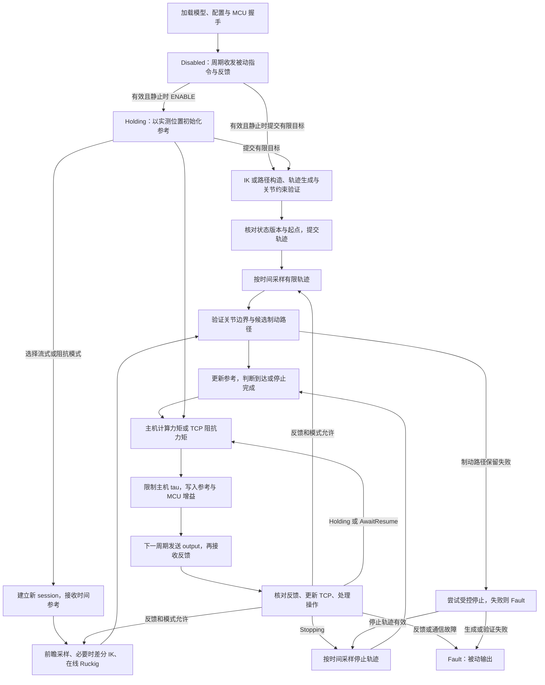
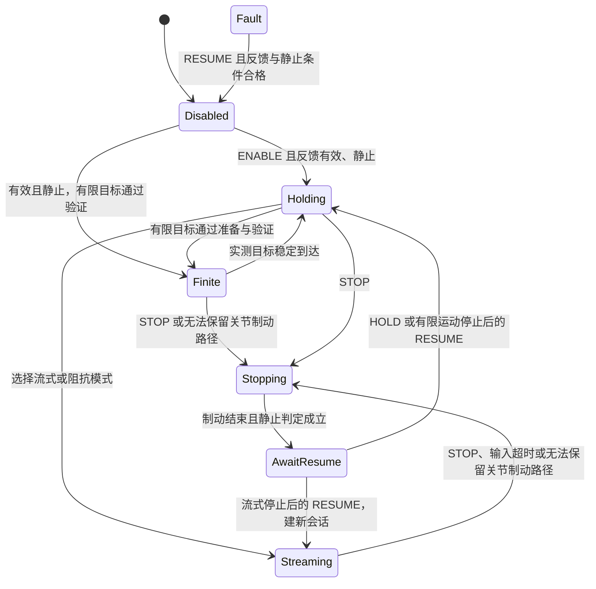

# Z1 SDK 算法详解

一条机械臂命令怎样变成电机输出？本页按 **建立模型 → 接收目标 → 生成参考 → 计算力矩 → 到达或停止** 的顺序，解释 SDK 的实现与公式。

原生控制内核为 `z1_core`，MCU 适配为 `z1_mcu_transport`，ROS 层负责消息转换。算法源码在 [z1_control/src](z1_control/src)，公开 API 在 [include/z1_control](z1_control/include/z1_control)。握手、协议编解码由随附官方动态库执行。

操作码与消息字段见 [Topic 接口说明](INTERFACES.md)，启动与构建见 [README.md](README.md)。

ROS YAML 配置每臂 4 ms 控制周期、3 ms 接收预算和 100 Hz 状态发布。独立 C++ `Config` 的默认周期为 2 ms，`Runtime` 使用调用方传入的配置。下文涉及周期的数值示例采用 ROS 的 4 ms。

## 目录

1. [执行总览：命令准备与周期执行如何衔接](#1-执行总览命令准备与周期执行如何衔接)
2. [启动：建立模型与通信，保持 Disabled](#2-启动建立模型与通信保持-disabled)
3. [周期前半段：接收反馈，处理使能与操作](#3-周期前半段接收反馈处理使能与操作)
4. [有限命令：生成整条轨迹，验证后提交](#4-有限命令生成整条轨迹验证后提交)
5. [流式命令：建立会话，更新带时间的目标](#5-流式命令建立会话更新带时间的目标)
6. [周期后半段：生成参考，检查运动并计算输出](#6-周期后半段生成参考检查运动并计算输出)
7. [停止分支：制动、等待恢复与退出](#7-停止分支制动等待恢复与退出)
8. [参数、时序统计与源码索引](#8-参数时序统计与源码索引)

## 1. 执行总览：命令准备与周期执行如何衔接

控制循环使用三种不同的数据：

| 数据 | 来源 | 用途 |
| --- | --- | --- |
| 上游目标 | 原生 API 或 ROS Topic，可以是关节位置、TCP 位姿或带时间的路点 | 交给规划器或时间线，转成关节参考 |
| 关节参考 $q_r,\dot q_r,\ddot q_r$ | 已准备轨迹的采样，或在线 Ruckig 的生成结果 | 经过运动检查后进入控制律 |
| 实测反馈 $q,\dot q,\tau$ | MCU 返回，主机核对序号、时龄和数值 | 算 TCP、跟踪误差、到达判定和力矩 |

程序启动后控制周期一直运行，Disabled 时也交换被动帧、读取反馈。反馈有效且机械臂静止时，可以直接提交有限目标；也可以先 ENABLE 进入 Holding，再提交有限目标或选择流式模式：



有限命令先在调用线程生成整条轨迹，控制线程按时间采样；流式命令持续更新时间线，控制线程从中生成下一步参考。两条路径共用后续运动检查和力矩计算。有限运动返回 `ACCEPTED` 时计划已经接受，实测到位后才返回 `SUCCEEDED`。

两臂是独立进程，分别使用同一套六轴算法。每臂只建立本臂的运动学、动力学模型；几何碰撞检测、同步规划和耦合动力学由上层实现。

## 2. 启动：建立模型与通信，保持 Disabled

入口看 [ros_node.cpp](z1_control/src/ros_node.cpp) 的 `Node` 构造函数，以及 [runtime.cpp](z1_control/src/runtime.cpp) 的 `Runtime` 构造函数和 `start`。ROS 节点先读配置，再建控制器和 MCU 适配器，最后启动原生控制线程。

初始化完成后进入 Disabled，持续交换被动帧；主动姿态保持从 ENABLE 或首条有限目标接受后开始。

### 2.1 统一变量、单位与坐标系

| 符号 | 含义 | 单位或约定 |
| --- | --- | --- |
| $q,\dot q,\ddot q$ | 六轴关节位置、速度、加速度 | rad、rad/s、rad/s²；顺序 `joint1..joint6` |
| $q_r,\dot q_r,\ddot q_r$ | 控制器生成的关节参考 | 与实测量同单位 |
| $\tau$ | 六轴关节力矩 | N·m |
| $T=[R,p]$ | TCP 相对本臂基座的位姿 | $R\in SO(3)$，$p\in\mathbb R^3$，位置单位 m |
| $V=[v;\omega]$ | TCP 线速度、角速度 | 基座轴方向，作用点在 TCP；m/s、rad/s |
| $J$ | TCP 的 $6\times6$ 雅可比 | 前三行线速度，后三行角速度 |
| $j=\dddot q$ | 关节 jerk | rad/s³ |
| $h$、$\Delta t$ | 轨迹段时长、实际控制间隔 | s |

代码用 `Vec = Eigen::Matrix<double,6,1>` 表示关节或笛卡尔六维量，具体含义由接口确定。MCU 反馈提供位置、速度和力矩；下文的加速度为参考值或控制指令。笛卡尔角速度是基座系向量，与 roll/pitch/yaw 的导数不同。

左、右臂 ROS 基座名为 `left_link00`、`right_link00`，原生模型里叫 `link00`。ROS 适配器核对 `frame_id`，不查 TF；世界坐标系目标要先转成基座系再发。

### 2.2 读取六轴模型、TCP 与重力

模型来自 [z1_control.urdf](z1_description/urdf/z1_control.urdf)。初始化要求 `nq=nv=6`，关节按 `joint1..joint6` 排列。质量、质心、惯性、关节轴和零位变换从这个文件读取。

当前控制 URDF 的主要关节参数：

| 关节 | 轴，父连杆坐标表达 | 零位平移，m | 角度范围，度 | URDF 力矩上限，N·m |
| --- | --- | --- | --- | --- |
| joint1 | Z | `(0, 0, 0.0585)` | `[-150, 150]` | 30 |
| joint2 | Y | `(0, 0, 0.045)` | `[0, 170]` | 60 |
| joint3 | Y | `(-0.35, 0, 0)` | `[-165, 0]` | 30 |
| joint4 | Y | `(0.218, 0, 0.057)` | `[-87, 87]` | 30 |
| joint5 | Z | `(0.07, 0, 0)` | `[-77, 77]` | 30 |
| joint6 | X | `(0.0492, 0, 0)` | `[-160, 160]` | 30 |

零位平移是相对父连杆的变换；六个活动关节的零位 RPY 都是零。

默认 TCP 为 `tool`，相对 `link06` 平移 `(0.051,0,0)` m，姿态不变。`tool` 是无质量的固定坐标系。原装夹爪定子、动子的质量、质心和惯性张量来自官方模型，质量分别为 0.52603655 kg 和 0.27621302 kg。六轴模型将夹爪关节固定在闭合零位；夹爪开合不改变 TCP，也不在线更新夹爪惯性。六轴速度上限与官方 URDF 一致，为 3.1415 rad/s。

重力默认在本臂基座系里是 $(0,0,-9.81)$ m/s²。安装方向变了，就在配置里给该基座系下的实际重力向量。

控制器建两个模型实例：`model_` 给控制线程用，`planning_model_` 给有限命令准备用。这样控制线程和规划线程各用一份模型数据。

### 2.3 碰撞几何交给上层规划

`Model` 只构造 Pinocchio 运动学、动力学模型，不建立 `GeometryModel`、碰撞形状或几何对。控制 URDF 可以省略所有 `collision` 标签；已有标签和网格描述继续供上层规划、仿真使用，控制启动无需加载碰撞网格。

需要自碰撞、双臂互碰、环境碰撞检测或绕障时，在上层接入几何库或规划器。

### 2.4 核对配置并记录模型指纹

控制器构造时核对周期、超时、参考前瞻、运动限制和控制增益；模型构造时核对六轴关节顺序、TCP frame 和重力向量。配置要满足 `reference_preview <= reference_extrapolation <= stream_timeout`，速度不大于 URDF 上限；主臂有效力矩上限取配置值和 URDF effort 的逐轴较小值。默认参数见 8.1。

ROS 适配器要求 UDP 接收预算小于控制周期。当前为 3 ms 对 4 ms，其余时间供发送、控制计算和调度使用，选择依据见[通信节拍说明](COMMUNICATION_TIMING.md)。

`Model::revision()` 对 URDF 全文、TCP 名称和重力向量算 SHA-256，用来识别运行时用的模型。URDF 中的显示与碰撞标签也计入全文；控制增益和外部网格内容不在指纹里。指纹不参与每周期求解。

### 2.5 建立 MCU 通信并启动被动循环

`McuTransport` 通过官方 IOUDP 握手，识别协议和物理电机数。它支持 7 或 8 个物理电机：第二关节是双电机，所以分别对应六轴主臂和六轴加夹爪。V2 状态带电机温度和错误信息，V1 没有这些字段。

握手成功后，`Runtime::start` 启动控制线程。控制器初始为 `Disabled`，第一轮发默认被动 `Output`，之后每轮发上一轮算出的输出。反馈有效且静止时，`ENABLE` 进入主动保持；有效有限目标也能从 Disabled 直接开始。

### 2.6 ROS 输入和发布线程

ROS 层负责消息字段、四元数、基座名、时龄检查和时钟映射。有限运动走独立的单线程规划回调队列；控制操作和流式目标走普通回调线程。控制线程由原生 Runtime 按配置周期跑，当前 ROS YAML 是 4 ms，默认反馈发布 100 Hz。

SDK 的 FK、IK、动力学和轨迹执行都在原生层。RViz 的目标编辑另用 MoveIt IK，执行参考预览共用 SDK 计算。控制内核不依赖 MoveIt 或 ros_control；RViz 测试工具单独使用官方 MoveIt MotionPlanning 交互与场景组件，实际运动仍由 SDK 负责。

## 3. 周期前半段：接收反馈，处理使能与操作

这一节从每轮唤醒讲到模式确定。启动、保持、运动和停止期间都会重复这些检查。源码入口是 [runtime.cpp](z1_control/src/runtime.cpp) 的 `Runtime::start` 和 [controller.cpp](z1_control/src/controller.cpp) 的 `Controller::step` 前半段。

### 3.1 先发送上一轮输出，再接收本轮反馈

每轮的运行顺序：

```text
周期 k 唤醒
  发送上一轮计算的 output[k-1]
  在接收预算内等待并读取反馈 feedback[k]
  用单调时钟检查反馈和控制间隔
  controller.step(feedback[k], now) -> output[k]
  等待绝对时间轴上的下一周期
```

本轮算出的输出在下一轮发送，主机计算到发送之间相隔一个控制时隙。

调用官方 `sendRecv` 前，适配器清理已排队的旧数据，达到 32 个包就报告积压故障。随后发送命令，在预算内接收报文，校验来源 IP/端口、长度和协议。每次有效接收增加主机反馈序号；该序号由主机生成，协议没有请求配对序号。

官方 IOUDP 保留命令打包和反馈解码；项目替换的是 UDP socket 收发路径，用来做非阻塞操作、有限等待、来源校验和接收时间观测。

反馈时间戳记录主机接收时刻，设备采样时刻未包含在协议中。控制器使用官方 `LowLevelState` 的原始 `q/dq/tau`；标定工具另用 `getDqFiltered()` 检查静止。

### 3.2 进入 step：先处理 DISABLE，再核对时钟和反馈

`step` 开头建默认被动输出。如果操作邮箱第一项是 `DISABLE`，立即执行：取消活动命令、清目标、让旧会话失效。这一步在时钟和反馈检查之前。

接着算实际控制间隔 $\Delta t$。第一轮用标称周期，之后用相邻 `now` 之差。时刻非有限、间隔非正或超过 `feedback_timeout`，返回被动输出；未失能时进入 Fault，其他待处理操作被拒绝。发送失败和接收积压故障也在反馈更新阶段处理。

`fresh=true` 且序号递增时，替换保存的反馈，再进行有效性检查。缺少新包时沿用上一份数据和原接收时刻。

反馈有效的主要条件：

- 已有正序号；主机接收时刻有限、不晚于当前时刻，时龄不超过默认 80 ms。
- $q,\dot q,\tau$ 都是有限数；关节位置不超过模型边界外 `joint_limit_tolerance`（默认 0.001 rad）。
- 实测各轴速度不超过配置最大速度的 1.25 倍。
- 没有检测到设备故障或通信故障；有夹爪时，还要核对夹爪反馈数值和位置范围。

实测位置允许比模型边界多出 1 mrad，这是反馈判定的容差；生成的参考仍按正式限位检查。反馈无效时，使能状态进入 Fault；DISABLE 即使在反馈或时钟无效时也照常执行。

### 3.3 用有效关节位置计算 TCP

反馈有效后执行 `state_.tcp = model_.fk(f.q)`。这个实测 TCP 用于状态发布、位姿到达判定和阻抗控制。后面 IK 迭代或路径拟合也会调 FK，但输入是候选关节位置。

对串联机械臂，TCP 变换可以写成：

$$
{}^0T_{\mathrm{TCP}}(q)=
{}^0T_1(q_1)\,{}^1T_2(q_2)\cdots{}^5T_6(q_6)\,{}^6T_{\mathrm{TCP}}.
$$

每个关节变换由 URDF 零位变换和关节轴旋转组成。实现调用 `pinocchio::forwardKinematics`，再更新 TCP frame，返回 `Eigen::Isometry3d`。ROS TF 不参与这个计算。

### 3.4 处理操作：ENABLE 从实测位置建立 Holding

反馈有效时，`step` 处理其余操作。`ENABLE` 要求 Disabled 且 `stationary(start_velocity_tolerance)` 成立，默认阈值为 0.03 rad/s。参考初始化为：

$$
q_r=\operatorname{clip}(q_{\mathrm{measured}},q_{\min},q_{\max}),
\qquad \dot q_r=0,\qquad \ddot q_r=0.
$$

实测反馈在限位附近会有小幅编码器误差，初始化时先投影到正式限位内。进入 Holding 后可以提交有限目标或选流式模式；静止的 Disabled 也能直接接有限目标。

静止判定使用原始速度和新位置反馈。只有一帧时按原始速度判定；已有两帧时，还要求相邻位置差分速度低于阈值。原始速度有尖峰时，使用至少 `stationary_window`（默认 100 ms）的新位置历史：窗口位置范围除以实际时长，以及最近相邻位置差分速度，均需低于阈值。范围取最大位置减最小位置，可识别窗口内往返运动。无效反馈会清空历史，重复使用旧包不会增加窗口时长。

Disabled 起步、ENABLE、HOLD 和恢复使用 `start_velocity_tolerance`；到达和停止完成使用 `velocity_tolerance`，两者默认相同。静止判定与反馈有效性是独立检查，动力学仍使用原始速度。

`STOP`、`RESUME`、`HOLD` 的分支见第 7 节，流式模式选择见 5.1。操作处理完仍是 `Disabled` 或 `Fault` 时，本轮直接返回被动输出。

控制操作有独立邮箱。DISABLE 会清掉旧操作并插到最前面；STOP 清普通待处理操作、保留 DISABLE；邮箱满时它仍能执行。

## 4. 有限命令：生成整条轨迹，验证后提交

这一节对应一次性提交完整运动的接口：`goal`、`poseGoal`、`trajectory`、`jointWaypoints`、`moveL`、`linearWaypoints`。准备在调用线程做；ROS 给这些命令配了独立的单线程规划队列。准备期间原生控制周期照常跑。

### 4.1 记录起点，选择轨迹生成分支

`Controller::prepare` 或 `preparePath` 先要求：反馈有效，模式是 Holding，或者 Disabled 且反馈静止。运动中不接受新的有限目标。命令 ID 为正、比上次接受的 ID 大；带速度比例的接口还要求比例有效。条件满足后短暂持锁，记下起点 `seed` 和状态版本 `generation_`，释放控制锁再准备。Disabled 用投影到限位内的实测位置，Holding 用当前保持参考。

| 输入 | 准备步骤 | 交给控制周期的结果 |
| --- | --- | --- |
| `goal` / `poseGoal` | 关节终点或终点 IK → Ruckig → 关节位置极值验证 | Ruckig 有限轨迹 |
| `trajectory` / `jointWaypoints` | 时间和导数安排 → 五次 Hermite → 极值检查及必要重定时 | `JointTrajectory` |
| `moveL` / `linearWaypoints` | TCP 路径 → 连续 IK → 关节 Hermite 拟合、加密和关节极值检查 | `JointTrajectory` |

### 4.2 分支 A：关节或位姿终点 → Ruckig

`planPoseGoal` / `planJointGoal` 的纯计算实现位于 [goal_planner.cpp](z1_control/src/goal_planner.cpp)，返回 Ruckig 轨迹，不修改控制器状态。控制器的有限目标准备和 RViz 只读预览共用这套实现。ID、反馈、模式与并发提交检查仍由控制器负责。


`goal` 直接给关节终点，核对位置限位后就能生成轨迹。`poseGoal` 先调 `Model::ik(target, seed, result)`，把 TCP 目标换成关节终点。下面先讲误差、雅可比和 IK，再接两种命令共用的 Ruckig。

#### 位姿误差

`poseError(actual, desired)` 用：

$$
e(T,T_d)=
\begin{bmatrix}
p_d-p\\
\operatorname{Log}(R_dR^T)^\vee
\end{bmatrix}.
$$

平移误差在基座系直接相减；姿态误差取相对旋转矩阵的 SO(3) 对数，得到基座方向表达的轴角误差。两项分开算，不引入 SE(3) 对数里的平移耦合项。

终点 IK 将平移与旋转分量直接放入同一数值方程，未按特征长度归一化。因此残差范数混合了 m 与 rad，收敛判定分别使用两项误差。

#### TCP 雅可比

采用 Pinocchio 的 `LOCAL_WORLD_ALIGNED` frame 雅可比：

$$
\begin{bmatrix}v_{\mathrm{TCP}}\\\omega_{\mathrm{TCP}}\end{bmatrix}
=J(q)\dot q.
$$

该雅可比与基座系位姿误差使用相同的轴方向。对转动关节，第 $i$ 列为：

$$
J_i=
\begin{bmatrix}
z_i\times(p_{\mathrm{TCP}}-p_i)\\z_i
\end{bmatrix},
$$

$z_i$ 是基座方向表达的关节轴，$p_i$ 是轴上一点。项目用库函数求解；`toolKinematics` 一次更新关节雅可比和 TCP 位置，省掉重复更新所有 frame。

#### 迭代求关节终点

在第 $k$ 次迭代的 $q_k$ 处算 $e_k$ 和 $J_k$，用阻尼最小二乘求增量：

$$
\Delta q_k=
J_k^T(J_kJ_k^T+\mu I)^{-1}e_k,
\qquad \mu=0.0002.
$$

$\mu$ 直接加在矩阵对角线上。按常见的 $\lambda^2I$ 写法，$\lambda^2=\mu$。

然后限制六维增量的二范数，再裁到位置限位：

$$
\|\Delta q_k\|_2\le0.15,\qquad
q_{k+1}=\operatorname{clip}(q_k+\Delta q_k,q_{\min},q_{\max}).
$$

最多迭代 300 次。成功要同时满足：

$$
\|e_p\|_2<10^{-4}\ \mathrm m,
\qquad \|e_R\|_2<5\times10^{-4}\ \mathrm{rad}.
$$

输入位姿要合法。种子允许在限位外 `seed_tolerance`（默认 0.001 rad）的反馈偏差，开始迭代前先投影到正式限位内；最终解仍在限位内。失败返回 `false`，原因或最终残差可以从 `failure` 取。

阻尼让奇异附近的小矩阵求解保持可用，代价是部分方向响应变慢。IK 从一个种子出发，沿一条关节分支迭代。

`poseGoal` 取得终点逆解后，生成并验证整条关节轨迹。IK 解与种子有关，换种子可能得到另一关节分支。

`poseGoal` 的中间 TCP 轨迹由关节运动决定。要 TCP 沿直线，用 4.4 节的 `moveL` 或 `linearWaypoints`。

#### 从静止到静止的 Ruckig 轨迹

Ruckig 分段用恒定 jerk。单段运动关系：

$$
q(t)=q_0+v_0t+\frac12a_0t^2+\frac16jt^3,
$$

$$
v(t)=v_0+a_0t+\frac12jt^2,\qquad a(t)=a_0+jt.
$$

这些分段拼出平滑的加减速。分段时长和六轴同步由 Ruckig 求解。

生成时从 `seed` 出发，初速度和初加速度为零，给目标关节位置，目标速度和加速度默认零。Ruckig 算出六轴同步、速度/加速度/jerk 受限的完整轨迹，成功后进 4.5 验证。

单目标接口的 `speed=s` 将 Ruckig 最大速度乘 $s$，最大加速度和 jerk 保持配置值，轨迹总时长由六轴同步求解确定。`jointWaypoints` 则将 v/a/jerk 上限分别按 $s/s^2/s^3$ 缩放。

### 4.3 分支 B：定时关节轨迹或连续关节过点 → Hermite

源码：[trajectory.hpp](z1_control/include/z1_control/trajectory.hpp)、[trajectory.cpp](z1_control/src/trajectory.cpp)。这条分支预计算五次 `JointTrajectory`，不在线用 Ruckig 逐个追路点。构造顺序：定路点时间 → 补缺省导数 → 构造分段多项式 → 检查内部极值 → 拒绝或统一重定时。

#### 时间和起终状态

`Controller::trajectory` 和 `jointWaypoints` 提交时要求轨迹从当前静止参考开始、最终静止。首点时间大于零时，`trajectory` 自动补一个当前参考的零时刻点。底层 `JointTrajectory` 本身允许非零端点导数，是有限运动控制接口拒绝首尾不静止的计划。

`trajectory` 用上游给的时间；`jointWaypoints` 调 `JointTrajectory::waypoints` 自动排时间。对速度比例 $s$，先设：

$$
v_{\lim}=sv_{\max},\qquad a_{\lim}=s^2a_{\max},\qquad
j_{\lim}=s^3j_{\max}.
$$

逐段按关节位移 $\Delta q_i$ 给初始时长：

$$
h\ge\max_i\left\{
T_{\mathrm{period}}/s,
\frac{1.875|\Delta q_i|}{v_{\lim,i}},
\sqrt{\frac{5.773502691896258|\Delta q_i|}{a_{\lim,i}}},
\sqrt[3]{\frac{60|\Delta q_i|}{j_{\lim,i}}}
\right\}.
$$

这些常数来自静止到静止五次 smoothstep 的导数峰值。初始时长按静止端点估计，内部过点赋予导数后，再统一检查和重定时。

#### 补缺省速度和加速度

显式给的速度、加速度作为端点条件。缺省的首尾速度取零，缺省加速度取零；缺省的内部速度按每轴相邻割线斜率估计。

令相邻段斜率为 $d_-,d_+$，时长为 $h_-,h_+$。任一斜率为零或两者异号时，该轴过点速度取零。否则用加权调和平均：

$$
w_-=2h_++h_-,\quad w_+=h_++2h_-,\qquad
v_i=\frac{w_-+w_+}{w_-/d_-+w_+/d_+},
$$

并限制 $|v_i|\le2\min(|d_-|,|d_+|)$，压住短段和慢段附近的过冲。之后仍要对完整多项式做位置和导数极值检查。

同向路点一般能以非零速度通过；反向轴会在路点处降到零。多轴组合里出现停顿是正常的。

#### 五次段

设一段时长 $h$，归一化时间 $s=(t-t_0)/h\in[0,1]$：

$$
q(s)=c_0+c_1s+c_2s^2+c_3s^3+c_4s^4+c_5s^5.
$$

给定两端 $q_0,v_0,a_0$ 和 $q_1,v_1,a_1$：

$$
c_0=q_0,\quad c_1=hv_0,\quad c_2=\tfrac12h^2a_0,
$$

$$
P=q_1-c_0-c_1-c_2,\quad
U=hv_1-c_1-2c_2,\quad
A=h^2a_1-2c_2.
$$

其余系数：

$$
c_3=10P-4U+\tfrac12A,\qquad
c_4=-15P+7U-A,\qquad
c_5=6P-3U+\tfrac12A.
$$

对 $s$ 求导后，速度、加速度、jerk 分别再除以 $h$、$h^2$、$h^3$。相邻段共享路点的 $q,v,a$，所以整条轨迹 C2 连续；jerk 有界，但在连接处不一定连续。

#### 检查段内极值

只看路点会漏掉段内超调，所以实现直接求极值：位置、速度、加速度和 jerk 取端点，加上各自导数在 $[0,1]$ 内的零点。

求根先递归求导数根，用这些点把区间划成单调段，再对变号区间二分，边界单独检查以处理相切和重根。这是数值极值检查，不靠固定时间网格；判断带浮点容差。

#### 按限制拒绝或全局重定时

记各轴各段的最大速度、加速度、jerk 为 $V,A,J$，取全局伸缩倍率：

$$
\gamma=\max\left(1,\max_{i,k}\left\{
\frac{V_{ik}}{v_{\max,i}},
\sqrt{\frac{A_{ik}}{a_{\max,i}}},
\sqrt[3]{\frac{J_{ik}}{j_{\max,i}}}
\right\}\right).
$$

`retime=false` 时，$\gamma$ 超出容差就拒绝，保留原时间和显式导数。`retime=true` 时，所有时刻和段时长乘 $\gamma$，归一化位置系数不变，于是：

$$
q_{\mathrm{new}}(\gamma t)=q_{\mathrm{old}}(t),\quad
v_{\mathrm{new}}=v_{\mathrm{old}}/\gamma,\quad
a_{\mathrm{new}}=a_{\mathrm{old}}/\gamma^2,\quad
j_{\mathrm{new}}=j_{\mathrm{old}}/\gamma^3.
$$

重定时保持关节路径形状，按相应阶次降低各导数。位置越限在构造多项式时直接拒绝；力矩限制在执行阶段处理，见 6.8。

### 4.4 分支 C：MoveL 或笛卡尔过点 → 连续关节轨迹

源码：[cartesian_path.cpp](z1_control/src/cartesian_path.cpp)，入口是 `moveL` 和 `linearWaypoints`。和只求终点的 `poseGoal` 不同，这条分支先约束中间 TCP 路径，再把它变成可执行的关节轨迹。

#### TCP 直线和姿态进度

单段用同一个进度 $u$ 插值位置和姿态：

$$
p(u)=(1-u)p_0+up_1,\qquad
R(u)=\operatorname{Slerp}(R_0,R_1,u).
$$

四元数 Slerp 走两姿态间的最短旋转。平移和旋转共用一个进度，所以固定姿态直线、纯旋转、边移边转都支持。

长度定义为：

$$
L(T_0,T_1)=\max(\|p_1-p_0\|,\;0.24\|\operatorname{Log}(R_1R_0^T)^\vee\|).
$$

`0.24 m/rad` 来自基准线速度与角速度之比 `0.12/0.5`，将旋转角换成等效路径长度，供时间安排和转角裁剪使用。

直线段用五次时间进度连接起终速度，端点路径加速度为零。不融合转角时，从静止开始、到静止结束。

#### 多段路径的转角融合

`blend_radius=0` 时逐点停车。正值时，第 $i$ 个内部点两侧的裁剪长度是：

$$
b_i=\min(\text{blend\_radius},0.45L_{i-1},0.45L_i).
$$

两个裁剪点之间放一条六控制点的五次 Bézier 过渡。位置按线性插值、姿态按 Slerp，用测地 de Casteljau 递归求值。控制点的端点三元组和两侧直线一致，用来匹配端点速度、零加速度，最后转成共享导数的关节 C2 轨迹。

平移过渡位于控制点的凸包内，绕过原始中间点。参数也作用于纯旋转，对应等效角度 $b/0.24$。这里生成五次 Bézier 过渡，融合后的总时长还取决于关节约束和重定时。

#### 沿路径连续求 IK

从起始关节状态出发，沿笛卡尔路径逐点求逆解，用上一点解作为下一点种子。拟合用的 `preciseIk` 比普通终点 IK 严：

- 最多 100 次迭代，正则系数 `1e-10`。
- 平移和旋转误差都小于 `1e-9` 才返回。
- 单次六维关节增量范数不超过 `0.15`。
- 最多 12 次步长减半，要求误差平方和下降，同时裁到位置限位。
- 相邻采样解任一轴跳变超过 `0.35 rad`，按分支不连续拒绝。

路径上某点不可达，或无法沿当前 IK 分支继续求解时，准备失败并拒绝命令。

#### 拟合关节轨迹、查误差、加密

初始采样间隔约 20 ms，每个路径片段至少分 8 段。用实际、可能不均匀的五点时间窗口拟合局部四次多项式，QR 解出内部关节速度和加速度；停车点保持零速度、零加速度。

拿到关节路点后，构造 4.3 节的五次 Hermite 轨迹，按关节速度、加速度、jerk 限制全局重定时。

接着对每个关节分段的 9 个时间点检查：

1. FK 与原始笛卡尔路径的平移、旋转误差。
2. $J(q)\dot q$ 的线速度、角速度是否超过 `0.12*speed` m/s、`0.5*speed` rad/s。

默认平移拟合阈值 0.1 mm，旋转 1 mrad。超差就把采样间隔减半，最多 5 轮，约 `20、10、5、2.5、1.25 ms`。任务速度超限时，整条轨迹统一降速。

关节多项式通过导数求根检查连续时间极值；笛卡尔轮廓误差与任务速度在上述离散点检查。0.1 mm 和 1 mrad 描述拟合参考在采样点的误差，实机跟踪误差由反馈测量。

准备完成后，控制周期直接按时间采样关节轨迹。

### 4.5 三条分支汇合：验证关节轨迹

Ruckig 有限目标用 `jointPathWithinLimits` 检查整条轨迹的关节位置。恒 jerk 分段对应三次位置多项式，检查段首、段尾和段内速度为零的点，覆盖 Ruckig 内部制动段；零时长段跳过。

预计算五次 `JointTrajectory` 在构造时就完成位置、速度、加速度和 jerk 的极值检查。`preparePath` 还要求轨迹从记录的 `seed` 以零速度、零加速度开始，并以零速度、零加速度结束。

### 4.6 验证通过后，核对状态并提交

控制器重新取得控制锁，检查 `generation_` 未变，并且反馈与模式仍允许有限运动。Disabled 下，当前实测起点与记录的 `seed` 偏差还需不超过 `position_tolerance`。满足后保存轨迹、时长和起始时刻，切到对应运动模式，发布 `ACCEPTED`。

有限目标的 ID 在准备前检查。接受另一条有限目标、STOP、DISABLE 或模式变化都会递增 `generation_`，因此提交时的版本检查同时覆盖 ID 竞争和 Holding 起点变化。`model_revision` 另用于识别模型内容。IK 和路径验证在独立的 `planning_model_` 上进行，起点读取与提交时才短暂持有控制锁。

提交后，控制线程在 6.1 按时间采样轨迹，继续核对反馈、关节边界和候选制动路径。

## 5. 流式命令：建立会话，更新带时间的目标

这一分支服务 `JointStream`、`PoseStream` 和 `Impedance`。它接收有限未来范围内的滚动目标，不预先准备整条轨迹。源码主要在 [reference.cpp](z1_control/src/reference.cpp) 和 [controller.cpp](z1_control/src/controller.cpp) 的 `startStream`、`stream`。

### 5.1 从 Holding 选模式，建立新会话

模式操作由 3.4 的 `step` 执行。`startStream` 增加 `session`，序号清零，用当前关节参考和实测 TCP 初始化时间线。这时还没有外部目标，等新会话的第一帧；等待时间也受 `stream_timeout` 限制。

上游用状态里的 `session` 和递增 `sequence` 发目标。控制器核对模式、会话、序号、数值、时龄和未来范围，接受后才更新序号、标记目标有效并续期。截止时刻是：

$$
t_{\mathrm{deadline}}=\max(t_{\mathrm{source}},t_{\mathrm{target}})
+T_{\mathrm{stream\_timeout}}.
$$

默认 `stream_timeout=0.2 s`，未来路点可将截止时刻延至该点之后 200 ms。停止和恢复会更新会话号，之后接收的帧需使用新会话。

### 5.2 目标写入时间线

`ReferenceTimeline` 用固定数组存最多 32 个点，时间是 `steady_clock` 秒数。新点在 $t$ 插入时，会替换所有时间大于等于 $t$ 的旧点，方便改未来计划。

`prune(now)` 删掉已经跨过的旧段，保留当前插值需要的前驱点。控制器限制未来参考范围，默认 `reference_horizon=0.5 s`。完整时间检查还要求目标时刻不早于这条消息的源时刻。

ROS 里 `header.stamp` 用来算源消息时龄，`target_time` 是路点目标时刻。适配器把相对 ROS 当前时刻的时间差映射到单调时钟；非零时龄会扣掉源时间的有效期。

### 5.3 缺省导数先差分再滤波

没给速度时，用相邻参考的位置差分，再过一阶滤波：

$$
v_{\mathrm{raw},k}=\frac{x_k-x_{k-1}}{\Delta t},\qquad
\alpha=\frac{\Delta t}{T_f+\Delta t},
$$

$$
v_k=v_{k-1}+\alpha(v_{\mathrm{raw},k}-v_{k-1}).
$$

笛卡尔位置差分里，平移直接相减，旋转用 $\operatorname{Log}(R_kR_{k-1}^T)^\vee$。缺省加速度由速度差分按同样方式滤波；默认 $T_f=0.01$ s。

差分估计受目标噪声和发送间隔影响，滤波会引入滞后。上游已有速度、加速度时，填写显式导数可减少这部分估计误差。

### 5.4 周期采样：关节或平移路点间插值

两个端点都标了 `has_acceleration=true` 时，用满足两端位置、速度、加速度的五次 Hermite；否则用满足位置、速度的三次 Hermite。

三次插值里，令 $x=t-t_0$、$h=t_1-t_0$、$\Delta q=q_1-q_0$：

$$
q(x)=q_0+v_0x+c_2x^2+c_3x^3,
$$

$$
c_2=\frac{3\Delta q}{h^2}-\frac{2v_0+v_1}{h},\qquad
c_3=-\frac{2\Delta q}{h^3}+\frac{v_0+v_1}{h^2}.
$$

估计加速度不会把 `has_acceleration` 改为 true，因此缺省加速度的段仍用三次插值。时间线的采样结果随后交给 Ruckig 及关节约束处理。

### 5.5 姿态插值要转换旋转导数

以段起点 $R_0$ 为基准：

$$
R(t)=\operatorname{Exp}(r(t)^\wedge)R_0,
\qquad r_1=\operatorname{Log}(R_1R_0^T)^\vee.
$$

对 $r(t)$ 做 Hermite 插值。旋转向量导数不直接等于角速度，要过 SO(3) 左雅可比：

$$
\omega=J_l(r)\dot r,\qquad
\dot\omega=J_l(r)\ddot r+\dot J_l(r,\dot r)\dot r,
$$

$$
J_l(r)=I+\frac{1-\cos\theta}{\theta^2}[r]_\times
+\frac{\theta-\sin\theta}{\theta^3}[r]_\times^2,
\qquad\theta=\|r\|.
$$

终点角速度先经 $J_l^{-1}(r_1)$ 转成旋转向量导数；角加速度还要减掉 $\dot J_l\dot r$。插值后再转回基座系角速度和角加速度。小角度处用级数展开，避免除以很小的角度。

### 5.6 末点之后最多外推 100 ms

超过最后一点时刻，最多外推 $T_e=0.1$ s。关节和平移量用：

$$
x(t_0+\delta)=x_0+v_0\delta+\tfrac12a_0\delta^2,
\qquad v=v_0+a_0\delta,
\quad\delta\in[0,T_e].
$$

姿态用 $r=\omega_0\delta+\tfrac12\dot\omega_0\delta^2$，左乘指数映射，再通过左雅可比修正外推后的角速度和角加速度。

超过外推期限后，保持外推边界的位置，速度和加速度置零。该参考再经 Ruckig 生成关节运动；流式超时则进入第 7 节的停止流程。

## 6. 周期后半段：生成参考，检查运动并计算输出

这一节接第 3 节的反馈和操作检查，对应 [controller.cpp](z1_control/src/controller.cpp) 的 `Controller::step` 后半段。第 4 节提交的有限轨迹、第 5 节持续更新的时间线和 Holding，都在这里形成输出。

同一次 `step` 的顺序：

```text
已核对反馈、计算实测 TCP并处理操作
  Disabled / Fault                         -> 返回被动输出
  流式输入超时                              -> beginStop
  按当前模式生成候选 q、dq、ddq
  运动模式：生成候选制动路径并验证关节位置极值
  核对关节限位，更新内部关节参考
  判断有限运动到达，或停止轨迹是否结束
  计算主机关节力矩或 TCP 阻抗力矩
  主机力矩幅值限制 -> 力矩变化率限制
  写入参考 q/dq、主机 tau、MCU 增益与夹爪输出
  统计本轮计算耗时与超期次数，返回 output[k]
 下一周期的 exchange 才发送 output[k]
```

### 6.1 有限运动直接采样，Holding 维持固定参考

`JointGoal`、`PoseGoal` 按 `now-motion_at_` 采样 4.2 的 Ruckig 轨迹；`JointTrajectory`、`CartesianPath` 按同一运动时间采样预计算的关节多项式。`Stopping` 采样停止轨迹，见 7.2。

`JointTrajectory::sample` 用二分定位分段，再用 Horner 法求值；它不做 IK、极值求根或轨迹重建。区间外保持端点并置零导数；正好在端点时保留多项式给的导数。

`Holding` 保持已有 $q_r$，参考速度和加速度为零。流式模式还没收到有效新会话目标时，保持初始化参考。6.2～6.4 只在有有效流式目标时生成新的流式参考。

### 6.2 JointStream：前瞻目标 → Ruckig 位置模式

在 `now + reference_preview` 采样关节时间线，默认前瞻 30 ms。位置、速度、加速度分别裁到模型/配置范围，作为 Ruckig 位置模式的终态，`minimum_duration=reference_preview`。

Ruckig 从上一周期的 $q_r,\dot q_r,\ddot q_r$ 出发重新算，再按本轮实际经过时间采样，得到下一参考。前瞻目标带速度、加速度，Ruckig 不用把每一步都当停车点。

### 6.3 PoseStream / Impedance：前瞻位姿 → 差分 IK → Ruckig

在 `now + reference_preview` 采样位姿时间线，用**上一周期的关节参考**调 `Model::differentialIk(q, target, speed, twist)`。这一步以关节参考为起点，把期望 TCP 位姿和速度换成关节目标速度；完整终点 IK 是另一条路径。

#### 速度前馈叠加位姿误差反馈

先在当前关节参考处算位姿误差，形成期望 TCP 速度：

$$
V^*=V_{\mathrm{ff}}+
\begin{bmatrix}4I_3&0\\0&3I_3\end{bmatrix}e.
$$

`twist` 对应 $V_{\mathrm{ff}}$，直接提供目标速度；位姿误差项负责修正跟踪偏差。

然后分别限制线速度和角速度的向量范数：

$$
\|v^*\|_2\le0.12s\ \mathrm{m/s},\qquad
\|\omega^*\|_2\le0.5s\ \mathrm{rad/s}.
$$

`PoseStream` 取 $s=1$，阻抗的辅助关节参考取 $s=0.5$。这个参数缩放的是速度饱和值，小误差下的反馈系数仍是 4 和 3。

#### 带奇异值阻尼求关节速度

对 $J$ 做 SVD，取最小奇异值 $\sigma_{\min}$：

$$
r=\min(1,\sigma_{\min}/0.05),\qquad
\mu=0.002+0.002(1-r)^2.
$$

关节速度：

$$
\dot q^*=J^T(JJ^T+\mu I)^{-1}V^*.
$$

阻尼在 `0.002..0.004` 之间变化，接近奇异时增大。这里也直接用 $\mu I$。SVD 用的是未做单位归一化的雅可比，阈值 `0.05` 是这个实现的数值参数。

差分 IK 到这里只产关节目标速度。控制器先逐轴裁到配置速度范围，再进 6.4 的临近限位约束和 Ruckig。

关节目标速度交给 Ruckig 速度模式，目标关节加速度设为零。笛卡尔加速度用于时间线插值与外推；差分 IK 在此求速度，不计算 $\dot J\dot q$ 加速度前馈。帧间关节参考由 Ruckig 和关节约束决定。

`Impedance` 在这里生成的是给关节边界和制动检查用的辅助关节参考；另外在 `now+period` 采样平衡位姿和速度，交给 6.7 的阻抗控制律。

### 6.4 流式分支共同限制终态，再按实际间隔推进

对每轴，沿目标速度方向算距位置限位的剩余距离 $d_i$，留 `0.02 rad` 缓冲。令：

$$
b_i=\frac{a_{\max,i}^2}{j_{\max,i}},\qquad
v_{\mathrm{safe},i}=
\max\left(0,\sqrt{b_i^2+2a_{\max,i}\max(0,d_i-0.02)}-b_i\right).
$$

目标速度方向不变，幅值不超过这个值。目标加速度再限制在：

$$
|a_{\mathrm{target},i}|\le
\sqrt{\max(0,j_{\max,i}(v_{\max,i}-|v_{\mathrm{target},i}|))}.
$$

这是生成前的局部限速；生成后还要查关节限位和制动路径。

JointStream 的位置、速度、加速度裁剪，以及位姿模式的速度求解，做完都会套上面的临近限位约束。然后从上一周期的 $q_r,\dot q_r,\ddot q_r$ 算在线 Ruckig 轨迹，生成失败进 Fault。

在线 Ruckig 按实际 $\Delta t$ 采样，得到本轮候选 $q_r,\dot q_r,\ddot q_r$。和标称周期差小于 `1 ns` 时，用标称周期去掉浮点相减噪声，实际周期统计不改。

### 6.5 从候选参考检查关节制动路径

有限运动、JointStream、PoseStream 和 Impedance 都要做这一步。从候选下一参考的位置、速度、加速度出发，用 Ruckig 速度模式生成到零速度、零加速度的制动轨迹，再用 `jointPathWithinLimits` 查所有分段的关节位置极值。

候选制动路径生成失败或越过关节限位时，调用 `beginStop`，制动起点按 7.2 的模式规则确定。停止生成或验证失败则进入 Fault。这里检查的是参考轨迹的关节范围，实测跟踪误差与力矩饱和另行处理。

Holding 使用固定参考，Stopping 使用已生成并验证的停止轨迹，均跳过候选制动路径生成。

### 6.6 更新参考后，判断到达或停止完成

运动检查通过后，再核对候选关节位置满足正式限位，然后更新内部 `reference_`、`velocity_`、`acceleration_`。这之后才判断运动是否完成，最后算本轮力矩；所以进入 Holding 或 AwaitResume 的这一轮，也会按更新后的状态算保持输出。

`Stopping` 的停止轨迹时间结束，并且 `stationary(velocity_tolerance)` 成立，就进入 `AwaitResume`，参考位置切到投影到限位内的实测位置，参考导数清零。后续恢复见 7.3。

有限运动的完成由实测到达决定。参考轨迹结束后，关节误差需满足：

$$
\|q-q_r\|_\infty<0.015\ \mathrm{rad}.
$$

同时 `stationary(velocity_tolerance)` 成立，默认阈值 0.03 rad/s，判定方式见 3.4。`PoseGoal` 和 `CartesianPath` 另外要求 TCP 平移误差小于 5 mm、旋转误差小于 0.025 rad。所有条件按新反馈接收时间持续超过 0.1 s，才发布 `SUCCEEDED` 并进入 Holding；末端等待超过默认 3 s 进 Fault。

拟合阈值评价生成的路径，`SUCCEEDED` 评价实测到达。流式和阻抗模式通过状态反馈描述连续跟踪，不逐帧产生到达事件。

### 6.7 用检查过的参考和实测反馈计算力矩

普通模式和 `Impedance` 共用模型、反馈和输出限制，控制律不同。先看动力学模型，再按模式算。源码：[dynamics.cpp](z1_control/src/dynamics.cpp)、[controller.cpp](z1_control/src/controller.cpp)。

#### 动力学模型包含哪些项

六轴固定基座模型：

$$
\tau=M(q)\ddot q+c(q,\dot q)+g(q).
$$

$M$ 是惯性矩阵，$c$ 是科里奥利和离心项，$g$ 是重力项。控制器按这个刚体模型补偿，摩擦、减速器滞回和外部接触作用会体现为模型与实机之间的差异。

#### RNEA：从状态和期望加速度算力矩

`Model::inverseDynamics(q,v,a)` 直接调 `pinocchio::rnea`。

递归牛顿欧拉先沿运动链正向传每个连杆的空间速度和加速度，再反向累加惯性力和子连杆作用力，最后投影到关节轴得到力矩。空间向量形式可以写成：

$$
v_i=X_{i\leftarrow p}v_p+S_i\dot q_i,
$$

$$
a_i=X_{i\leftarrow p}a_p+S_i\ddot q_i+
v_i\times(S_i\dot q_i),
$$

$$
f_i^{\mathrm{body}}=I_i a_i+v_i\times^*(I_i v_i),
$$

$$
f_i=f_i^{\mathrm{body}}+
\sum_{k\in\mathrm{children}(i)}X_{k\leftarrow i}^Tf_k,
\qquad \tau_i=S_i^Tf_i.
$$

$X$ 是父到子的空间运动变换，$S_i$ 是关节运动子空间，$I_i$ 是空间惯性。反向递推将各子连杆的力经 $X^T$ 变换后累加，重力通过基座加速度处理。实现调用 Pinocchio 完成这些运算。

控制里有两个关键调用：

- `inverseDynamics(q, dq, desired_acc)`：含惯性、速度相关项和重力补偿。
- `inverseDynamics(q, dq, Zero())`：只留 $c(q,\dot q)+g(q)$，阻抗模式用这个。

#### 普通使能状态：参考加速度加关节误差反馈，再调 RNEA

除 `Impedance` 外，所有使能状态都用：

$$
a_{\mathrm{cmd}}=\ddot q_r+
K_p(q_r-q)+K_d(\dot q_r-\dot q),
$$

$$
\tau^*=\operatorname{RNEA}(q,\dot q,a_{\mathrm{cmd}})
=M(q)a_{\mathrm{cmd}}+c(q,\dot q)+g(q).
$$

$K_p,K_d$ 是对角矩阵，代码里按元素乘。`kp` 的单位是 s⁻²，`kd` 是 s⁻¹；它们把位置、速度误差变成加速度修正，力矩由后面的 RNEA 算。

默认主机 $K_p=[50,80,60,35,20,20]$，$K_d=[8,12,10,6,3,3]$。这些公式描述主机写进 `tau` 的部分。非阻抗模式还同时下发参考位置、速度和独立的 `mcu_kp/mcu_kd`；默认 MCU Kp 为 `[500,600,500,400,300,200]`，Kd 每轴 5。执行器闭环由主机力矩和 MCU 位置环共同构成。

`Holding` 使用固定 $q_r$ 和零参考导数，持续进行位置反馈与动力学补偿。

#### Impedance：平衡参考、平滑增益、TCP 弹簧阻尼力矩

阻抗模式有两条参考链：

- 辅助关节链：采样 `now+reference_preview` 的位姿，经差分 IK 和 Ruckig 形成关节参考，给关节边界和制动检查用。
- 平衡位姿链：采样 `now+period` 的位姿和速度，直接作为阻抗控制律里的 $T_e,V_e$。

平衡目标直接取第二条链的采样位姿，避免将辅助关节参考的 IK/Ruckig 滞后带入阻抗平衡点。控制器先更新实际阻抗增益，再计算力矩。

在 `Holding` 或 `Impedance` 下可以设置新的有限正值刚度、阻尼。实际增益按指数规律逼近配置值：

$$
\alpha=1-e^{-\Delta t/T_K},\qquad
K\leftarrow K+\alpha(K_{\mathrm{target}}-K),
$$

阻尼同样处理，默认 $T_K=0.1$ s。`gains()` 更新的是配置目标，实际平滑发生在阻抗计算期间。

再以期望 TCP 位姿 $T_e$ 和速度 $V_e$ 为平衡参考，用平滑后的增益算本轮的弹簧阻尼力和关节力矩：

$$
e_x=\operatorname{poseError}(T(q),T_e),\qquad V=J(q)\dot q,
$$

$$
F^*=K_xe_x+D_x(V_e-V),
$$

$$
\tau^*=J(q)^TF^*+\operatorname{RNEA}(q,\dot q,0).
$$

$F^*=[f;m]$ 是虚拟 TCP 力/力矩，$J^T$ 把它映射成关节力矩。平移刚度单位 N/m，旋转刚度 N·m/rad；对应阻尼是 N·s/m 和 N·m·s/rad。

默认使用对角增益：平移刚度 30 N/m、旋转刚度 0.2 N·m/rad，平移阻尼 4 N·s/m、旋转阻尼 0.02 N·m·s/rad。该控制律用关节反馈和模型形成柔顺响应，未引入任务惯量整形或外部六维力反馈。

弹簧项的误差先分别限幅：$\|e_p\|\le0.1$ m、$\|e_R\|\le0.25$ rad。限幅只加在弹簧项上，阻尼项不单独限幅；合成后统一过关节力矩限制。

### 6.8 限制主臂力矩，生成独立夹爪输出

先按幅值限幅，有效上限取配置值和 URDF effort 的逐轴较小值：

$$
\tau_{\mathrm{lim},i}=\min(\tau_{\mathrm{config},i},\tau_{\mathrm{URDF},i}),
\quad \tau_c=\operatorname{clip}(\tau^*,-\tau_{\mathrm{lim}},\tau_{\mathrm{lim}}).
$$

再按上一轮输出限制变化量：

$$
\Delta\tau_{\max,i}=\dot\tau_{\max,i}\min(\Delta t,T_{\mathrm{period}}),
$$

$$
\tau_{\mathrm{out},i}=\operatorname{clip}
(\tau_{c,i},\tau_{\mathrm{last},i}-\Delta\tau_{\max,i},
\tau_{\mathrm{last},i}+\Delta\tau_{\max,i}).
$$

默认力矩上限 `[20,30,20,12,8,8]` N·m，变化率上限每轴 1000 N·m/s。当前 4 ms 标称周期下，单次最大变化 4 N·m；周期再长，单次允许跳变量也以标称周期封顶。故障或失能的被动输出可以直接归零，不受普通力矩斜坡约束。

限幅作用于主机 `tau`，MCU 增益使用独立字段。规划阶段按运动学限制生成参考，执行时才限制力矩；饱和会影响跟踪，因此带载误差需要从实测反馈评价。

#### 夹爪的独立位置控制

夹爪是独立位置控制，不进六轴 RNEA 或 IK。检测到夹爪且处于 `Holding` 时，接受 `[-1,0]` 范围内的目标电机位置。

每周期先把实测夹爪位置投影到 `[-1,0]`，再朝目标最多走 `0.4*period`；当前 4 ms 周期对应每次 `0.0016 rad`；发送 MCU 增益 `Kp=8`、`Kd=0.5`。夹爪通过相对实测位置的逐周期限步控制，接口返回目标接受结果，不产生到达事件。

### 6.9 返回本轮输出，下一轮打包发送

算完后，`Output` 里是 `enabled=true`、关节参考 `q/dq`、限制后的主机力矩、主臂 MCU 增益和夹爪指令。`step` 耗时超过标称周期时只加 `overruns`，输出照常；异常或非有限力矩进 Fault。控制间隔超过反馈有效期仍按 3.2 处理。

`Runtime` 保存输出，在绝对时间轴的下一轮交给 `McuTransport::exchange`。适配器把 `q/dq/tau/Kp/Kd` 写进官方 `LowLevelCmd`：非 Impedance 的使能状态发配置的 `mcu_kp/mcu_kd`，Impedance 的主臂 MCU Kp/Kd 保持为零，夹爪发独立增益。

ROS 用 `commanded_joint_states` 发布六轴主机参考与计算力矩，用 `joint_states` 发布最近收到的原始反馈。结合 `status.mode`、`feedback_valid`、`feedback_age` 对照二者；消息头记录发布时刻。MCU 增益在设备侧参与控制，未包含在主机计算力矩字段中。

发送后进入下一轮接收和反馈检查，重新从第 3 节开始。

## 7. 停止分支：制动、等待恢复与退出

停止是正常周期里的一个分支：它替换后续参考来源，不暂停控制线程。这一节把触发原因、制动起点、制动执行和恢复条件串起来。源码是 `beginStop`、`fault`、`step` 和 `Runtime::start` 的退出段。

### 7.1 受控制动和 Fault 的分界

用户 STOP、流式超时，或候选参考无法保留关节限位内的制动路径时，调用 `beginStop`。反馈无效、通信故障、生成错误、关节越界、到达超时、控制间隔超过反馈期限，会进 Fault；停止轨迹生成或验证失败也进 Fault。单次计算超期只计数，不触发停止。

两者输出不同：受控制动继续生成停止参考、算主臂力矩；Fault 结束活动命令，清目标、夹爪请求和会话，返回被动输出。DISABLE 也转被动输出，并取消活动有限命令。

### 7.2 beginStop：定起点，生成并验证停止轨迹

普通轨迹跟踪从当前生成参考开始制动。Holding 或 Impedance 开始停止时，先把参考位置切到投影到限位内的实测位置，用实测速度，参考加速度置零。Holding 里如果已有完整静止窗口、位置范围不超过 `joint_limit_tolerance`、并且满足起步静止判定，就忽略速度尖峰，把制动起始速度当零；否则保留实测速度。

接着用 Ruckig 速度模式生成到零速度、零加速度的停止轨迹，并检查整条轨迹的关节位置极值。失败则进入 Fault；通过后向活动有限命令发送 `STOPPED`，切到 Stopping，清除流式目标并更新会话和状态版本。

后续周期采样停止轨迹并用计算力矩跟踪。轨迹结束且 `stationary(velocity_tolerance)` 成立后进入 AwaitResume，此时机械臂才满足软件停稳判定。

### 7.3 停稳后等明确恢复，旧轨迹到此结束

`AwaitResume` 继续保持在停止位置。`RESUME` 和 `HOLD` 都要求反馈有效、满足 `stationary(start_velocity_tolerance)`：

| 当前状态与操作 | 后续状态和参考来源 |
| --- | --- |
| 有限运动或 Holding 停止后 `RESUME` | 回 Holding；旧有限命令已经结束，要发新命令 |
| 流式或阻抗停止后 `RESUME` | 回原模式，建新会话，等新目标 |
| AwaitResume 中 `HOLD` | 以实测位置进 Holding，再选新命令或模式 |
| Fault 中 `RESUME` | 确认故障后进 Disabled；可以发新有限目标，或单独 ENABLE 进 Holding |

旧有限命令随停止结束，恢复后提交新命令；流式与阻抗恢复后使用新会话。

### 7.4 正常执行与停止合起来的状态机



图里 `Finite` 包括 `JointGoal`、`PoseGoal`、`JointTrajectory`、`CartesianPath`；`Streaming` 包括 `JointStream`、`PoseStream`、`Impedance`。使能状态下出现无效反馈、通信故障、生成错误、关节越界、到达超时或控制间隔超期，都可能进 `Fault`。`DISABLE` 可从任何状态回到被动输出。

### 7.5 正常退出时尝试受控制动

`Runtime::stop` 结束主循环后，对尚在保持或运动的状态提交 STOP，以 2 s 为截止期限继续执行控制循环。到 AwaitResume、Disabled 或 Fault 时结束等待，最后尝试发送一次被动帧。被动交换返回关节反馈，协议没有单独的设备停稳确认。

ROS 发布循环在调用 `Runtime::stop` 前已经结束，因此退出阶段的原生事件不会再转发到 `result`。

## 8. 参数、时序统计与源码索引

### 8.1 默认参数速查

默认值来自 [types.hpp](z1_control/include/z1_control/types.hpp) 和 [control.yaml](z1_bringup/config/control.yaml)；通信预算来自 [communication.yaml](z1_bringup/config/communication.yaml)。

| 参数 | 默认值 | 作用 |
| --- | --- | --- |
| `period` | 0.004 s | ROS YAML 里的原生控制周期；独立 C++ `Config` 缺省值 0.002 s |
| `feedback_timeout` | 0.08 s | 反馈时龄和异常长控制间隔的上限 |
| `stream_timeout` | 0.2 s | 流目标有效期的一部分 |
| `reference_preview` | 0.03 s | 流式参考前瞻时长 |
| `reference_extrapolation` | 0.1 s | 时间线最大外推时长 |
| `reference_velocity_filter` | 0.01 s | 缺省导数估计的滤波时间常数 |
| `reference_horizon` | 0.5 s | 允许提交的未来参考范围 |
| `impedance_gain_time_constant` | 0.1 s | 阻抗增益平滑时间常数 |
| `velocity` | 每轴 0.8 rad/s | 关节参考速度上限 |
| `acceleration` | 每轴 1.5 rad/s² | 关节参考加速度上限 |
| `jerk` | 每轴 8 rad/s³ | 关节参考 jerk 上限 |
| `torque` | `[20,30,20,12,8,8]` N·m | 主机 tau 幅值上限，还受 URDF effort 约束 |
| `torque_rate` | 每轴 1000 N·m/s | 主机 tau 逐周期变化上限 |
| `kp` / `kd` | `[50,80,60,35,20,20]` / `[8,12,10,6,3,3]` | 主机期望加速度误差反馈增益 |
| `mcu_kp` / `mcu_kd` | `[500,600,500,400,300,200]` / 每轴 5 | 非阻抗使能状态下发的 MCU 增益 |
| `joint_limit_tolerance` | 0.001 rad | 实测位置和 IK 种子的边界容差，不放宽目标限位 |
| `start_velocity_tolerance` / `stationary_window` | 0.03 rad/s / 0.1 s | 起步、使能和恢复的静止判定 |
| `position_tolerance` / `velocity_tolerance` | 0.015 rad / 0.03 rad/s | 实测到达和静止条件 |
| `tcp_position_tolerance` / `tcp_orientation_tolerance` | 0.005 m / 0.025 rad | 位姿运动的实测到达条件 |
| `settle_timeout` | 3 s | 参考结束后的最长到达等待 |

配置检查要求 `reference_preview <= reference_extrapolation <= stream_timeout`，关节速度不大于 URDF 速度上限，控制增益和限制是有限正数。这些参数一起决定跟踪、制动距离和输出饱和。

### 8.2 绝对节拍、超期和统计

`Runtime` 用 `steady_clock` 和 `sleep_until`。每轮在绝对时间网格上加一个周期；错过时隙就跳过，不连续补跑过期周期。

控制间隔非正或超过反馈超时，算时钟/期限错误，使能状态进 Fault。正常执行路径结束时，`step` 耗时超过标称周期只加 `overruns`，不切断输出。运行时还分别记录：

- 控制周期数和跳过的绝对时隙数。
- 最近一个周期和最大收发耗时。
- 最近一个周期和最大唤醒迟到。
- 控制器周期、计算耗时和计算超期计数。

这些统计口径不同：`missed_slots` 数主机跳过的时隙，`runtime_cycles` 数主机周期。250 Hz 是主机节拍，实际拿到多少新反馈看 `feedback_sequence` 的增长。

CPU 亲和性和 SCHED_FIFO 只配控制线程，默认沿用系统调度。设置结果和错误码写进 `status`。

### 8.3 各接口的算法区别

| 输入接口 | 参考生成 | 时间与路径语义 |
| --- | --- | --- |
| `goal` / `joint_goal` | Ruckig 关节点到点 | 静止到静止；speed 只缩最大关节速度 |
| `poseGoal` / `pose_goal` | 终点 IK + Ruckig | 求解并检查终点位姿；中间 TCP 路径由关节运动决定 |
| `trajectory` / `joint_trajectory` | 五次 Hermite | 指定时间；可拒绝或全局降速；在线按时间采样 |
| `jointWaypoints` / `joint_waypoints` | 自动时长 + Hermite 过点 | speed 对 v/a/jerk 按 s/s²/s³ 缩放，首尾静止 |
| `moveL` / 单点 `linear_path` | TCP 直线与旋转插值 + 连续 IK + 关节拟合 | speed 缩放任务速度基准，按关节限制进一步重定时 |
| `linearWaypoints` / 多点 `linear_path` | 多段直线与转角融合 | 半径零逐点停车，正值绕过中间点连续通过 |
| `JointStream` | 时间线 + Ruckig 位置模式 | 跟踪滚动的 q/v/a 目标 |
| `PoseStream` | 位姿时间线 + 差分 IK + Ruckig 速度模式 | 带 twist 前馈的局部位姿跟踪 |
| `Impedance` | 动态平衡位姿 + 辅助关节参考 | TCP 弹簧阻尼力矩，允许偏离平衡，保留关节制动和输出约束 |

### 8.4 按执行顺序读源码

| 顺序 | 文件 | 对应步骤 |
| --- | --- | --- |
| 1 | [types.hpp](z1_control/include/z1_control/types.hpp) | 公共状态、反馈、输出和默认参数 |
| 2 | [ros_node.cpp](z1_control/src/ros_node.cpp) | 读配置、建 Runtime、输入校验和线程分工 |
| 3 | [model.cpp](z1_control/src/model.cpp)、[model_internal.hpp](z1_control/src/model_internal.hpp) | 模型初始化、FK、误差、雅可比、IK |
| 4 | [runtime.cpp](z1_control/src/runtime.cpp)、[mcu_transport.cpp](z1_control/src/mcu_transport.cpp)、[observed_udp.cpp](z1_control/src/observed_udp.cpp) | 先发后收、握手、反馈数组、来源校验和时效 |
| 5 | [controller.cpp](z1_control/src/controller.cpp) 的 `step` 前半段 | 反馈有效性、TCP 更新、操作与使能 |
| 6 | [controller.cpp](z1_control/src/controller.cpp) 的 `prepare` / `preparePath`、[goal_planner.cpp](z1_control/src/goal_planner.cpp)，以及 [trajectory.cpp](z1_control/src/trajectory.cpp)、[cartesian_path.cpp](z1_control/src/cartesian_path.cpp) | 有限命令准备、IK、拟合、重定时、验证和提交 |
| 7 | [reference.cpp](z1_control/src/reference.cpp) 与 `startStream` / `stream` | 流式会话、时间线、导数估计、插值和外推 |
| 8 | `step` 后半段 | 参考采样、差分 IK、在线 Ruckig、关节制动检查 |
| 9 | `step` 控制律与 [dynamics.cpp](z1_control/src/dynamics.cpp) | 完成判定、RNEA、阻抗、力矩限制与输出 |
| 10 | `beginStop` / `fault` 与 Runtime 退出段 | 停止生成、状态恢复和有界退出 |

### 8.5 测试覆盖

| 测试源码 | 覆盖内容 |
| --- | --- |
| [core_tests.cpp](z1_control/tests/core_tests.cpp) | FK/IK、RNEA/ABA 一致性、运动限制、流式跟踪、停止恢复、阻抗增益和故障 |
| [model_only_tests.cpp](z1_control/tests/model_only_tests.cpp) | 无碰撞描述、碰撞网格不存在时，模型计算、目标执行和受控停止与原模型一致 |
| [goal_planner_tests.cpp](z1_control/tests/goal_planner_tests.cpp) | Home 与普通位姿的预览轨迹和控制器执行参考逐步一致、不可达目标与无效速度 |
| [reference_tests.cpp](z1_control/tests/reference_tests.cpp) | 时间线与 SO(3) 导数、重力配置、全帧 FK/雅可比与 IK 对照、官方速度上限和闭合夹爪七坐标动力学等价 |
| [trajectory_tests.cpp](z1_control/tests/trajectory_tests.cpp) | 显式导数、C2 过点、多项式内部极值、重定时和采样无分配 |
| [cartesian_path_tests.cpp](z1_control/tests/cartesian_path_tests.cpp) | 直线、同步旋转、纯旋转、停车/融合转角、约束与不可达路径 |
| [prepared_motion_tests.cpp](z1_control/tests/prepared_motion_tests.cpp) | 已准备轨迹的控制器执行、完成事件、中途停止与大幅关节路径 |
| [runtime_tests.cpp](z1_control/tests/runtime_tests.cpp) | 绝对节拍与跳过时隙、收发延迟、线程设置、运行统计与受控退出 |
| [transport_tests.cpp](z1_control/tests/transport_tests.cpp) | 本地 MCU 协议夹具与通信适配行为 |
| [motion_contract_tests.cpp](z1_control/tests/motion_contract_tests.cpp) | Disabled 首目标、兼容距离字段不可用、关节制动、计算超期计数与受控退出 |
| [feedback_motion_tests.cpp](z1_control/tests/feedback_motion_tests.cpp) | 编码器边界容差、位置窗口静止判定、首目标与反馈驱动执行 |

控制计算分配检查见 [performance_audit](tools/performance_audit/README.md)。上表列出软件测试覆盖的行为；带载跟踪、接触响应与停止表现使用实机反馈评价。

### 8.6 补充接口：ABA 正动力学

`Model::forwardDynamics(q,v,tau)` 调 `pinocchio::aba`，求：

$$
\ddot q=M(q)^{-1}[\tau-c(q,\dot q)-g(q)].
$$

ABA 利用串联结构递归算加速度，不用显式构造和求逆完整惯性矩阵。控制器在线算力矩用 RNEA；ABA 主要给离线仿真、测试或其他原生调用。
