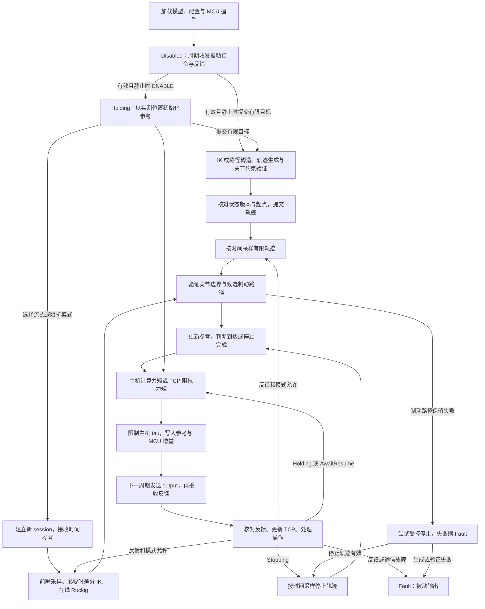
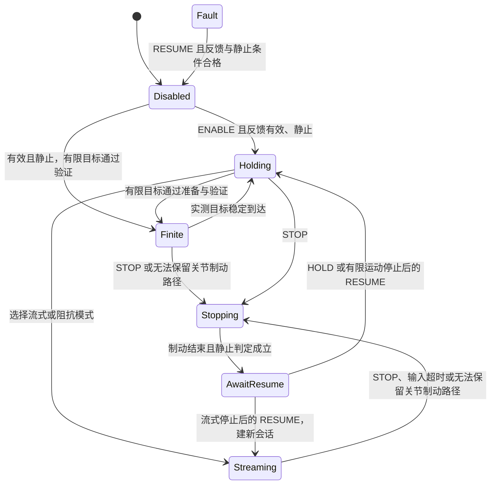

# Z1 SDK 算法详解

一条机械臂命令怎样变成电机输出？本页按照 **建立模型 → 接收目标 → 生成参考 → 计算力矩 → 到达或停止** 的顺序，解释 SDK 的实现和公式。

原生控制内核是 `z1_core`，MCU 适配是 `z1_mcu_transport`，ROS 层负责消息转换。算法源码在 [z1_control/src](z1_control/src)，公开 API 在 [include/z1_control](z1_control/include/z1_control)。握手和协议编解码由随附的官方动态库完成。

操作码与消息字段见 [Topic 接口说明](INTERFACES.md)，启动与构建见 [README.md](README.md)。

ROS YAML 配置为每臂使用 4 ms 控制周期、3 ms 接收预算和 100 Hz 状态发布。独立 C++ `Config` 的默认周期是 2 ms，`Runtime` 使用调用方传入的配置。下文涉及周期的数值示例采用 ROS 的 4 ms。

## 目录

1. [执行总览：命令准备与周期执行如何衔接](#1-执行总览命令准备与周期执行如何衔接)
2. [启动：建立模型与通信，保持 Disabled](#2-启动建立模型与通信保持-disabled)
3. [周期前半段：接收反馈，处理使能与操作](#3-周期前半段接收反馈处理使能与操作)
4. [有限命令：生成整条轨迹，验证后提交](#4-有限命令生成整条轨迹验证后提交)
5. [流式命令：建立会话，更新带时间的目标](#5-流式命令建立会话更新带时间的目标)
6. [周期后半段：生成参考，检查运动并计算输出](#6-周期后半段生成参考检查运动并计算输出)
7. [停止分支：制动、等待恢复与退出](#7-停止分支制动等待恢复与退出)
8. [参数、时序统计与源码索引](#8-参数时序统计与源码索引)
9. [摩擦补偿参数与实机对照](#9-摩擦补偿参数与实机对照)

## 1. 执行总览：命令准备与周期执行如何衔接

控制循环使用三种不同的数据：

| 数据 | 来源 | 用途 |
| --- | --- | --- |
| 上游目标 | 原生 API 或 ROS Topic，可以是关节位置、TCP 位姿或带时间的路点 | 交给规划器或时间线，转换成关节参考 |
| 关节参考 $q_r,\dot q_r,\ddot q_r$ | 已准备轨迹的采样，或在线 Ruckig 的生成结果 | 经过运动检查后进入控制律 |
| 实测反馈 $q,\dot q,\tau$ | MCU 返回，主机核对序号、时龄和数值 | 用来计算 TCP、跟踪误差、到达判定和力矩 |

程序启动后，控制周期会一直运行，即使处于 Disabled 也会交换被动帧、读取反馈。当反馈有效且机械臂静止时，可以直接提交有限目标；也可以先发送 ENABLE 进入 Holding，再提交有限目标或选择流式模式：



有限命令会先在调用线程生成整条轨迹，控制线程再按时间采样；流式命令则持续更新时间线，控制线程从中生成下一步参考。两条路径共用后续的运动检查和力矩计算。有限运动返回 `ACCEPTED` 时只表示计划已经被接受，要等实测到位后才会返回 `SUCCEEDED`。

两臂是独立进程，分别使用同一套六轴算法。每臂只建立本臂的运动学与动力学模型；几何碰撞检测、同步规划和耦合动力学由上层实现。

## 2. 启动：建立模型与通信，保持 Disabled

入口可以看 [ros_node.cpp](z1_control/src/ros_node.cpp) 的 `Node` 构造函数，以及 [runtime.cpp](z1_control/src/runtime.cpp) 的 `Runtime` 构造函数和 `start`。ROS 节点先读取配置，再创建控制器和 MCU 适配器，最后启动原生控制线程。

初始化完成后，系统进入 Disabled，持续交换被动帧（全零控制量）；主动姿态保持要到 ENABLE 或接受首条有限目标之后才开始。

### 2.1 统一变量、单位与坐标系

| 符号 | 含义 | 单位或约定 |
| --- | --- | --- |
| $q,\dot q,\ddot q$ | 六轴关节位置、速度、加速度 | rad、rad/s、rad/s²；顺序为 `joint1..joint6` |
| $q_r,\dot q_r,\ddot q_r$ | 控制器生成的关节参考 | 与实测量使用相同单位 |
| $\tau$ | 六轴关节力矩 | N·m |
| $T=[R,p]$ | TCP 相对本臂基座的位姿 | $R\in SO(3)$，$p\in\mathbb R^3$，位置单位为 m |
| $V=[v;\omega]$ | TCP 线速度、角速度 | 基座轴方向，作用点在 TCP；m/s、rad/s |
| $J$ | TCP 的 $6\times6$ 雅可比 | 前三行是线速度，后三行是角速度 |
| $j=\dddot q$ | 关节 jerk | rad/s³ |
| $h$、$\Delta t$ | 轨迹段时长、实际控制间隔 | s |

代码用 `Vec = Eigen::Matrix<double,6,1>` 表示关节或笛卡尔六维量，具体含义由接口决定。MCU 反馈提供位置、速度和力矩；下文的加速度都是参考值或控制指令。笛卡尔角速度是基座系向量，与 roll/pitch/yaw 的导数不同。

左、右臂的 ROS 基座名分别是 `left_link00` 和 `right_link00`，原生模型里叫 `link00`。ROS 适配器会核对 `frame_id`，但不查询 TF；世界坐标系下的目标要先转换成基座系再发送。

### 2.2 读取六轴模型、TCP 与重力

模型来自 [z1_control.urdf](z1_description/urdf/z1_control.urdf)。初始化要求 `nq=nv=6`，关节按 `joint1..joint6` 排列。质量、质心、惯性、关节轴和零位变换都从这个文件读取。

当前控制 URDF 的主要关节参数如下：

| 关节 | 轴（在父连杆坐标中表达） | 零位平移，m | 角度范围，度 | URDF 力矩上限，N·m |
| --- | --- | --- | --- | --- |
| joint1 | Z | `(0, 0, 0.0585)` | `[-150, 150]` | 30 |
| joint2 | Y | `(0, 0, 0.045)` | `[0, 170]` | 60 |
| joint3 | Y | `(-0.35, 0, 0)` | `[-165, 0]` | 30 |
| joint4 | Y | `(0.218, 0, 0.057)` | `[-87, 87]` | 30 |
| joint5 | Z | `(0.07, 0, 0)` | `[-77, 77]` | 30 |
| joint6 | X | `(0.0492, 0, 0)` | `[-160, 160]` | 30 |

零位平移是相对父连杆的变换；六个活动关节的零位 RPY 都是零。

默认 TCP 是 `tool`，它相对 `link06` 平移 `(0.051,0,0)` m，姿态不变。`tool` 是一个无质量的固定坐标系。原装夹爪定子和动子的质量、质心与惯性张量来自官方模型，质量分别是 0.52603655 kg 和 0.27621302 kg。六轴模型把夹爪关节固定在闭合零位；夹爪开合不会改变 TCP，也不会在线更新夹爪惯性。六轴速度上限与官方 URDF 一致，为 3.1415 rad/s。

ROS 控制节点会在被动 MCU 握手后，根据实际附件构建模型：8 个物理电机表示带夹爪，保留上述惯量；7 个表示无夹爪，移除夹爪子树。两种配置的六轴运动学和 TCP 相同，但重力和惯量不同。原生 `ModelConfig.has_gripper` 默认为 true；实际选择通过 `device_has_gripper` 和 `effective_model_xml` 参数公开。

重力默认在本臂基座系中为 $(0,0,-9.81)$ m/s²。如果安装方向变了，就在配置里给出该基座系下的实际重力向量。

控制器会创建两个模型实例：`model_` 给控制线程使用，`planning_model_` 给有限命令准备使用。这样控制线程和规划线程各自使用一份模型数据。

### 2.3 碰撞几何交给上层规划

`Model` 只构造 Pinocchio 的运动学和动力学模型，不建立 `GeometryModel`、碰撞形状或几何对。控制 URDF 可以省略所有 `collision` 标签；已有的标签和网格描述继续供上层规划与仿真使用，控制启动时不需要加载碰撞网格。

如果要做自碰撞、双臂互碰、环境碰撞检测或绕障，请在上层接入几何库或规划器。

### 2.4 核对配置并记录模型指纹

控制器构造时会核对周期、超时、参考前瞻、运动限制和控制增益；模型构造时会核对六轴关节顺序、TCP frame 和重力向量。配置需要满足 `reference_preview <= reference_extrapolation <= stream_timeout`，速度不能超过 URDF 上限；主臂的有效力矩上限取配置值和 URDF effort 的逐轴较小值。默认参数见 8.1。

ROS 适配器要求 UDP 接收预算小于控制周期。当前是 3 ms 对 4 ms，其余时间用于发送、控制计算和调度，选择依据见[通信节拍说明](COMMUNICATION_TIMING.md)。

`Model::revision()` 会对实际生效的 URDF XML、TCP 名称和重力向量计算 SHA-256，用来识别运行时使用的模型。无夹爪时使用移除夹爪后的 XML；保留的显示与碰撞标签也会计入全文。控制增益和外部网格内容不在指纹里，指纹不参与每周期求解。

### 2.5 建立 MCU 通信并启动被动循环

`McuTransport` 通过官方 IOUDP 握手，识别协议和物理电机数。它支持 7 或 8 个物理电机：第二关节是双电机，因此这两种数量分别对应六轴主臂和六轴加夹爪。V2 状态带有电机温度和错误信息，V1 没有这些字段。

握手成功后，`Runtime::start` 会启动控制线程。控制器初始为 `Disabled`，第一轮发送默认被动 `Output`，之后每轮发送上一轮算出的输出。当反馈有效且机械臂静止时，`ENABLE` 会进入主动保持；有效的有限目标也可以从 Disabled 直接开始。

### 2.6 ROS 输入和发布线程

ROS 层负责消息字段、四元数、基座名、时龄检查和时钟映射。有限运动使用独立的单线程规划回调队列；控制操作和流式目标使用普通回调线程。控制线程由原生 Runtime 按配置周期运行，当前 ROS YAML 是 4 ms，默认反馈发布频率为 100 Hz。

SDK 的 FK、IK、动力学计算和轨迹执行都在原生层完成。RViz 中编辑目标时，目标臂的 IK 由 MoveIt 计算；而淡紫色的执行参考预览则由 SDK 用自己的 IK 和 Ruckig 计算，两者并不共用同一次求解。控制内核不依赖 MoveIt 或 ros_control；RViz 测试工具单独使用官方 MoveIt MotionPlanning 的交互与场景组件，实际运动仍然由 SDK 负责。

## 3. 周期前半段：接收反馈，处理使能与操作

这一节从每轮唤醒讲到模式确定。启动、保持、运动和停止期间都会重复这些检查。源码入口是 [runtime.cpp](z1_control/src/runtime.cpp) 的 `Runtime::start` 和 [controller.cpp](z1_control/src/controller.cpp) 的 `Controller::step` 前半段。

### 3.1 先发送上一轮输出，再接收本轮反馈

每轮的运行顺序是：

```text
周期 k 唤醒
  发送上一轮计算的 output[k-1]
  在接收预算内等待并读取反馈 feedback[k]
  用单调时钟检查反馈和控制间隔
  controller.step(feedback[k], now) -> output[k]
  等待绝对时间轴上的下一周期
```

本轮算出的输出要到下一轮才发送，所以从主机计算到实际发送之间相隔一个控制时隙。

在调用官方 `sendRecv` 之前，适配器会清理已经排队的旧数据；如果达到 32 个包，就报告积压故障。之后发送命令，在预算内接收报文，并校验来源 IP/端口、长度和协议。每次有效接收都会增加主机反馈序号；这个序号由主机生成，协议本身没有请求配对序号。

官方 IOUDP 保留命令打包和反馈解码；项目替换的是 UDP socket 收发路径，用来实现非阻塞操作、有限等待、来源校验和接收时间观测。

反馈时间戳记录的是主机接收时刻，设备采样时刻没有包含在协议中。控制器使用官方 `LowLevelState` 中的原始 `q/dq/tau`；标定工具则另外使用 `getDqFiltered()` 检查静止。

### 3.2 进入 step：先处理 DISABLE，再核对时钟和反馈

`step` 开头会建立默认的被动输出。如果操作邮箱的第一项是 `DISABLE`，就立即执行：取消活动命令、清空目标、让旧会话失效。这一步发生在时钟和反馈检查之前。

接着计算实际控制间隔 $\Delta t$。第一轮使用标称周期，之后使用相邻 `now` 之差。如果时刻不是有限值、间隔非正，或者超过 `feedback_timeout`，就返回被动输出；在未失能的情况下会进入 Fault，其他待处理操作也会被拒绝。发送失败和接收积压故障同样在反馈更新阶段处理。

当 `fresh=true` 且序号递增时，替换保存的反馈，再进行有效性检查。缺少新包时，沿用上一份数据和原来的接收时刻。

反馈有效的主要条件是：

- 已有正序号；主机接收时刻是有限值，不晚于当前时刻，时龄不超过默认的 80 ms。
- $q,\dot q,\tau$ 都是有限数；关节位置超出模型边界的幅度不超过 `joint_limit_tolerance`（默认 0.001 rad）。
- 实测各轴速度不超过配置最大速度的 1.25 倍。
- 没有检测到设备故障或通信故障；有夹爪时，还要核对夹爪反馈的数值和位置范围。

实测位置允许比模型边界多出 1 mrad，这是反馈判定的容差；生成的参考仍然按正式限位检查。反馈无效时，使能状态会进入 Fault；而 DISABLE 即使在反馈或时钟无效时也会照常执行。

### 3.3 用有效关节位置计算 TCP

反馈有效后，执行 `state_.tcp = model_.fk(f.q)`。这个实测 TCP 用于状态发布、位姿到达判定和阻抗控制。后面的 IK 迭代或路径拟合也会调用 FK，但输入是候选关节位置。

对于串联机械臂，TCP 变换可以写成：

$$
{}^0T_{\mathrm{TCP}}(q)=
{}^0T_1(q_1)\,{}^1T_2(q_2)\cdots{}^5T_6(q_6)\,{}^6T_{\mathrm{TCP}}.
$$

每个关节变换由 URDF 零位变换和关节轴旋转组成。实现会调用 `pinocchio::forwardKinematics`，再更新 TCP frame，返回 `Eigen::Isometry3d`。ROS TF 不参与这个计算。

### 3.4 处理操作：ENABLE 从实测位置建立 Holding

反馈有效时，`step` 会处理其余操作。`ENABLE` 要求当前处于 Disabled，并且 `stationary(start_velocity_tolerance)` 成立，默认阈值是 0.03 rad/s。参考初始化如下：

$$
q_r=\operatorname{clip}(q_{\mathrm{measured}},q_{\min},q_{\max}),
\qquad \dot q_r=0,\qquad \ddot q_r=0.
$$

实测反馈在限位附近会有小幅编码器误差，初始化时会先投影到正式限位内。进入 Holding 后，可以提交有限目标或选择流式模式；静止的 Disabled 也能直接接收有限目标。

静止判定会使用原始速度和新位置反馈。如果只有一帧，就按原始速度判断；如果已有两帧，还要求相邻位置差分速度低于阈值。原始速度出现尖峰时，使用至少 `stationary_window`（默认 100 ms）的新位置历史：窗口位置范围除以实际时长，以及最近的相邻位置差分速度，都必须低于阈值。范围取最大位置减最小位置，因此可以识别窗口内的往返运动。无效反馈会清空历史，重复使用旧包不会增加窗口时长。

Disabled 起步、ENABLE、HOLD 和恢复使用 `start_velocity_tolerance`；到达和停止完成使用 `velocity_tolerance`，两者默认相同。静止判定与反馈有效性是独立的检查，动力学仍然使用原始速度。

`STOP`、`RESUME`、`HOLD` 的分支见第 7 节，流式模式的选择见 5.1。操作处理完仍然是 `Disabled` 或 `Fault` 时，本轮直接返回被动输出。

控制操作有独立的邮箱。DISABLE 会清掉旧操作并插到最前面；STOP 会清掉普通待处理操作，但保留 DISABLE；即使邮箱满了，DISABLE 仍然能执行。

## 4. 有限命令：生成整条轨迹，验证后提交

这一节对应那些一次性提交完整运动的接口：`goal`、`poseGoal`、`trajectory`、`jointWaypoints`、`moveL`、`linearWaypoints`。准备是在调用线程中完成的；ROS 为这些命令配置了独立的单线程规划队列。准备期间，原生控制周期照常运行。

### 4.1 记录起点，选择轨迹生成分支

`Controller::prepare` 或 `preparePath` 会先要求：反馈有效，模式是 Holding，或者模式是 Disabled 且反馈处于静止。运动过程中不接受新的有限目标。命令 ID 必须为正数，并且比上次接受的 ID 大；带速度比例的接口还要求比例有效。条件满足后，程序短暂持锁，记下起点 `seed` 和状态版本 `generation_`，释放控制锁后再准备。Disabled 使用投影到限位内的实测位置，Holding 使用当前的保持参考。

| 输入 | 准备步骤 | 交给控制周期的结果 |
| --- | --- | --- |
| `goal` / `poseGoal` | 关节终点或终点 IK → Ruckig → 关节位置极值验证 | Ruckig 有限轨迹 |
| `trajectory` / `jointWaypoints` | 安排时间和导数 → 五次 Hermite → 极值检查及必要重定时 | `JointTrajectory` |
| `moveL` / `linearWaypoints` | TCP 路径 → 连续 IK → 关节 Hermite 拟合、加密和关节极值检查 | `JointTrajectory` |

### 4.2 分支 A：关节或位姿终点 → Ruckig

`planPoseGoal` / `planJointGoal` 的纯计算实现位于 [goal_planner.cpp](z1_control/src/goal_planner.cpp)，返回 Ruckig 轨迹，不修改控制器状态。控制器的有限目标准备和 RViz 只读预览都共用这套实现。ID、反馈、模式与并发提交的检查仍然由控制器负责。

`goal` 直接给出关节终点，核对位置限位后就能生成轨迹。`poseGoal` 会先调用 `Model::ik(target, seed, result)`，把 TCP 目标换成关节终点。下面先讲误差、雅可比和 IK，再介绍两种命令共用的 Ruckig。

#### 位姿误差

`poseError(actual, desired)` 使用：

$$
e(T,T_d)=
\begin{bmatrix}
p_d-p\\
\operatorname{Log}(R_dR^T)^\vee
\end{bmatrix}.
$$

平移误差在基座系中直接相减；姿态误差取相对旋转矩阵的 SO(3) 对数，得到用基座方向表达的轴角误差。两项分开计算，不引入 SE(3) 对数中的平移耦合项。

终点 IK 会把平移和旋转分量直接放进同一个数值方程，没有按特征长度归一化。因此残差范数混合了 m 和 rad，收敛判定会分别使用两项误差。

#### TCP 雅可比

采用 Pinocchio 的 `LOCAL_WORLD_ALIGNED` frame 雅可比：

$$
\begin{bmatrix}v_{\mathrm{TCP}}\\\omega_{\mathrm{TCP}}\end{bmatrix}
=J(q)\dot q.
$$

这个雅可比与基座系位姿误差使用相同的轴方向。对于转动关节，第 $i$ 列是：

$$
J_i=
\begin{bmatrix}
z_i\times(p_{\mathrm{TCP}}-p_i)\\z_i
\end{bmatrix},
$$

其中 $z_i$ 是用基座方向表达的关节轴，$p_i$ 是轴上的一点。项目使用库函数求解；`toolKinematics` 会一次更新关节雅可比和 TCP 位置，省掉重复更新所有 frame 的开销。

#### 迭代求关节终点

在第 $k$ 次迭代的 $q_k$ 处计算 $e_k$ 和 $J_k$，再用阻尼最小二乘求增量：

$$
\Delta q_k=
J_k^T(J_kJ_k^T+\mu I)^{-1}e_k,
\qquad \mu=0.0002.
$$

$\mu$ 直接加在矩阵对角线上。按照常见的 $\lambda^2I$ 写法，$\lambda^2=\mu$。

然后限制六维增量的二范数，再裁剪到位置限位：

$$
\|\Delta q_k\|_2\le0.15,\qquad
q_{k+1}=\operatorname{clip}(q_k+\Delta q_k,q_{\min},q_{\max}).
$$

最多迭代 300 次。成功需要同时满足：

$$
\|e_p\|_2<10^{-4}\ \mathrm m,
\qquad \|e_R\|_2<5\times10^{-4}\ \mathrm{rad}.
$$

输入位姿必须合法。种子允许有超出限位 `seed_tolerance`（默认 0.001 rad）的反馈偏差，开始迭代前会先投影到正式限位内；最终解仍然要在限位内。失败时返回 `false`，原因或最终残差可以从 `failure` 中取得。

阻尼能让奇异附近的小矩阵求解保持可用，代价是部分方向的响应会变慢。IK 从一个种子出发，沿一条关节分支迭代。

`poseGoal` 取得终点逆解后，会生成并验证整条关节轨迹。IK 解与种子有关，换一个种子可能得到另一条关节分支。

`poseGoal` 的中间 TCP 轨迹由关节运动决定。如果希望 TCP 沿直线运动，请使用 4.4 节的 `moveL` 或 `linearWaypoints`。

#### 从静止到静止的 Ruckig 轨迹

Ruckig 在分段内使用恒定 jerk。单段运动关系为：

$$
q(t)=q_0+v_0t+\frac12a_0t^2+\frac16jt^3,
$$

$$
v(t)=v_0+a_0t+\frac12jt^2,\qquad a(t)=a_0+jt.
$$

这些分段拼出了平滑的加减速。分段时长和六轴同步由 Ruckig 求解。

生成时从 `seed` 出发，初速度和初加速度为零，给定目标关节位置，目标速度和加速度默认为零。Ruckig 会算出六轴同步、速度/加速度/jerk 受限的完整轨迹，成功后进入 4.5 节的验证。

单目标接口的 `speed=s` 会把 Ruckig 的最大速度乘以 $s$，最大加速度和 jerk 保持配置值，轨迹总时长由六轴同步求解决定。`jointWaypoints` 则把 v/a/jerk 上限分别按 $s/s^2/s^3$ 缩放。

### 4.3 分支 B：定时关节轨迹或连续关节过点 → Hermite

源码：[trajectory.hpp](z1_control/include/z1_control/trajectory.hpp)、[trajectory.cpp](z1_control/src/trajectory.cpp)。这条分支会预先计算五次 `JointTrajectory`，不会在线用 Ruckig 逐个追路点。构造顺序是：确定路点时间 → 补齐缺省导数 → 构造分段多项式 → 检查内部极值 → 拒绝或统一重定时。

#### 时间和起终状态

`Controller::trajectory` 和 `jointWaypoints` 在提交时要求轨迹从当前静止参考开始，并在最终静止。首点时间大于零时，`trajectory` 会自动补一个当前参考的零时刻点。底层 `JointTrajectory` 本身允许非零端点导数，是有限运动控制接口拒绝首尾不静止的计划。

`trajectory` 使用上游给出的时间；`jointWaypoints` 会调用 `JointTrajectory::waypoints` 自动安排时间。对于速度比例 $s$，先设置：

$$
v_{\lim}=sv_{\max},\qquad a_{\lim}=s^2a_{\max},\qquad
j_{\lim}=s^3j_{\max}.
$$

然后逐段按关节位移 $\Delta q_i$ 给出初始时长：

$$
h\ge\max_i\left\{
T_{\mathrm{period}}/s,
\frac{1.875|\Delta q_i|}{v_{\lim,i}},
\sqrt{\frac{5.773502691896258|\Delta q_i|}{a_{\lim,i}}},
\sqrt[3]{\frac{60|\Delta q_i|}{j_{\lim,i}}}
\right\}.
$$

这些常数来自静止到静止五次 smoothstep 的导数峰值。初始时长按静止端点估计；给内部过点赋予导数后，再统一检查和重定时。

#### 补缺省速度和加速度

显式给出的速度和加速度会作为端点条件。缺省的首尾速度取零，缺省加速度也取零；缺省的内部速度按每轴相邻割线的斜率估计。

令相邻段的斜率为 $d_-,d_+$，时长为 $h_-,h_+$。如果任一斜率为零，或者两者异号，该轴过点的速度就取零。否则使用加权调和平均：

$$
w_-=2h_++h_-,\quad w_+=h_++2h_-,\qquad
v_i=\frac{w_-+w_+}{w_-/d_-+w_+/d_+},
$$

并限制 $|v_i|\le2\min(|d_-|,|d_+|)$，以压住短段和慢段附近的过冲。之后仍然要对完整多项式做位置和导数极值检查。

同向路点一般能以非零速度通过；反向轴会在路点处降到零。多轴组合中出现停顿是正常的。

#### 五次段

设一段时长为 $h$，归一化时间为 $s=(t-t_0)/h\in[0,1]$：

$$
q(s)=c_0+c_1s+c_2s^2+c_3s^3+c_4s^4+c_5s^5.
$$

给定两端的 $q_0,v_0,a_0$ 和 $q_1,v_1,a_1$：

$$
c_0=q_0,\quad c_1=hv_0,\quad c_2=\tfrac12h^2a_0,
$$

$$
P=q_1-c_0-c_1-c_2,\quad
U=hv_1-c_1-2c_2,\quad
A=h^2a_1-2c_2.
$$

其余系数为：

$$
c_3=10P-4U+\tfrac12A,\qquad
c_4=-15P+7U-A,\qquad
c_5=6P-3U+\tfrac12A.
$$

对 $s$ 求导后，速度、加速度和 jerk 分别再除以 $h$、$h^2$、$h^3$。相邻段共享路点的 $q,v,a$，所以整条轨迹 C2 连续；jerk 有界，但在连接处不一定连续。

#### 检查段内极值

只看路点会漏掉段内超调，所以实现会直接求极值：位置、速度、加速度和 jerk 先取端点，再加上各自导数在 $[0,1]$ 内的零点。

求根时先递归求导数根，用这些点把区间划成单调段，再对变号区间二分；边界单独检查，以处理相切和重根。这是数值极值检查，不依赖固定时间网格；判断时带有浮点容差。

#### 按限制拒绝或全局重定时

记各轴各段的最大速度、加速度和 jerk 为 $V,A,J$，取全局伸缩倍率：

$$
\gamma=\max\left(1,\max_{i,k}\left\{
\frac{V_{ik}}{v_{\max,i}},
\sqrt{\frac{A_{ik}}{a_{\max,i}}},
\sqrt[3]{\frac{J_{ik}}{j_{\max,i}}}
\right\}\right).
$$

`retime=false` 时，如果 $\gamma$ 超出容差就拒绝，保留原时间和显式导数。`retime=true` 时，所有时刻和段时长都乘以 $\gamma$，归一化位置系数保持不变，于是：

$$
q_{\mathrm{new}}(\gamma t)=q_{\mathrm{old}}(t),\quad
v_{\mathrm{new}}=v_{\mathrm{old}}/\gamma,\quad
a_{\mathrm{new}}=a_{\mathrm{old}}/\gamma^2,\quad
j_{\mathrm{new}}=j_{\mathrm{old}}/\gamma^3.
$$

重定时会保持关节路径的形状，并按相应阶次降低各导数。位置越限会在构造多项式时直接拒绝；力矩限制在执行阶段处理，见 6.8。

### 4.4 分支 C：MoveL 或笛卡尔过点 → 连续关节轨迹

源码：[cartesian_path.cpp](z1_control/src/cartesian_path.cpp)，入口是 `moveL` 和 `linearWaypoints`。与只求终点的 `poseGoal` 不同，这条分支会先约束中间的 TCP 路径，再把它变成可执行的关节轨迹。

#### TCP 直线和姿态进度

单段使用同一个进度 $u$ 来插值位置和姿态：

$$
p(u)=(1-u)p_0+up_1,\qquad
R(u)=\operatorname{Slerp}(R_0,R_1,u).
$$

四元数 Slerp 会沿两个姿态之间的最短旋转进行插值。平移和旋转共用一个进度，因此固定姿态直线、纯旋转、边移边转都支持。

长度定义为：

$$
L(T_0,T_1)=\max(\|p_1-p_0\|,\;0.24\|\operatorname{Log}(R_1R_0^T)^\vee\|).
$$

`0.24 m/rad` 来自基准线速度与角速度之比 `0.12/0.5`，它把旋转角换算成等效路径长度，供时间安排和转角裁剪使用。

直线段用五次时间进度连接起终速度，端点路径加速度为零。不融合转角时，从静止开始，到静止结束。

#### 多段路径的转角融合

`blend_radius=0` 时逐点停车。为正值时，第 $i$ 个内部点两侧的裁剪长度为：

$$
b_i=\min(\text{blend\_radius},0.45L_{i-1},0.45L_i).
$$

两个裁剪点之间会放一条六控制点的五次 Bézier 过渡。位置按线性插值，姿态按 Slerp，并使用测地 de Casteljau 递归求值。控制点的端点三元组与两侧直线一致，用来匹配端点速度、零加速度，最后转换成共享导数的关节 C2 轨迹。

平移过渡位于控制点的凸包内，因此会绕过原始中间点。参数同样作用于纯旋转，对应等效角度为 $b/0.24$。这里生成的是五次 Bézier 过渡，融合后的总时长还取决于关节约束和重定时。

#### 沿路径连续求 IK

从起始关节状态出发，沿笛卡尔路径逐点求逆解，并用上一点解作为下一点的种子。拟合用的 `preciseIk` 比普通终点 IK 更严格：

- 最多 100 次迭代，正则系数为 `1e-10`。
- 平移和旋转误差都小于 `1e-9` 才返回。
- 单次六维关节增量的范数不超过 `0.15`。
- 最多做 12 次步长减半，要求误差平方和下降，同时裁剪到位置限位。
- 相邻采样解任一轴跳变超过 `0.35 rad` 时，按分支不连续拒绝。

如果路径上某点不可达，或者无法沿当前 IK 分支继续求解，准备就会失败并拒绝命令。

#### 拟合关节轨迹、查误差、加密

初始采样间隔约为 20 ms，每个路径片段至少分 8 段。程序用实际、可能不均匀的五点时间窗口拟合局部四次多项式，再通过 QR 解出内部关节速度和加速度；停车点保持零速度和零加速度。

拿到关节路点后，构造 4.3 节的五次 Hermite 轨迹，并按关节速度、加速度和 jerk 限制做全局重定时。

接着对每个关节分段的 9 个时间点检查：

1. FK 与原始笛卡尔路径之间的平移、旋转误差。
2. $J(q)\dot q$ 的线速度和角速度是否超过 `0.12*speed` m/s、`0.5*speed` rad/s。

默认平移拟合阈值是 0.1 mm，旋转是 1 mrad。超差就把采样间隔减半，最多 5 轮，大约是 `20、10、5、2.5、1.25 ms`。如果任务速度超限，整条轨迹会统一降速。

关节多项式通过导数求根来检查连续时间极值；笛卡尔轮廓误差和任务速度在上述离散点检查。0.1 mm 和 1 mrad 描述的是拟合参考在采样点的误差，实机跟踪误差要由反馈测量。

准备完成后，控制周期直接按时间采样关节轨迹。

### 4.5 三条分支汇合：验证关节轨迹

Ruckig 有限目标使用 `jointPathWithinLimits` 检查整条轨迹的关节位置。恒 jerk 分段对应三次位置多项式，检查段首、段尾和段内速度为零的点，覆盖 Ruckig 内部的制动段；零时长段会跳过。

预计算的五次 `JointTrajectory` 在构造时就已经完成了位置、速度、加速度和 jerk 的极值检查。`preparePath` 还要求轨迹从记录的 `seed` 以零速度、零加速度开始，并以零速度、零加速度结束。

### 4.6 验证通过后，核对状态并提交

控制器会重新取得控制锁，检查 `generation_` 没有变化，并且反馈与模式仍然允许有限运动。在 Disabled 下，当前实测起点与记录的 `seed` 之间的偏差还不能超过 `position_tolerance`。满足条件后，保存轨迹、时长和起始时刻，切换到对应的运动模式，并发布 `ACCEPTED`。

有限目标的 ID 在准备前检查。接受另一条有限目标、STOP、DISABLE 或模式变化都会递增 `generation_`，因此提交时的版本检查同时覆盖了 ID 竞争和 Holding 起点变化。`model_revision` 另外用于识别模型内容。IK 和路径验证在独立的 `planning_model_` 上进行，只有在读取起点和提交时才短暂持有控制锁。

提交后，控制线程会在 6.1 节按时间采样轨迹，并继续核对反馈、关节边界和候选制动路径。

## 5. 流式命令：建立会话，更新带时间的目标

这一分支服务于 `JointStream`、`PoseStream` 和 `Impedance`。它接收有限未来范围内的滚动目标，不会预先准备整条轨迹。源码主要在 [reference.cpp](z1_control/src/reference.cpp) 和 [controller.cpp](z1_control/src/controller.cpp) 的 `startStream`、`stream` 中。

### 5.1 从 Holding 选模式，建立新会话

模式操作由 3.4 节的 `step` 执行。`startStream` 会增加 `session`，把序号清零，并用当前关节参考和实测 TCP 初始化时间线。这时还没有外部目标，程序会等待新会话的第一帧；等待时间同样受 `stream_timeout` 限制。

上游使用状态中的 `session` 和递增的 `sequence` 发送目标。控制器会核对模式、会话、序号、数值、时龄和未来范围，接受后才更新序号、标记目标有效并续期。截止时刻为：

$$
t_{\mathrm{deadline}}=\max(t_{\mathrm{source}},t_{\mathrm{target}})
+T_{\mathrm{stream\_timeout}}.
$$

默认 `stream_timeout=0.2 s`，未来路点可以把截止时刻延到该点之后 200 ms。停止和恢复会更新会话号，之后收到的帧必须使用新会话。

### 5.2 目标写入时间线

`ReferenceTimeline` 使用固定数组保存最多 32 个点，时间单位是 `steady_clock` 秒。新点在 $t$ 插入时，会替换所有时间大于等于 $t$ 的旧点，方便修改未来的计划。

`prune(now)` 会删掉已经跨过的旧段，但保留当前插值需要的前驱点。控制器限制未来参考范围，默认 `reference_horizon=0.5 s`。完整的时间检查还要求目标时刻不早于这条消息的源时刻。

在 ROS 中，`header.stamp` 用来计算源消息的时龄，`target_time` 是路点的目标时刻。适配器会把相对 ROS 当前时刻的时间差映射到单调时钟；非零时龄会扣掉源时间的有效期。

### 5.3 缺省导数先差分再滤波

没有提供速度时，用相邻参考的位置差分，再过一阶滤波：

$$
v_{\mathrm{raw},k}=\frac{x_k-x_{k-1}}{\Delta t},\qquad
\alpha=\frac{\Delta t}{T_f+\Delta t},
$$

$$
v_k=v_{k-1}+\alpha(v_{\mathrm{raw},k}-v_{k-1}).
$$

在笛卡尔位置差分中，平移直接相减，旋转使用 $\operatorname{Log}(R_kR_{k-1}^T)^\vee$。缺省加速度由速度差分按同样的方式滤波；默认 $T_f=0.01$ s。

差分估计会受到目标噪声和发送间隔的影响，滤波也会引入滞后。如果上游已经有速度和加速度，填写显式导数可以减少这部分估计误差。

### 5.4 周期采样：关节或平移路点间插值

当两个端点都标记了 `has_acceleration=true` 时，使用满足两端位置、速度和加速度的五次 Hermite；否则使用满足位置和速度的三次 Hermite。

在三次插值中，令 $x=t-t_0$、$h=t_1-t_0$、$\Delta q=q_1-q_0$：

$$
q(x)=q_0+v_0x+c_2x^2+c_3x^3,
$$

$$
c_2=\frac{3\Delta q}{h^2}-\frac{2v_0+v_1}{h},\qquad
c_3=-\frac{2\Delta q}{h^3}+\frac{v_0+v_1}{h^2}.
$$

估计出来的加速度不会把 `has_acceleration` 改成 true，因此缺省加速度的段仍然使用三次插值。时间线的采样结果随后交给 Ruckig 和关节约束处理。

### 5.5 姿态插值要转换旋转导数

以段起点 $R_0$ 为基准：

$$
R(t)=\operatorname{Exp}(r(t)^\wedge)R_0,
\qquad r_1=\operatorname{Log}(R_1R_0^T)^\vee.
$$

对 $r(t)$ 做 Hermite 插值。旋转向量导数并不直接等于角速度，需要经过 SO(3) 左雅可比：

$$
\omega=J_l(r)\dot r,\qquad
\dot\omega=J_l(r)\ddot r+\dot J_l(r,\dot r)\dot r,
$$

$$
J_l(r)=I+\frac{1-\cos\theta}{\theta^2}[r]_\times
+\frac{\theta-\sin\theta}{\theta^3}[r]_\times^2,
\qquad\theta=\|r\|.
$$

终点的角速度先经过 $J_l^{-1}(r_1)$ 转成旋转向量导数；角加速度还要减掉 $\dot J_l\dot r$。插值完成后再转回基座系角速度和角加速度。小角度处使用级数展开，避免除以很小的角度。

### 5.6 末点之后最多外推 100 ms

超过最后一点的时间后，最多外推 $T_e=0.1$ s。关节量和平移量使用：

$$
x(t_0+\delta)=x_0+v_0\delta+\tfrac12a_0\delta^2,
\qquad v=v_0+a_0\delta,
\quad\delta\in[0,T_e].
$$

姿态使用 $r=\omega_0\delta+\tfrac12\dot\omega_0\delta^2$，左乘指数映射，再通过左雅可比修正外推后的角速度和角加速度。

超过外推期限后，保持外推边界的位置，并把速度和加速度置零。这个参考再经过 Ruckig 生成关节运动；如果流式超时，则进入第 7 节的停止流程。

## 6. 周期后半段：生成参考，检查运动并计算输出

这一节接着第 3 节的反馈和操作检查，对应 [controller.cpp](z1_control/src/controller.cpp) 的 `Controller::step` 后半段。第 4 节提交的有限轨迹、第 5 节持续更新的时间线，以及 Holding 状态，都会在这里形成输出。

同一次 `step` 的顺序是：

```text
已核对反馈、计算实测 TCP并处理操作
  Disabled / Fault                         -> 返回被动输出
  流式输入超时                              -> beginStop
  按当前模式生成候选 q、dq、ddq
  运动模式：生成候选制动路径并验证关节位置极值
  核对关节限位，更新内部关节参考
  判断有限运动到达，或停止轨迹是否结束
  计算主机关节力矩或 TCP 阻抗力矩
  主机力矩幅值限制 -> 力矩变化率限制
  写入参考 q/dq、主机 tau、MCU 增益与夹爪输出
  统计本轮计算耗时与超期次数，返回 output[k]
 下一周期的 exchange 才发送 output[k]
```

### 6.1 有限运动直接采样，Holding 维持固定参考

`JointGoal`、`PoseGoal` 会按 `now-motion_at_` 采样 4.2 节的 Ruckig 轨迹；`JointTrajectory`、`CartesianPath` 按同一运动时间采样预计算的关节多项式。`Stopping` 会采样停止轨迹，见 7.2。

`JointTrajectory::sample` 用二分定位分段，再用 Horner 法求值；它不做 IK、极值求根或轨迹重建。区间外保持端点并置零导数；正好在端点时保留多项式给出的导数。

`Holding` 保持已有的 $q_r$，参考速度和加速度为零。流式模式还没收到有效的新会话目标时，保持初始化参考。6.2～6.4 只在有有效流式目标时才生成新的流式参考。

### 6.2 JointStream：前瞻目标 → Ruckig 位置模式

在 `now + reference_preview` 处采样关节时间线，默认前瞻 30 ms。位置、速度和加速度分别裁剪到模型/配置范围，作为 Ruckig 位置模式的终态，`minimum_duration=reference_preview`。

Ruckig 从上一周期的 $q_r,\dot q_r,\ddot q_r$ 出发重新计算，再按本轮实际经过时间采样，得到下一参考。因为前瞻目标带有速度和加速度，Ruckig 不需要把每一步都当成停车点。

### 6.3 PoseStream / Impedance：前瞻位姿 → 差分 IK → Ruckig

在 `now + reference_preview` 处采样位姿时间线，然后用**上一周期的关节参考**调用 `Model::differentialIk(q, target, speed, twist)`。这一步以关节参考为起点，把期望的 TCP 位姿和速度换成关节目标速度；完整的终点 IK 是另一条路径。

#### 速度前馈叠加位姿误差反馈

先在当前关节参考处计算位姿误差，形成期望的 TCP 速度：

$$
V^*=V_{\mathrm{ff}}+
\begin{bmatrix}4I_3&0\\0&3I_3\end{bmatrix}e.
$$

`twist` 对应 $V_{\mathrm{ff}}$，直接提供目标速度；位姿误差项负责修正跟踪偏差。

然后分别限制线速度和角速度的向量范数：

$$
\|v^*\|_2\le0.12s\ \mathrm{m/s},\qquad
\|\omega^*\|_2\le0.5s\ \mathrm{rad/s}.
$$

`PoseStream` 取 $s=1$，阻抗的辅助关节参考取 $s=0.5$。这个参数缩放的是速度饱和值，小误差下的反馈系数仍然是 4 和 3。

#### 带奇异值阻尼求关节速度

对 $J$ 做 SVD，取最小奇异值 $\sigma_{\min}$：

$$
r=\min(1,\sigma_{\min}/0.05),\qquad
\mu=0.002+0.002(1-r)^2.
$$

关节速度为：

$$
\dot q^*=J^T(JJ^T+\mu I)^{-1}V^*.
$$

阻尼在 `0.002..0.004` 之间变化，接近奇异时会增大。这里同样直接使用 $\mu I$。SVD 使用的是没有做单位归一化的雅可比，阈值 `0.05` 是这个实现里的数值参数。

差分 IK 到这里只产生关节目标速度。控制器先逐轴裁剪到配置速度范围，再进入 6.4 节的临近限位约束和 Ruckig。

关节目标速度交给 Ruckig 的速度模式，目标关节加速度设为零。笛卡尔加速度用于时间线插值和前外推；差分 IK 在这里只求速度，不计算 $\dot J\dot q$ 加速度前馈。帧间关节参考由 Ruckig 和关节约束决定。

`Impedance` 在这里生成的是给关节边界和制动检查用的辅助关节参考；另外还会在 `now+period` 处采样平衡位姿和速度，交给 6.7 节的阻抗控制律。

### 6.4 流式分支共同限制终态，再按实际间隔推进

对每个轴，沿着目标速度方向计算距位置限位的剩余距离 $d_i$，并留出 `0.02 rad` 的缓冲。令：

$$
b_i=\frac{a_{\max,i}^2}{j_{\max,i}},\qquad
v_{\mathrm{safe},i}=
\max\left(0,\sqrt{b_i^2+2a_{\max,i}\max(0,d_i-0.02)}-b_i\right).
$$

目标速度的方向不变，幅值不超过这个值。目标加速度再限制在：

$$
|a_{\mathrm{target},i}|\le
\sqrt{\max(0,j_{\max,i}(v_{\max,i}-|v_{\mathrm{target},i}|))}.
$$

这是生成之前的局部限速；生成之后还要检查关节限位和制动路径。

JointStream 的位置、速度和加速度裁剪，以及位姿模式的速度求解，完成之后都会套用上面的临近限位约束。然后从上一周期的 $q_r,\dot q_r,\ddot q_r$ 计算在线 Ruckig 轨迹，生成失败就进入 Fault。

在线 Ruckig 按实际 $\Delta t$ 采样，得到本轮的候选 $q_r,\dot q_r,\ddot q_r$。当它与标称周期的差小于 `1 ns` 时，使用标称周期来消除浮点相减噪声，实际周期统计不变。

### 6.5 从候选参考检查关节制动路径

有限运动、JointStream、PoseStream 和 Impedance 都要做这一步。从候选下一参考的位置、速度、加速度出发，用 Ruckig 速度模式生成一条到零速度、零加速度的制动轨迹，再用 `jointPathWithinLimits` 检查所有分段的关节位置极值。

如果候选制动路径生成失败或越过关节限位，就调用 `beginStop`，制动起点按 7.2 节的模式规则确定。停止轨迹生成或验证失败则进入 Fault。这里检查的是参考轨迹的关节范围，实测跟踪误差和力矩饱和另外处理。

Holding 使用固定参考，Stopping 使用已经生成并验证过的停止轨迹，两者都会跳过候选制动路径的生成。

### 6.6 更新参考后，判断到达或停止完成

运动检查通过后，再核对候选关节位置是否满足正式限位，然后更新内部的 `reference_`、`velocity_`、`acceleration_`。之后才会判断运动是否完成，最后计算本轮力矩；因此，进入 Holding 或 AwaitResume 的这一轮也会按更新后的状态计算保持输出。

`Stopping` 的停止轨迹时间结束，并且 `stationary(velocity_tolerance)` 成立时，就进入 `AwaitResume`，参考位置切换到投影到限位内的实测位置，参考导数清零。后续恢复见 7.3。

有限运动的完成由实测到达决定。参考轨迹结束后，关节误差需要满足：

$$
\|q-q_r\|_\infty<0.015\ \mathrm{rad}.
$$

同时 `stationary(velocity_tolerance)` 成立，默认阈值是 0.03 rad/s，判定方式见 3.4。`PoseGoal` 和 `CartesianPath` 还额外要求 TCP 平移误差小于 5 mm、旋转误差小于 0.025 rad。所有条件都要按新反馈的接收时间持续满足超过 0.1 s，才会发布 `SUCCEEDED` 并进入 Holding；末端等待超过默认的 3 s 会进入 Fault。

拟合阈值评价的是生成的路径，`SUCCEEDED` 评价的是实测到达。流式和阻抗模式通过状态反馈描述连续跟踪，不会逐帧产生到达事件。

### 6.7 用检查过的参考和实测反馈计算力矩

普通模式和 `Impedance` 共用模型、反馈和输出限制，只是控制律不同。下面先看动力学模型，再按模式计算。源码：[dynamics.cpp](z1_control/src/dynamics.cpp)、[controller.cpp](z1_control/src/controller.cpp)。

#### 动力学模型包含哪些项

六轴固定基座模型为：

$$
\tau=M(q)\ddot q+c(q,\dot q)+g(q).
$$

$M$ 是惯性矩阵，$c$ 是科里奥利和离心项，$g$ 是重力项。RNEA 保持这个刚体模型；可选的摩擦前馈会在两种控制律算完之后单独叠加，不写进惯性或重力模型。减速器滞回和外部接触等作用仍然会体现为模型与实机之间的差异。

#### RNEA：从状态和期望加速度算力矩

`Model::inverseDynamics(q,v,a)` 直接调用 `pinocchio::rnea`。

递归牛顿欧拉算法先沿运动链正向传递每个连杆的空间速度和加速度，再反向累加惯性力和子连杆作用力，最后投影到关节轴上得到力矩。用空间向量可以写成：

$$
v_i=X_{i\leftarrow p}v_p+S_i\dot q_i,
$$

$$
a_i=X_{i\leftarrow p}a_p+S_i\ddot q_i+
v_i\times(S_i\dot q_i),
$$

$$
f_i^{\mathrm{body}}=I_i a_i+v_i\times^*(I_i v_i),
$$

$$
f_i=f_i^{\mathrm{body}}+
\sum_{k\in\mathrm{children}(i)}X_{k\leftarrow i}^Tf_k,
\qquad \tau_i=S_i^Tf_i.
$$

$X$ 是父到子的空间运动变换，$S_i$ 是关节运动子空间，$I_i$ 是空间惯性。反向递推会把各子连杆的力经 $X^T$ 变换后累加，重力通过基座加速度处理。实现调用 Pinocchio 完成这些运算。

控制里有两个关键调用：

- `inverseDynamics(q, dq, desired_acc)`：包含惯性项、速度相关项和重力补偿。
- `inverseDynamics(q, dq, Zero())`：只保留 $c(q,\dot q)+g(q)$，阻抗模式使用这个。

#### 普通使能状态：参考加速度加关节误差反馈，再调 RNEA

除了 `Impedance`，所有使能状态都使用：

$$
a_{\mathrm{cmd}}=\ddot q_r+
K_p(q_r-q)+K_d(\dot q_r-\dot q),
$$

$$
\tau^*=\operatorname{RNEA}(q,\dot q,a_{\mathrm{cmd}})
=M(q)a_{\mathrm{cmd}}+c(q,\dot q)+g(q).
$$

$K_p,K_d$ 是对角矩阵，代码里按元素相乘。`kp` 的单位是 s⁻²，`kd` 是 s⁻¹；它们把位置和速度误差变成加速度修正，力矩则由后面的 RNEA 计算。

默认主机 $K_p=[50,80,60,35,20,20]$，$K_d=[8,12,10,6,3,3]$。这些公式描述的是主机写进 `tau` 的部分。非阻抗模式还会同时下发参考位置、速度以及独立的 `mcu_kp/mcu_kd`；默认 MCU Kp 为 `[500,600,500,400,300,200]`，Kd 每轴为 5。执行器闭环由主机力矩和 MCU 位置环共同构成。

`Holding` 使用固定的 $q_r$ 和零参考导数，持续进行位置反馈与动力学补偿。

#### Impedance：平衡参考、平滑增益、TCP 弹簧阻尼力矩

阻抗模式有两条参考链：

- 辅助关节链：采样 `now+reference_preview` 的位姿，经过差分 IK 和 Ruckig 形成关节参考，供关节边界和制动检查使用。
- 平衡位姿链：采样 `now+period` 的位姿和速度，直接作为阻抗控制律中的 $T_e,V_e$。

平衡目标直接取第二条链的采样位姿，避免把辅助关节参考的 IK/Ruckig 滞后带进阻抗平衡点。控制器先更新实际阻抗增益，再计算力矩。

在 `Holding` 或 `Impedance` 下可以设置新的有限正刚度、阻尼。实际增益按指数规律逼近配置值：

$$
\alpha=1-e^{-\Delta t/T_K},\qquad
K\leftarrow K+\alpha(K_{\mathrm{target}}-K),
$$

阻尼也做同样处理，默认 $T_K=0.1$ s。`gains()` 更新的是配置目标，实际的平滑发生在阻抗计算期间。

然后以期望 TCP 位姿 $T_e$ 和速度 $V_e$ 作为平衡参考，用平滑后的增益计算本轮的弹簧阻尼力和关节力矩：

$$
e_x=\operatorname{poseError}(T(q),T_e),\qquad V=J(q)\dot q,
$$

$$
F^*=K_xe_x+D_x(V_e-V),
$$

$$
\tau^*=J(q)^TF^*+\operatorname{RNEA}(q,\dot q,0).
$$

$F^*=[f;m]$ 是虚拟的 TCP 力/力矩，$J^T$ 把它映射成关节力矩。平移刚度单位是 N/m，旋转刚度是 N·m/rad；对应的阻尼单位是 N·s/m 和 N·m·s/rad。

默认使用对角增益：平移刚度 30 N/m、旋转刚度 0.2 N·m/rad，平移阻尼 4 N·s/m、旋转阻尼 0.02 N·m·s/rad。这个控制律用关节反馈和模型形成柔顺响应，没有引入任务惯量整形或外部六维力反馈。

弹簧项的误差会先分别限幅：$\|e_p\|\le0.1$ m、$\|e_R\|\le0.25$ rad。限幅只加在弹簧项上，阻尼项不单独限幅；合成之后统一经过关节力矩限制。

#### 共同叠加摩擦前馈

基础公式是逐轴的关节侧补偿：

$$
\tau_f=F_c\tanh(v/v_s)+b v.
$$

- **位置控制**：使用已经生成的关节参考速度 `dq_ref`，覆盖有限关节/位姿/路径运动、JointStream、PoseStream 以及它们的保持/制动。Holding 的参考速度为零，因此静止时不会有恒定摩擦推力。主机和 MCU 的原有 PD 增益不变。
- **笛卡尔阻抗**：使用新反馈的实测关节速度，经过 `impedance_velocity_filter_s=0.02 s` 一阶滤波；辅助 IK 参考不参与摩擦前馈。补偿分量还受 `impedance_torque_rate_nm_s=1.0 N·m/s` 的逐轴变化率限制，以减少静摩擦释放时的速度突增。MCU 主臂的 Kp/Kd 仍然为零。

默认 `velocity_scale_rad_s=0.01 rad/s`，使过零处保持连续。两种控制律都会在基础力矩之后叠加 $\tau^*\leftarrow\tau^*+\tau_f$，再进入下节的**总主机力矩幅值与变化率限幅**，不会增加原有的力矩预算。Disabled 和 Fault 保持被动输出。夹爪独立控制，不应用这套六轴摩擦参数。

阻抗补偿会减小关节的等效阻力；低惯量腕关节起动时，可能会释放已经积累的弹簧力。实机初次使用时，请保留上面保守的变化率限制，并检查当前的阻抗刚度/阻尼；不能把位置模式的对照结果直接当成阻抗稳定性验证。

参数导入、SDK 开关与实机对照见[第 9 节](#9-摩擦补偿参数与实机对照)。

### 6.8 限制主臂力矩，生成独立夹爪输出

先按幅值限幅，有效上限取配置值和 URDF effort 的逐轴较小值：

$$
\tau_{\mathrm{lim},i}=\min(\tau_{\mathrm{config},i},\tau_{\mathrm{URDF},i}),
\quad \tau_c=\operatorname{clip}(\tau^*,-\tau_{\mathrm{lim}},\tau_{\mathrm{lim}}).
$$

再按上一轮输出限制变化量：

$$
\Delta\tau_{\max,i}=\dot\tau_{\max,i}\min(\Delta t,T_{\mathrm{period}}),
$$

$$
\tau_{\mathrm{out},i}=\operatorname{clip}
(\tau_{c,i},\tau_{\mathrm{last},i}-\Delta\tau_{\max,i},
\tau_{\mathrm{last},i}+\Delta\tau_{\max,i}).
$$

默认力矩上限是 `[20,30,20,12,8,8]` N·m，变化率上限每轴 1000 N·m/s。在当前 4 ms 标称周期下，单次最大变化是 4 N·m；周期再长，单次允许的跳变量也以标称周期封顶。故障或失能时的被动输出可以直接归零，不受普通力矩斜坡约束。

限幅作用于主机 `tau`，MCU 增益使用独立字段。规划阶段按运动学限制生成参考，执行时才限制力矩；饱和会影响跟踪，因此带载误差需要从实测反馈评价。

#### 夹爪的独立位置控制

夹爪使用独立的位置控制，不进入六轴 RNEA 或 IK。检测到夹爪并且处于 `Holding` 时，接受 `[-1,0]` 范围内的目标电机位置。

每个周期先把实测夹爪位置投影到 `[-1,0]`，再朝目标最多移动 `0.4*period`；当前 4 ms 周期对应每次 `0.0016 rad`；发送的 MCU 增益为 `Kp=8`、`Kd=0.5`。夹爪通过相对实测位置的逐周期限步控制，接口只返回目标接受结果，不产生到达事件。

### 6.9 返回本轮输出，下一轮打包发送

计算完成后，`Output` 中包含 `enabled=true`、关节参考 `q/dq`、限制后的主机力矩、主臂 MCU 增益和夹爪指令。`step` 的耗时超过标称周期时只会增加 `overruns`，输出照常；异常或非有限力矩会进入 Fault。控制间隔超过反馈有效期仍然按 3.2 处理。

`Runtime` 保存输出，并在绝对时间轴的下一轮交给 `McuTransport::exchange`。适配器把 `q/dq/tau/Kp/Kd` 写进官方 `LowLevelCmd`：非 Impedance 的使能状态发送配置的 `mcu_kp/mcu_kd`，Impedance 的主臂 MCU Kp/Kd 保持为零，夹爪则发送独立增益。

ROS 用 `commanded_joint_states` 发布六轴主机参考与计算力矩，用 `joint_states` 发布最近收到的原始反馈。要对照二者，需要结合 `status.mode`、`feedback_valid` 和 `feedback_age`；消息头记录的是发布时刻。MCU 增益在设备侧参与控制，不包含在主机计算的力矩字段中。

发送后进入下一轮接收和反馈检查，重新从第 3 节开始。

## 7. 停止分支：制动、等待恢复与退出

停止是正常周期中的一个分支：它会替换后续的参考来源，但不会暂停控制线程。这一节把触发原因、制动起点、制动执行和恢复条件串起来。源码是 `beginStop`、`fault`、`step` 和 `Runtime::start` 的退出段。

### 7.1 受控制动和 Fault 的分界

用户发送 STOP、流式超时，或者候选参考无法保留关节限位内的制动路径时，程序会调用 `beginStop`。反馈无效、通信故障、生成错误、关节越界、到达超时、控制间隔超过反馈期限，都会进入 Fault；停止轨迹生成或验证失败同样进入 Fault。单次计算超期只会计数，不会触发停止。

两者的输出不同：受控制动会继续生成停止参考、计算主臂力矩；Fault 则会结束活动命令，清空目标、夹爪请求和会话，并返回被动输出。DISABLE 也会转为被动输出，并取消活动的有限命令。

### 7.2 beginStop：定起点，生成并验证停止轨迹

普通轨迹跟踪会从当前生成的参考开始制动。Holding 或 Impedance 开始停止时，先把参考位置切换到投影到限位内的实测位置，使用实测速度，并把参考加速度置零。在 Holding 中，如果已经有完整的静止窗口、位置范围不超过 `joint_limit_tolerance`，并且满足起步静止判定，就忽略速度尖峰，把制动起始速度当作零；否则保留实测速度。

接着用 Ruckig 速度模式生成一条到零速度、零加速度的停止轨迹，并检查整条轨迹的关节位置极值。失败则进入 Fault；通过后向活动的有限命令发送 `STOPPED`，切换到 Stopping，清除流式目标，并更新会话和状态版本。

后续周期会采样停止轨迹，并用计算力矩跟踪。轨迹结束且 `stationary(velocity_tolerance)` 成立后进入 AwaitResume，这时机械臂才满足软件层面的停稳判定。

### 7.3 停稳后等明确恢复，旧轨迹到此结束

`AwaitResume` 会继续保持在停止位置。`RESUME` 和 `HOLD` 都要求反馈有效，并满足 `stationary(start_velocity_tolerance)`：

| 当前状态与操作 | 后续状态和参考来源 |
| --- | --- |
| 有限运动或 Holding 停止后 `RESUME` | 回 Holding；旧的有限命令已经结束，需要发送新命令 |
| 流式或阻抗停止后 `RESUME` | 回到原模式，建立新会话，等待新目标 |
| AwaitResume 中 `HOLD` | 以实测位置进入 Holding，再选择新命令或模式 |
| Fault 中 `RESUME` | 确认故障后进入 Disabled；可以发送新的有限目标，也可以单独 ENABLE 进入 Holding |

旧的有限命令会随停止结束，恢复后需要提交新命令；流式和阻抗恢复后则使用新会话。

### 7.4 正常执行与停止合起来的状态机



图里的 `Finite` 包括 `JointGoal`、`PoseGoal`、`JointTrajectory`、`CartesianPath`；`Streaming` 包括 `JointStream`、`PoseStream`、`Impedance`。使能状态下如果出现无效反馈、通信故障、生成错误、关节越界、到达超时或控制间隔超期，都可能进入 `Fault`。`DISABLE` 可以从任何状态回到被动输出。

### 7.5 正常退出时尝试受控制动

`Runtime::stop` 结束主循环后，会对仍在保持或运动的状态提交 STOP，并以 2 s 为截止期限继续执行控制循环。到达 AwaitResume、Disabled 或 Fault 时结束等待，最后尝试发送一次被动帧。被动交换会返回关节反馈，但协议没有单独的设备停稳确认。

ROS 发布循环在调用 `Runtime::stop` 之前就已经结束，因此退出阶段的原生事件不会再转发到 `result`。

## 8. 参数、时序统计与源码索引

### 8.1 默认参数速查

默认值来自 [types.hpp](z1_control/include/z1_control/types.hpp)、[control.yaml](z1_bringup/config/control.yaml) 和 [friction_compensation.yaml](z1_control/config/friction_compensation.yaml)；通信预算来自 [communication.yaml](z1_bringup/config/communication.yaml)。

| 参数 | 默认值 | 作用 |
| --- | --- | --- |
| `period` | 0.004 s | ROS YAML 中的原生控制周期；独立 C++ `Config` 的缺省值是 0.002 s |
| `feedback_timeout` | 0.08 s | 反馈时龄和异常长控制间隔的上限 |
| `stream_timeout` | 0.2 s | 流目标有效期的一部分 |
| `reference_preview` | 0.03 s | 流式参考的前瞻时长 |
| `reference_extrapolation` | 0.1 s | 时间线允许的最大外推时长 |
| `reference_velocity_filter` | 0.01 s | 缺省导数估计的滤波时间常数 |
| `reference_horizon` | 0.5 s | 允许提交的未来参考范围 |
| `impedance_gain_time_constant` | 0.1 s | 阻抗增益的平滑时间常数 |
| `velocity` | 每轴 0.8 rad/s | 关节参考速度上限 |
| `acceleration` | 每轴 1.5 rad/s² | 关节参考加速度上限 |
| `jerk` | 每轴 8 rad/s³ | 关节参考 jerk 上限 |
| `torque` | `[20,30,20,12,8,8]` N·m | 主机 tau 的幅值上限，同时受 URDF effort 约束 |
| `torque_rate` | 每轴 1000 N·m/s | 主机 tau 的逐周期变化上限 |
| `kp` / `kd` | `[50,80,60,35,20,20]` / `[8,12,10,6,3,3]` | 主机期望加速度的误差反馈增益 |
| `mcu_kp` / `mcu_kd` | `[500,600,500,400,300,200]` / 每轴 5 | 非阻抗使能状态下发给 MCU 的增益 |
| `joint_limit_tolerance` | 0.001 rad | 实测位置和 IK 种子的边界容差，不放宽目标限位 |
| `start_velocity_tolerance` / `stationary_window` | 0.03 rad/s / 0.1 s | 起步、使能和恢复时的静止判定 |
| `position_tolerance` / `velocity_tolerance` | 0.015 rad / 0.03 rad/s | 实测到达和静止条件 |
| `tcp_position_tolerance` / `tcp_orientation_tolerance` | 0.005 m / 0.025 rad | 位姿运动的实测到达条件 |
| `settle_timeout` | 3 s | 参考结束后的最长到达等待时间 |
| `coulomb_nm` / `viscous_nm_s_per_rad` | 左右臂各六轴全为 0 | 关节侧库仑/黏性摩擦系数；系数为零时保持原输出 |
| 摩擦参数 `enabled` | true | 正常启动入口的补偿开关；辨识入口会强制关闭 |
| `velocity_scale_rad_s` | 0.01 rad/s | 摩擦前馈过零处的平滑速度尺度 |
| `impedance_velocity_filter_s` | 0.02 s | 阻抗补偿中实测关节速度的滤波时间常数 |
| `impedance_torque_rate_nm_s` | 1.0 N·m/s | 阻抗摩擦补偿分量的逐轴变化率上限 |

配置检查要求 `reference_preview <= reference_extrapolation <= stream_timeout`，关节速度不大于 URDF 速度上限，控制增益和限制都是有限正数。这些参数一起决定跟踪、制动距离和输出饱和。

### 8.2 绝对节拍、超期和统计

`Runtime` 使用 `steady_clock` 和 `sleep_until`。每轮在绝对时间网格上增加一个周期；错过的时隙会跳过，不会连续补跑过期周期。

控制间隔非正或超过反馈超时，会被算作时钟/期限错误，使能状态进入 Fault。正常执行路径结束时，`step` 耗时超过标称周期只会增加 `overruns`，不会切断输出。运行时还会分别记录：

- 控制周期数和跳过的绝对时隙数。
- 最近一个周期和最大收发耗时。
- 最近一个周期和最大唤醒迟到。
- 控制器周期、计算耗时和计算超期计数。

这些统计口径不同：`missed_slots` 统计主机跳过的时隙，`runtime_cycles` 统计主机周期。250 Hz 是主机节拍，实际拿到了多少新反馈，要看 `feedback_sequence` 的增长。

CPU 亲和性和 SCHED_FIFO 只配置控制线程，默认沿用系统调度。设置结果和错误码会写进 `status`。

### 8.3 各接口的算法区别

| 输入接口 | 参考生成 | 时间与路径语义 |
| --- | --- | --- |
| `goal` / `joint_goal` | Ruckig 关节点到点 | 静止到静止；speed 只缩放最大关节速度 |
| `poseGoal` / `pose_goal` | 终点 IK + Ruckig | 求解并检查终点位姿；中间 TCP 路径由关节运动决定 |
| `trajectory` / `joint_trajectory` | 五次 Hermite | 指定时间；可以拒绝或全局降速；在线按时间采样 |
| `jointWaypoints` / `joint_waypoints` | 自动时长 + Hermite 过点 | speed 按 s/s²/s³ 缩放 v/a/jerk，首尾静止 |
| `moveL` / 单点 `linear_path` | TCP 直线与旋转插值 + 连续 IK + 关节拟合 | speed 缩放任务速度基准，再按关节限制重定时 |
| `linearWaypoints` / 多点 `linear_path` | 多段直线与转角融合 | 半径为零时逐点停车，为正值时绕过中间点连续通过 |
| `JointStream` | 时间线 + Ruckig 位置模式 | 跟踪滚动的 q/v/a 目标 |
| `PoseStream` | 位姿时间线 + 差分 IK + Ruckig 速度模式 | 带 twist 前馈的局部位姿跟踪 |
| `Impedance` | 动态平衡位姿 + 辅助关节参考 | TCP 弹簧阻尼力矩，允许偏离平衡，同时保留关节制动和输出约束 |

### 8.4 按执行顺序读源码

| 顺序 | 文件 | 对应步骤 |
| --- | --- | --- |
| 1 | [types.hpp](z1_control/include/z1_control/types.hpp) | 公共状态、反馈、输出和默认参数 |
| 2 | [ros_node.cpp](z1_control/src/ros_node.cpp) | 读取配置、创建 Runtime、输入校验和线程分工 |
| 3 | [model.cpp](z1_control/src/model.cpp)、[model_internal.hpp](z1_control/src/model_internal.hpp) | 模型初始化、FK、误差、雅可比和 IK |
| 4 | [runtime.cpp](z1_control/src/runtime.cpp)、[mcu_transport.cpp](z1_control/src/mcu_transport.cpp)、[observed_udp.cpp](z1_control/src/observed_udp.cpp) | 先发后收、握手、反馈数组、来源校验和时效 |
| 5 | [controller.cpp](z1_control/src/controller.cpp) 的 `step` 前半段 | 反馈有效性、TCP 更新、操作与使能 |
| 6 | [controller.cpp](z1_control/src/controller.cpp) 的 `prepare` / `preparePath`、[goal_planner.cpp](z1_control/src/goal_planner.cpp)，以及 [trajectory.cpp](z1_control/src/trajectory.cpp)、[cartesian_path.cpp](z1_control/src/cartesian_path.cpp) | 有限命令准备、IK、拟合、重定时、验证和提交 |
| 7 | [reference.cpp](z1_control/src/reference.cpp) 与 `startStream` / `stream` | 流式会话、时间线、导数估计、插值和外推 |
| 8 | `step` 后半段 | 参考采样、差分 IK、在线 Ruckig、关节制动检查 |
| 9 | `step` 控制律、[dynamics.cpp](z1_control/src/dynamics.cpp) 与 [friction.cpp](z1_control/src/friction.cpp) | 完成判定、RNEA、阻抗、摩擦前馈、力矩限制与输出 |
| 10 | `beginStop` / `fault` 与 Runtime 退出段 | 停止生成、状态恢复和有界退出 |
| 11 | [friction_profile.py](z1_control/python/z1_control/friction_profile.py)、[friction_compare.py](z1_control/scripts/friction_compare.py)、[friction_comparison.py](z1_control/python/z1_control/friction_comparison.py) | 辨识结果导入、实机 A/B 采集、误差指标与曲线生成 |

### 8.5 测试覆盖

| 测试源码 | 覆盖内容 |
| --- | --- |
| [core_tests.cpp](z1_control/tests/core_tests.cpp) | FK/IK、RNEA/ABA 一致性、运动限制、流式跟踪、停止恢复、阻抗增益和故障 |
| [model_only_tests.cpp](z1_control/tests/model_only_tests.cpp) | 无碰撞描述、碰撞网格不存在时，模型计算、目标执行和受控停止与原模型一致 |
| [goal_planner_tests.cpp](z1_control/tests/goal_planner_tests.cpp) | Home 与普通位姿的预览轨迹和控制器执行参考逐步一致、不可达目标与无效速度 |
| [reference_tests.cpp](z1_control/tests/reference_tests.cpp) | 时间线与 SO(3) 导数、重力配置、全帧 FK/雅可比与 IK 对照、官方速度上限和闭合夹爪七坐标动力学等价 |
| [trajectory_tests.cpp](z1_control/tests/trajectory_tests.cpp) | 显式导数、C2 过点、多项式内部极值、重定时和采样无分配 |
| [cartesian_path_tests.cpp](z1_control/tests/cartesian_path_tests.cpp) | 直线、同步旋转、纯旋转、停车/融合转角、约束与不可达路径 |
| [prepared_motion_tests.cpp](z1_control/tests/prepared_motion_tests.cpp) | 已准备轨迹的控制器执行、完成事件、中途停止与大幅关节路径 |
| [runtime_tests.cpp](z1_control/tests/runtime_tests.cpp) | 绝对节拍与跳过时隙、收发延迟、线程设置、运行统计与受控退出 |
| [transport_tests.cpp](z1_control/tests/transport_tests.cpp) | 本地 MCU 协议夹具与通信适配行为 |
| [motion_contract_tests.cpp](z1_control/tests/motion_contract_tests.cpp) | Disabled 首目标、兼容距离字段不可用、关节制动、计算超期计数与受控退出 |
| [feedback_motion_tests.cpp](z1_control/tests/feedback_motion_tests.cpp) | 编码器边界容差、位置窗口静止判定、首目标与反馈驱动执行 |
| [friction_compensation_tests.cpp](z1_control/tests/friction_compensation_tests.cpp) | `friction_compensation_core`：零系数不改变输出、两种控制律、总限幅、补偿切换限制、模型来源匹配，以及隔离 J6 的补偿开关回归 |
| [test_friction_compensation.py](z1_control/tests/test_friction_compensation.py) | `friction_profiles_comparison`：导出备份、无效/混合模型参数拒绝、完整 A/B 采集、开关恢复、缺帧 STOP、相同轨迹和“无改善”判定 |

控制计算分配检查见 [performance_audit](tools/performance_audit/README.md)。上表列出的是软件测试覆盖的行为；带载跟踪、接触响应和停止表现要用实机反馈评价。

摩擦补偿的隔离 J6 回归装置使用已知的库仑/黏性阻力，锁住其余五轴，在相同轨迹和增益下比较误差。当前环境没有运行 ROS 1 服务/消息联调和真机 A/B；需要在目标 ROS 1 环境中按第 9.3 节测量，查看 `comparison.yaml` 和曲线后，再决定采用哪些参数。

### 8.6 补充接口：ABA 正动力学

`Model::forwardDynamics(q,v,tau)` 调用 `pinocchio::aba`，求：

$$
\ddot q=M(q)^{-1}[\tau-c(q,\dot q)-g(q)].
$$

ABA 利用串联结构递归计算加速度，不需要显式构造和求逆完整的惯性矩阵。控制器在线计算力矩时使用 RNEA；ABA 主要给离线仿真、测试或其他原生调用使用。

## 9. 摩擦补偿参数与实机对照

左右臂参数集中在 [friction_compensation.yaml](z1_control/config/friction_compensation.yaml)。六轴库仑和黏性系数初始全部为 0，此时 SDK 输出与原先一致。正常控制 launch 会自动为各臂读取对应参数；原生 C++ 调用者也可以使用同一个文件，见下文。

摩擦前馈的计算方式以及两种控制律的区别见[共同叠加摩擦前馈](#共同叠加摩擦前馈)；本节按导入参数、日常使用和实机对照说明操作流程。

### 9.1 从辨识结果更新参数

重新执行 `catkin_make` 和 `source devel/setup.bash`，确保新消息、节点和 Python 脚本一起更新。

1. 运行 `roslaunch z1_bringup friction_identification.launch`。这个入口会强制关闭补偿；如果采样时发现补偿是开启的，就拒绝辨识，避免重复辨识已经被补偿过的摩擦。姿态准备见[辨识说明](FRICTION_IDENTIFICATION.md)。
2. 查看本次 `result.yaml` 中的运动摩擦结果。每个轴都必须是 `usable: true`，然后再导入共享参数文件：

   ```bash
   rosrun z1_control friction_export.py /完整路径/本次辨识目录
   ```

   也可以传入 `result_refit.yaml` 文件。脚本只会导入已经通过验证的 `coulomb_nm` 和 `viscous_nm_s_per_rad`；独立的起动摩擦测量值不参与前馈。部分轴辨识时，会保留其他轴和另一臂的参数；没有通过的运动摩擦结果不会被导入。如果未测的非零轴来自另一附件/模型，脚本会拒绝混合写入。
3. 导出前会自动把原文件备份为 `.yaml.bak-时间`，然后原子替换；**不会修改正在运行的控制器**。请先关闭本次控制 launch，再启动日常 SDK 控制或第 9.3 节的对照入口，加载新系数。`--output /完整路径/已有参数.yaml` 可以指定另一份已有参数文件。

也可以手工填写 YAML。两臂各有六个 `coulomb_nm`（N·m）和 `viscous_nm_s_per_rad`（N·m·s/rad），顺序对应 J1～J6。系数必须是有限且非负的。导出脚本会同时写入实际模型版本和附件状态；启用非零参数时，控制器会核对这些信息。附件或模型改变后，可以用辨识入口在补偿关闭状态下重新测量；旧参数不能通过开关重新启用。

`enabled: true` 表示启动时开启，零系数仍然不会增加力矩。把它改成 `false`，正常入口就会以补偿关闭状态启动。修改任何系数或平滑参数后，都需要重启控制器。

### 9.2 日常 SDK 开关与原生调用

ROS 服务名是 `/left_arm/controller/set_friction_compensation`，右臂同理，类型为 `std_srvs/SetBool`。只有在 Disabled，或反馈有效且静止的 Holding 状态下才接受切换，运动中会拒绝。它只改变开关，不重载参数，也不修改其他控制设置：

```bash
rosservice call /left_arm/controller/set_friction_compensation "data: false"
rosservice call /left_arm/controller/set_friction_compensation "data: true"
```

`status.friction_compensation_enabled` 是当前的逻辑开关；`ControlSample` 中的同名字段属于实际发送的上一轮输出，`friction_feedforward[6]` 是该输出在总限幅前请求的补偿分量，不能解释成限幅后单独施加到电机上的力矩。`controller/friction` 参数会公布已加载的系数、平滑设置和当前开关。

原生 C++ 不需要修改现有入口，只要在创建控制器/Runtime 之前填入配置：

```cpp
#include <z1_control/controller.hpp>
#include <z1_control/friction.hpp>

z1::Config cfg;
cfg.friction = z1::loadFrictionConfig("/完整路径/friction_compensation.yaml", "left");
auto model = z1::defaultModelConfig("/完整路径/z1_control.urdf");
model.has_gripper = true;  // 用本臂 MCU 发现的附件状态
z1::Controller controller(model, cfg);
// 后续仍使用原有 goal / trajectory / stream / operate / step 等接口。
controller.frictionCompensation(false);  // 返回是否接受；启用用 true
```

没有设置 `Config.friction` 的旧调用会保持零系数行为，不会新增文件前置条件。标准 ROS 控制入口会读取共享 YAML，而原生调用必须显式加载本臂配置。

### 9.3 同一条轨迹，只切换补偿开关

在已经加载非零参数、并关闭其他 MCU 控制 launch 的情况下：

```bash
roslaunch z1_bringup friction_comparison.launch
```

**这个入口会连接真实 MCU，预检通过后自动开始运动。** 默认左右臂 J1～J6 逐轴测试，沿用辨识基准和现场路径准备要求；不会自动移动到文档推荐的姿态。被测轴围绕基准 `±0.10 rad` 运动，峰值速度为 `0.04 rad/s`，其他轴保持在基准。

这个对照使用位置控制律的 `joint_trajectory`，用于评价轨迹跟踪。每轴有四对往返：A/B、B/A、A/B、B/A，其中 A 表示无补偿，B 表示有补偿。每组都会先关闭补偿、回到同一中心、沿相同方向到达起点并等待，然后再切换本组开关。两组提交相同的轨迹点和时间，PD、MCU 增益、周期和限幅都不变；程序还会核对样本内的 MCU 增益与实际补偿开关。如果被测轴的系数全为零，对照会拒绝启动。参数可以在 [friction_comparison.yaml](z1_control/config/friction_comparison.yaml) 中修改。

输出目录是 `~/.ros/z1_friction_comparison/日期-时间-编号/`：

| 文件 | 查看什么 |
| --- | --- |
| `comparison.yaml` | 每轴每对试验的指标、四对的中位数、改善百分比和 `improved` 判断 |
| `left_joint1.png` 等 | 首对的轨迹、误差和速度曲线，以及全部配对 RMS 的柱状图 |
| `samples.csv` | 原始实测/发送数据、补偿状态和限幅前补偿分量、温度 |
| `result.yaml` | 采集是否完整、已完成试次的 ID、统一轨迹模板、模型与控制参数 |

位置误差按同一条采样的 `实测 position − 实际发送 command_position` 计算，不做时间移位对齐。位置误差的 RMS、MAE 和最大值只在请求运动的样本上计算，避免不同的到达等待时间改变权重。速度由 80 ms 的局部位置拟合得到；恒速段统计速度误差 RMS，以及“请求恒速但实际速度低于 `max(0.002 rad/s, 20% 请求速度)`”的停走比例，并排除计划中的加减速和换向停车。

默认情况下，`improved=true` 要求配对中位数的位置 RMS 至少下降 10%，并且速度误差 RMS 和停走比例没有恶化（速度数值容差为 `1e-6 rad/s`）。不满足时会报告 `no_clear_improvement`；缺帧、未完成试次或缺配对数据都不会生成通过结论。

正常完成后会返回基准，并恢复测试开始时各臂的补偿开关，控制器保持 Holding。出现异常时会请求 STOP、保留部分数据，不会自动恢复开关或回位。即使不连接硬件，也可以重新生成报告：

```bash
rosrun z1_control friction_compare_report.py /完整路径/某次对照目录
```
