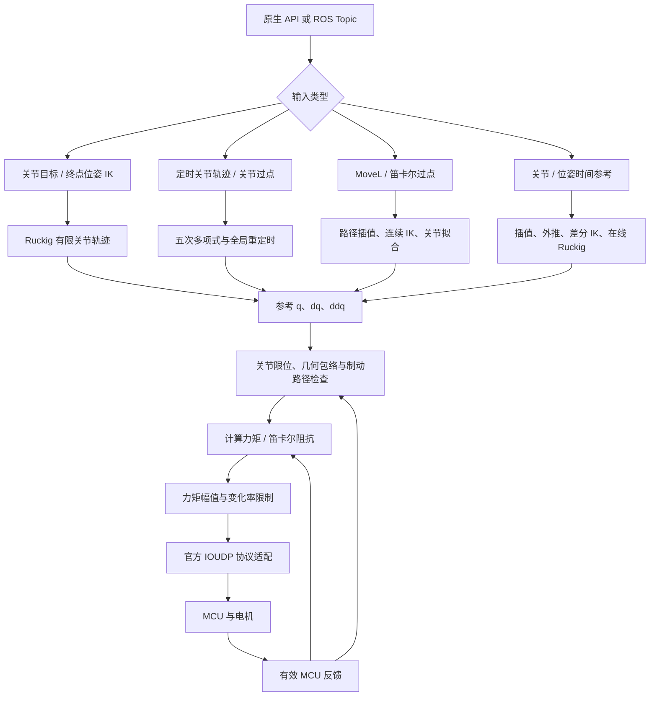
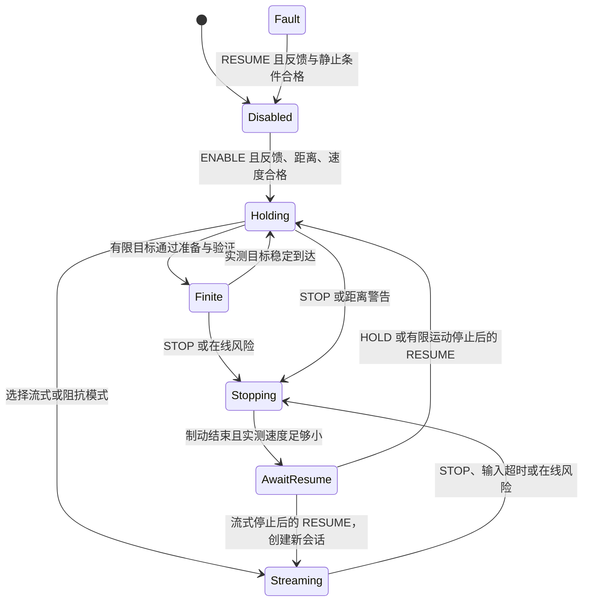

# Z1 SDK 算法详解

本文根据当前工作区的实现，介绍 `src/z1_ros` 中双 Z1 机械臂 SDK 的模型、运动生成、反馈控制、碰撞检查和周期执行算法。

这里的 SDK 指本目录的原生 C++ 控制内核 `z1_core`、MCU 通信适配 `z1_mcu_transport`，以及 ROS 1 Topic 适配。算法主要位于 [z1_control/src](z1_control/src)，公开接口位于 [z1_control/include/z1_control](z1_control/include/z1_control)。官方动态库用于 MCU 握手、协议和反馈解码；本文不推测该闭源库或电机固件内部的控制算法。

阅读接口字段和操作码时可配合 [INTERFACES.md](INTERFACES.md)，启动方式见 [README.md](README.md)。本文以源码中的现行行为为准。

## 目录

1. [整体算法链路](#1-整体算法链路)
2. [变量、坐标系与机器人模型](#2-变量坐标系与机器人模型)
3. [正运动学、位姿误差与雅可比](#3-正运动学位姿误差与雅可比)
4. [终点逆运动学](#4-终点逆运动学)
5. [差分逆运动学与连续位姿跟踪](#5-差分逆运动学与连续位姿跟踪)
6. [刚体动力学](#6-刚体动力学)
7. [Ruckig 点到点运动](#7-ruckig-点到点运动)
8. [定时关节轨迹与连续过点](#8-定时关节轨迹与连续过点)
9. [MoveL 与笛卡尔连续路径](#9-movel-与笛卡尔连续路径)
10. [带时间的连续参考](#10-带时间的连续参考)
11. [流式参考如何进入执行器](#11-流式参考如何进入执行器)
12. [计算力矩与笛卡尔阻抗控制](#12-计算力矩与笛卡尔阻抗控制)
13. [力矩输出与夹爪控制](#13-力矩输出与夹爪控制)
14. [碰撞距离与运动包络](#14-碰撞距离与运动包络)
15. [路径验证与在线制动检查](#15-路径验证与在线制动检查)
16. [状态机、反馈有效性与完成判定](#16-状态机反馈有效性与完成判定)
17. [控制周期、通信与 ROS 边界](#17-控制周期通信与-ros-边界)
18. [参数、源码索引与测试](#18-参数源码索引与测试)

## 1. 整体算法链路

SDK 将“输入目标”“可执行参考”和“发送给电机的力矩”分开处理。目标位置本身不会直接成为主臂 MCU 的位置控制指令。



| 层次 | 主要算法或工具 | 本项目承担的工作 |
| --- | --- | --- |
| 模型层 | Pinocchio、URDF | FK、雅可比、RNEA、ABA，读取关节和惯性参数 |
| 运动层 | Ruckig、自定义 Hermite 插值 | 点到点运动、连续参考、定时轨迹、连续过点 |
| 笛卡尔路径层 | 直线/Slerp、连续局部 IK、样条拟合 | 将 TCP 路径转成可直接采样的关节轨迹 |
| 几何层 | Coal、AABB、关节运动距离界 | 自碰撞和固定结构距离、路径与制动检查 |
| 控制层 | 计算力矩、雅可比转置阻抗 | 根据参考和反馈计算主臂力矩 |
| 执行层 | 单调时钟绝对节拍、UDP | 周期收发、反馈时效管理、统计和停止处理 |

双臂由两个独立进程运行同一套六轴算法。当前没有把两臂组成一个十二轴优化问题，也没有在线双臂互碰检查；每臂模型只包含本臂及其配置的固定结构。

## 2. 变量、坐标系与机器人模型

### 2.1 符号与单位

| 符号 | 含义 | 单位或约定 |
| --- | --- | --- |
| $q,\dot q,\ddot q$ | 六轴关节位置、速度、加速度 | rad、rad/s、rad/s²；顺序 `joint1..joint6` |
| $q_r,\dot q_r,\ddot q_r$ | 控制器生成的关节参考 | 与实测量单位相同 |
| $\tau$ | 六轴关节力矩 | N·m |
| $T=[R,p]$ | TCP 相对本臂基座的位姿 | $R\in SO(3)$，$p\in\mathbb R^3$，位置单位 m |
| $V=[v;\omega]$ | TCP 线速度、角速度 | 基座轴方向，作用点在 TCP；m/s、rad/s |
| $J$ | TCP 的 $6\times6$ 雅可比 | 前三行线速度，后三行角速度 |
| $j=\dddot q$ | 关节 jerk，加速度变化率 | rad/s³ |
| $h$、$\Delta t$ | 轨迹段时长、实际控制间隔 | s |

代码用 `Vec = Eigen::Matrix<double,6,1>` 同时表示关节向量和笛卡尔六维向量，物理含义依调用位置区分。反馈提供实测位置、速度和力矩，没有实测加速度字段；本文中的加速度用于参考生成、控制指令和动力学计算。笛卡尔角速度在基座方向表达，不能用 roll/pitch/yaw 的导数代替。

左、右臂 ROS 基座名分别为 `left_link00`、`right_link00`。原生模型使用不带前缀的 `link00`。ROS 适配器核对 `frame_id`，不自动查询 TF 或转换世界坐标系目标。

### 2.2 控制模型

模型来自 [z1_control.urdf](z1_description/urdf/z1_control.urdf)。初始化要求 `nq=nv=6`，关节按 `joint1..joint6` 排列。质量、质心、惯性、关节轴、零位变换和碰撞形状都从这个文件读取。

当前控制 URDF 中的主要关节参数如下。零位平移是相对父连杆的变换；六个活动关节的零位 RPY 均为零。

| 关节 | 轴，父连杆坐标表达 | 零位平移，m | 角度范围，度 | URDF 力矩上限，N·m |
| --- | --- | --- | --- | --- |
| joint1 | Z | `(0, 0, 0.0585)` | `[-150, 150]` | 30 |
| joint2 | Y | `(0, 0, 0.045)` | `[0, 170]` | 60 |
| joint3 | Y | `(-0.35, 0, 0)` | `[-165, 0]` | 30 |
| joint4 | Y | `(0.218, 0, 0.057)` | `[-87, 87]` | 30 |
| joint5 | Z | `(0.07, 0, 0)` | `[-77, 77]` | 30 |
| joint6 | X | `(0.0492, 0, 0)` | `[-160, 160]` | 30 |

默认 TCP 为 `tool`，相对 `link06` 平移 `(0.051,0,0)` m、姿态相同。`tool` 是固定连杆，当前含 0.25 kg 的惯性参数和工具碰撞包络。它们都会进入模型计算；夹爪开合不会改变该 TCP，也不会在线改变工具惯性或碰撞形状。

重力默认在本臂基座系表示为 $(0,0,-9.81)$ m/s²。安装方向改变时，需要给出该基座系中的实际重力向量。

### 2.3 模型指纹

`Model::revision()` 对 URDF 文件内容、TCP 名称、重力、碰撞排除对和固定结构配置计算 SHA-256，用于识别运行模型。它不包含控制增益或外部网格文件内容，也不参与每周期的运动求解。

## 3. 正运动学、位姿误差与雅可比

源码：[model.cpp](z1_control/src/model.cpp)。

### 3.1 正运动学 FK

对串联机械臂，TCP 变换可写为：

$$
{}^0T_{\mathrm{TCP}}(q)=
{}^0T_1(q_1)\,{}^1T_2(q_2)\cdots{}^5T_6(q_6)\,{}^6T_{\mathrm{TCP}}.
$$

每个关节变换由 URDF 零位变换和关节轴旋转组成。实现调用 `pinocchio::forwardKinematics`，再更新 TCP frame，返回 `Eigen::Isometry3d`。显示用的 ROS TF 不参与该运算。

### 3.2 位姿误差

`poseError(actual, desired)` 使用：

$$
e(T,T_d)=
\begin{bmatrix}
p_d-p\\
\operatorname{Log}(R_dR^T)^\vee
\end{bmatrix}.
$$

平移误差直接在基座系相减；姿态误差取相对旋转矩阵的 SO(3) 对数，形成基座方向表达的轴角误差。它没有逐分量相减欧拉角，也不是完整 SE(3) 对数中的耦合平移误差。

平移误差和旋转误差具有不同单位。终点 IK 直接将它们放入同一个六维求解式，没有配置任务权重或特征长度；因此不能把两部分合并后的数值范数解释为单一物理距离。

### 3.3 雅可比

采用 Pinocchio 的 `LOCAL_WORLD_ALIGNED` frame 雅可比：

$$
\begin{bmatrix}v_{\mathrm{TCP}}\\\omega_{\mathrm{TCP}}\end{bmatrix}
=J(q)\dot q.
$$

该约定使雅可比与上面的基座方向位姿误差一致。对转动关节，第 $i$ 列的几何含义为：

$$
J_i=
\begin{bmatrix}
z_i\times(p_{\mathrm{TCP}}-p_i)\\z_i
\end{bmatrix},
$$

其中 $z_i$ 为基座方向表达的关节轴，$p_i$ 为轴上的点。项目实际使用库函数求解；`toolKinematics` 一次更新关节雅可比与 TCP 位置，避免为每次求解重复更新所有 frame。

## 4. 终点逆运动学

入口是 `Model::ik(target, seed, result)`，主要用于 `poseGoal` 的终点求解。算法是带阻尼的局部迭代逆运动学。

### 4.1 迭代公式

在当前迭代 $q_k$ 计算 $e_k$ 和 $J_k$，用阻尼最小二乘求增量：

$$
\Delta q_k=
J_k^T(J_kJ_k^T+\mu I)^{-1}e_k,
\qquad \mu=0.0002.
$$

这里的 $\mu$ 是源码直接加到矩阵对角线的系数。如果采用常见的 $\lambda^2I$ 记法，应令 $\lambda^2=\mu$，不能把代码中的数值再平方一次。

随后限制整个六维增量的二范数，再裁剪到位置限位：

$$
\|\Delta q_k\|_2\le0.15,\qquad
q_{k+1}=\operatorname{clip}(q_k+\Delta q_k,q_{\min},q_{\max}).
$$

最多迭代 300 次。成功条件同时满足：

$$
\|e_p\|_2<10^{-4}\ \mathrm m,
\qquad \|e_R\|_2<5\times10^{-4}\ \mathrm{rad}.
$$

输入位姿必须合法，种子必须位于关节限位内；失败返回 `false`。

### 4.2 求解能力

阻尼使奇异或接近奇异时的小矩阵求解保持可用，但会降低部分方向的响应。当前算法只有一个种子，没有多初值搜索、解析解枚举、约束 QP 或绕障优化。

`Model::ik` 自身不查询碰撞。`poseGoal` 先得到终点关节解，再生成并检查整条关节轨迹。目标可达不等于路径可执行，求解失败也不等于该目标在所有其他关节分支上都不可达。

`poseGoal` 的中间 TCP 轨迹由关节运动决定；需要 TCP 沿直线时，应使用第 9 节的 `moveL` 或 `linearWaypoints`。

## 5. 差分逆运动学与连续位姿跟踪

入口是 `Model::differentialIk(q, target, speed, twist)`，用于 `PoseStream` 和 `Impedance` 中的关节参考生成。

### 5.1 目标 twist 加误差反馈

先在当前关节参考处计算位姿误差，形成期望 TCP 速度：

$$
V^*=V_{\mathrm{ff}}+
\begin{bmatrix}4I_3&0\\0&3I_3\end{bmatrix}e.
$$

`twist` 参数就是 $V_{\mathrm{ff}}$。目标带速度时，这一项使执行器不必完全依赖位置落后产生的误差来追赶。

再分别限制线速度和角速度的向量范数：

$$
\|v^*\|_2\le0.12s\ \mathrm{m/s},\qquad
\|\omega^*\|_2\le0.5s\ \mathrm{rad/s}.
$$

`PoseStream` 内部取 $s=1$，阻抗的辅助关节参考取 $s=0.5$。这个参数缩放的是速度饱和值，小误差下的反馈系数仍是 4 和 3。

### 5.2 奇异值相关阻尼

对 $J$ 做 SVD，取最小奇异值 $\sigma_{\min}$：

$$
r=\min(1,\sigma_{\min}/0.05),\qquad
\mu=0.002+0.002(1-r)^2.
$$

关节速度为：

$$
\dot q^*=J^T(JJ^T+\mu I)^{-1}V^*.
$$

阻尼在 `0.002..0.004` 之间变化，接近奇异时增大。这里同样使用直接正则项 $\mu I$。SVD 使用未做单位归一化的雅可比，阈值 `0.05` 是该实现的数值参数。

控制器随后逐轴裁剪关节速度，通过临近限位的速度约束和 Ruckig 速度模式生成连续的 $q_r,\dot q_r,\ddot q_r$。差分 IK 的输出本身不是最终力矩。

这是一种局部跟踪算法，没有把碰撞距离、关节限制与任务误差统一放入同一个优化问题；碰撞和制动可行性由后续检查处理。

## 6. 刚体动力学

源码：[dynamics.cpp](z1_control/src/dynamics.cpp)。

### 6.1 动力学方程

六轴固定基座模型可写为：

$$
\tau=M(q)\ddot q+c(q,\dot q)+g(q).
$$

$M$ 是惯性矩阵，$c$ 是科里奥利和离心项，$g$ 是重力项。这里只描述 SDK 当前调用的刚体模型；控制器没有显式添加辨识后的摩擦、减速器滞回或外部接触力模型。

### 6.2 逆动力学 RNEA

`Model::inverseDynamics(q,v,a)` 直接调用 `pinocchio::rnea`。

递归牛顿欧拉算法先沿运动链正向传播每个连杆的空间速度与加速度，再反向累积惯性力和子连杆作用力，最后投影到关节运动轴得到力矩。其空间向量形式可概括为：

$$
v_i=X_{i\leftarrow p}v_p+S_i\dot q_i,
$$

$$
a_i=X_{i\leftarrow p}a_p+S_i\ddot q_i+
v_i\times(S_i\dot q_i),
$$

$$
f_i=I_i a_i+v_i\times^*(I_i v_i),\qquad
\tau_i=S_i^Tf_i.
$$

其中 $X$ 是父到子的空间运动变换，$S_i$ 是关节运动子空间，$I_i$ 是空间惯性；反向阶段还要将子连杆力变换后累加到父连杆，重力通过基座加速度处理。SDK 将这些运算交给 Pinocchio。

控制中的两个重要调用是：

- `inverseDynamics(q, dq, desired_acc)`：同时包含惯性、速度相关项与重力补偿。
- `inverseDynamics(q, dq, Zero())`：只保留 $c(q,\dot q)+g(q)$，用于当前阻抗模式。

因此不能在计算力矩结果上再次叠加一份相同的重力或科里奥利补偿。

### 6.3 正动力学 ABA

`Model::forwardDynamics(q,v,tau)` 调用 `pinocchio::aba`，求：

$$
\ddot q=M(q)^{-1}[\tau-c(q,\dot q)-g(q)].
$$

ABA 利用串联结构递归计算加速度，避免为此显式构造和求逆完整惯性矩阵。当前控制器在线生成力矩使用 RNEA；ABA 主要供离线仿真、测试或其他原生调用使用。

## 7. Ruckig 点到点运动

入口：`Controller::goal`、`Controller::poseGoal`；实现位于 [controller.cpp](z1_control/src/controller.cpp) 的 `prepare`。

### 7.1 从目标到关节轨迹

1. 只在 `Holding` 接受有限目标，记录当前关节参考和内部状态版本 `generation_`。
2. 关节目标直接作为终点；位姿目标先用当前参考作种子求终点 IK。
3. 从静止参考出发，设置目标位置，目标速度和加速度使用默认零值。
4. 通过 Ruckig 计算六轴同步的速度、加速度、jerk 受限轨迹。
5. 检查关节位置多项式与全段几何距离。
6. 再次确认状态、版本和起点没有变化，提交轨迹并发出 `Accepted`。

Ruckig 分段使用恒定 jerk。单段的运动关系为：

$$
q(t)=q_0+v_0t+\frac12a_0t^2+\frac16jt^3,
$$

$$
v(t)=v_0+a_0t+\frac12jt^2,\qquad a(t)=a_0+jt.
$$

这些分段形成受限的平滑加减速运动。SDK 使用库生成轨迹，没有自行实现 Ruckig 的分段求解器。

### 7.2 `speed` 的具体语义

对这一类单目标，`speed=s` 只将 Ruckig 最大速度乘以 $s$；最大加速度和最大 jerk 保持配置值。它不承诺轨迹总时长恰好变成原来的 $1/s$。

这一点与 `jointWaypoints` 的整段速度缩放不同，不能将不同接口中的 `speed_scale` 视作完全相同的时间变换。

### 7.3 离线准备与在线采样

`model_` 服务控制线程，`planning_model_` 服务准备线程。IK 和完整路径验证在提交调用所在的线程执行，不长时间持有控制互斥锁。

状态版本检查阻止已经失效的准备结果覆盖较新的 STOP、DISABLE 或模式变化。这个版本号是运行状态计数器，与模型 SHA-256 指纹是不同机制。

执行时直接按 `now-motion_at_` 采样已经生成的轨迹。有限轨迹的离线几何检查使用 `collision_margin + 0.01`，默认是 18 mm；在线仍继续检查实际间距、下一周期运动包络和制动路径。

## 8. 定时关节轨迹与连续过点

源码：[trajectory.hpp](z1_control/include/z1_control/trajectory.hpp)、[trajectory.cpp](z1_control/src/trajectory.cpp)。

SDK 的预计算 `JointTrajectory` 是独立的五次 Hermite 多项式实现，并非通过在线 Ruckig 逐个追踪关节路点。

### 8.1 五次 Hermite 分段

设一段时长为 $h$，归一化时间 $s=(t-t_0)/h\in[0,1]$：

$$
q(s)=c_0+c_1s+c_2s^2+c_3s^3+c_4s^4+c_5s^5.
$$

给定两端 $q_0,v_0,a_0$ 和 $q_1,v_1,a_1$，定义：

$$
c_0=q_0,\quad c_1=hv_0,\quad c_2=\tfrac12h^2a_0,
$$

$$
P=q_1-c_0-c_1-c_2,\quad
U=hv_1-c_1-2c_2,\quad
A=h^2a_1-2c_2.
$$

其余系数为：

$$
c_3=10P-4U+\tfrac12A,\qquad
c_4=-15P+7U-A,\qquad
c_5=6P-3U+\tfrac12A.
$$

对 $s$ 求导后，速度、加速度和 jerk 分别再除以 $h$、$h^2$、$h^3$。相邻段共享路点处的 $q,v,a$，所以整条轨迹为 C2 连续；jerk 有界不代表 jerk 在所有连接处连续。

### 8.2 缺省导数

显式给出的速度和加速度作为端点条件。缺省首尾速度取零，缺省加速度取零；缺省内部速度按每轴相邻割线斜率估计。

令相邻段斜率为 $d_-,d_+$，时长为 $h_-,h_+$。任一斜率为零或两者异号时，该轴过点速度取零。否则使用加权调和平均：

$$
w_-=2h_++h_-,\quad w_+=h_++2h_-,\qquad
v_i=\frac{w_-+w_+}{w_-/d_-+w_+/d_+},
$$

并限制 $|v_i|\le2\min(|d_-|,|d_+|)$，降低短段和慢段附近的过冲风险。之后仍要对完整多项式进行位置及导数极值检查。

因此同向关节路点通常可以非零速度通过；反向轴可能在路点处速度为零。不能承诺任意一组多轴路点都能完全不停顿。

### 8.3 分段内部极值检查

只检查路点不能发现多项式中途超调。实现对位置、速度、加速度和 jerk 的极值分别求界：端点加上相应导数在 $[0,1]$ 内的零点。

求根先递归求导数根，以这些点划分单调区间，再对变号区间二分，检查边界以处理相切或重根。这是多项式的数值极值检查，不依赖固定时间采样网格；判断仍带浮点容差。

### 8.4 全局重定时

记各轴各段的最大速度、加速度、jerk 为 $V,A,J$，取全局伸缩倍率：

$$
\gamma=\max\left(1,\max_{i,k}\left\{
\frac{V_{ik}}{v_{\max,i}},
\sqrt{\frac{A_{ik}}{a_{\max,i}}},
\sqrt[3]{\frac{J_{ik}}{j_{\max,i}}}
\right\}\right).
$$

当 `retime=false`，若 $\gamma$ 超出容差便拒绝，保留原时间和显式导数。当 `retime=true`，统一将所有时刻和段时长乘以 $\gamma$，归一化位置系数保持不变，因此：

$$
q_{\mathrm{new}}(\gamma t)=q_{\mathrm{old}}(t),\quad
v_{\mathrm{new}}=v_{\mathrm{old}}/\gamma,\quad
a_{\mathrm{new}}=a_{\mathrm{old}}/\gamma^2,\quad
j_{\mathrm{new}}=j_{\mathrm{old}}/\gamma^3.
$$

重定时保持关节几何路径，不能修复位置越限或碰撞，也没有进行力矩约束下的时间优化。

### 8.5 自动关节过点时间

`JointTrajectory::waypoints` 不要求上游提供时间。对速度比例 $s$，先设置：

$$
v_{\lim}=sv_{\max},\qquad a_{\lim}=s^2a_{\max},\qquad
j_{\lim}=s^3j_{\max}.
$$

逐段根据关节位移 $\Delta q_i$ 给出初始时长：

$$
h\ge\max_i\left\{
T_{\mathrm{period}}/s,
\frac{1.875|\Delta q_i|}{v_{\lim,i}},
\sqrt{\frac{5.773502691896258|\Delta q_i|}{a_{\lim,i}}},
\sqrt[3]{\frac{60|\Delta q_i|}{j_{\lim,i}}}
\right\}.
$$

这些常数来自静止到静止五次 smoothstep 的导数峰值。赋予内部过点速度后，再统一检查并重定时。这是可验证的启发式时间安排，没有求全局时间最优解。

`Controller::trajectory` 和 `jointWaypoints` 提交时要求轨迹从当前静止参考开始、最终静止；首点时间大于零时，`trajectory` 自动补入当前参考的零时刻点。底层 `JointTrajectory` 本身可表达非零端点导数，但有限运动控制接口会拒绝不满足首尾静止的计划。

运行采样通过二分定位分段并用 Horner 法求值；该采样函数不做 IK、极值求根或轨迹重建。区间外保持端点并置零导数；恰好位于区间端点时保留多项式指定的导数。

## 9. MoveL 与笛卡尔连续路径

源码：[cartesian_path.cpp](z1_control/src/cartesian_path.cpp)，入口为 `moveL` 和 `linearWaypoints`。

### 9.1 先定义 TCP 路径

单段使用共同进度 $u$ 插值位置和姿态：

$$
p(u)=(1-u)p_0+up_1,\qquad
R(u)=\operatorname{Slerp}(R_0,R_1,u).
$$

四元数 Slerp 描述两姿态之间的最短旋转路径。平移和旋转共用进度，既支持固定姿态直线，也支持纯旋转和同时平移旋转。

将长度定义为：

$$
L(T_0,T_1)=\max(\|p_1-p_0\|,\;0.24\|\operatorname{Log}(R_1R_0^T)^\vee\|).
$$

`0.24` 的量纲是 m/rad，正好对应基准线速度与角速度之比 `0.12/0.5`，使路径时间同时受两种任务速度限制。它只是路径长度与裁剪的度量，不是机器人真实连杆长度。

直线段用五次时间进度连接所需的起终速度，并令端点路径加速度为零。无转角融合时从静止开始、静止结束。

### 9.2 多段转角融合

`blend_radius=0` 时逐点停车。正值时，第 $i$ 个内部点两侧的裁剪长度为：

$$
b_i=\min(\text{blend\_radius},0.45L_{i-1},0.45L_i).
$$

在两侧裁剪点之间构造六控制点的五次 Bézier 过渡。位置按线性插值、姿态按 Slerp，用测地 de Casteljau 递归求值；控制点的端点三元组与两侧直线路径一致，用于匹配端点速度与零加速度，再转成共享导数的关节 C2 轨迹。

平移过渡位于裁剪转角的控制点凸包内。正半径意味着绕过原始中间点，不能再要求精确经过该点。这个参数也适用于纯旋转，其等效角度由 `b/0.24` 给出。该过渡不是圆弧 MoveC，也不保证总时间比逐点停车更短。

### 9.3 连续分支 IK

从起始关节状态开始，沿笛卡尔路径逐点求逆解，并用上一点解作为下一点种子。拟合专用 `preciseIk` 比普通终点 IK 更严格：

- 最多 100 次迭代，正则系数 `1e-10`。
- 平移和旋转误差分别小于 `1e-9` 才返回。
- 单次六维关节增量范数不超过 `0.15`。
- 最多 12 次步长减半，要求误差平方和下降，同时裁剪位置限位。
- 相邻采样解任一轴跳变大于 `0.35 rad`，拒绝为分支不连续。

这些阈值是数值准备条件，不代表真机精度。路径上某点不可达或本地分支无法连续延伸时拒绝，不切换到全局搜索寻找其他路线。

### 9.4 关节拟合、加密与速度检查

初始采样间隔约 20 ms，每个路径片段至少分成 8 段。使用实际、可能不均匀的五点时间窗口拟合局部四次多项式，以 QR 求解导数，估计内部关节速度和加速度；停车点保持零速度、零加速度。

得到关节路点后，构建第 8 节的五次 Hermite 轨迹，并按关节速度、加速度、jerk 限制全局重定时。

接着对每个关节分段的 9 个时间点检查：

1. FK 与原始笛卡尔路径的平移、旋转误差。
2. $J(q)\dot q$ 的线速度与角速度是否超过 `0.12*speed` m/s、`0.5*speed` rad/s。

默认平移拟合阈值为 0.1 mm，旋转阈值为 1 mrad。超差则将采样间隔减半，最多 5 轮，即约 `20、10、5、2.5、1.25 ms`。任务速度超限时，再对整条轨迹统一降速。

这里对关节多项式导数的限制经过极值检查；笛卡尔轮廓误差和任务速度经过离散点数值检查，不能把后者表述成所有连续时刻的解析上界，更不能等同于真实机械臂的跟踪误差。

准备完成后，控制周期只采样关节轨迹，不再在线对该 MoveL 路径执行 IK。`validation_budget` 约束后续全段几何检查，不是上述全部 IK、拟合和加密过程的总超时。

## 10. 带时间的连续参考

源码：[reference.hpp](z1_control/include/z1_control/reference.hpp)、[reference.cpp](z1_control/src/reference.cpp)。

时间参考是有限未来范围内的滚动目标，服务 `JointStream`、`PoseStream`、`Impedance`，与一次性提交的完整有限轨迹分开管理。

### 10.1 时间线及替换规则

`ReferenceTimeline` 用固定数组最多保存 32 点，时间采用 `steady_clock` 秒数。新点在时刻 $t$ 插入时，会替换原来所有时间大于等于 $t$ 的点，以支持修改未来计划。

`prune(now)` 删除已经跨过的旧段，同时保留当前插值需要的前驱点。控制器限制未来参考范围，默认 `reference_horizon=0.5 s`。完整时间检查还要求目标时刻不早于该消息的源时刻。

ROS 中 `header.stamp` 用于计算源消息时龄，`target_time` 是路点目标时刻。适配器把相对 ROS 当前时刻的时间差映射到单调时钟；非零时龄会扣减源时间有效期。

### 10.2 缺省导数估计

未提供速度时，使用相邻参考的位置差分，再进行一阶滤波：

$$
v_{\mathrm{raw},k}=\frac{x_k-x_{k-1}}{\Delta t},\qquad
\alpha=\frac{\Delta t}{T_f+\Delta t},
$$

$$
v_k=v_{k-1}+\alpha(v_{\mathrm{raw},k}-v_{k-1}).
$$

笛卡尔位置差分中，平移直接相减，旋转使用 $\operatorname{Log}(R_kR_{k-1}^T)^\vee$。缺省加速度由速度差分按同样形式滤波；默认 $T_f=0.01$ s。

估计导数会受目标噪声和发送周期影响。上游能够给出可信的速度和加速度时，可以使用显式导数减少差分滤波带来的滞后。

### 10.3 关节和位置插值

两个端点都标记 `has_acceleration=true` 时，使用满足两端位置、速度、加速度的五次 Hermite 插值；否则使用满足位置和速度的三次 Hermite 插值。

三次插值中，令 $x=t-t_0$、$h=t_1-t_0$、$\Delta q=q_1-q_0$：

$$
q(x)=q_0+v_0x+c_2x^2+c_3x^3,
$$

$$
c_2=\frac{3\Delta q}{h^2}-\frac{2v_0+v_1}{h},\qquad
c_3=-\frac{2\Delta q}{h^3}+\frac{v_0+v_1}{h^2}.
$$

导数估计会填充数值，但不会把缺省的 `has_acceleration` 标志改为真。因此“估计出了加速度”不意味着这段自动采用五次插值。时间线插值也没有第 8 节完整有限轨迹那样的分段极值验证，其输出还要经过执行器约束。

### 10.4 姿态插值及旋转导数

以段起点 $R_0$ 为基准，表示：

$$
R(t)=\operatorname{Exp}(r(t)^\wedge)R_0,
\qquad r_1=\operatorname{Log}(R_1R_0^T)^\vee.
$$

对 $r(t)$ 进行 Hermite 插值。旋转向量导数不直接等于角速度，必须通过 SO(3) 左雅可比转换：

$$
\omega=J_l(r)\dot r,\qquad
\dot\omega=J_l(r)\ddot r+\dot J_l(r,\dot r)\dot r,
$$

$$
J_l(r)=I+\frac{1-\cos\theta}{\theta^2}[r]_\times
+\frac{\theta-\sin\theta}{\theta^3}[r]_\times^2,
\qquad\theta=\|r\|.
$$

终点角速度先通过 $J_l^{-1}(r_1)$ 转成旋转向量导数；角加速度还要扣除 $\dot J_l\dot r$。插值后再转回基座系角速度、角加速度。小角度处使用级数展开，避免除以很小的角度。

这保证了参考中的姿态、角速度和角加速度在所用插值表达下相互一致，尤其适用于转轴不共线的目标。

### 10.5 有界外推

超过最后一点时刻时，最多外推 $T_e=0.1$ s。关节/平移采用：

$$
x(t_0+\delta)=x_0+v_0\delta+\tfrac12a_0\delta^2,
\qquad v=v_0+a_0\delta,
\quad\delta\in[0,T_e].
$$

姿态采用 $r=\omega_0\delta+\tfrac12\dot\omega_0\delta^2$，左乘指数映射，并通过左雅可比修正外推后的角速度和角加速度。它是有限时间的预测模型，不是任意复杂旋转的长期精确外推。

超过外推期限后，时间线保持外推边界位置并给出零速度、零加速度。这个参考截断本身不是平滑制动轨迹；关节执行仍由 Ruckig 处理，输入失效还会触发独立停止流程。

## 11. 流式参考如何进入执行器

实现位于 `Controller::step`，当前 ROS 配置下每 4 ms 执行一次。

### 11.1 JointStream

在 `now + reference_preview` 采样关节时间线，默认前瞻 30 ms，将位置、速度、加速度分别裁剪到模型/配置范围，作为 Ruckig 位置模式的终态。设置 `minimum_duration=reference_preview`。

Ruckig 从上一周期的 $q_r,\dot q_r,\ddot q_r$ 出发重新计算，再按本次实际经过时间采样，获得下一参考。前瞻目标包含导数，区别于反复把当前位置当作必须停下来的终点。

### 11.2 PoseStream

在 `now + reference_preview` 采样位姿时间线，对上一关节参考执行第 5 节的差分 IK；得到关节目标速度，使用 Ruckig 速度模式，目标关节加速度设置为零。

此处的目标笛卡尔加速度参与时间参考的构造和外推，但没有直接转换成含 $\dot J\dot q$ 的关节加速度前馈。`PoseStream` 也不承诺经过每一帧目标，或沿任意两帧间形成工艺直线。

### 11.3 临近关节限位的速度约束

对每轴，沿目标速度方向计算距位置限位的剩余距离 $d_i$，并留出 `0.02 rad` 缓冲。令：

$$
b_i=\frac{a_{\max,i}^2}{j_{\max,i}},\qquad
v_{\mathrm{safe},i}=
\max\left(0,\sqrt{b_i^2+2a_{\max,i}\max(0,d_i-0.02)}-b_i\right).
$$

目标速度保持方向，幅值不超过该值。随后将目标加速度限制在：

$$
|a_{\mathrm{target},i}|\le
\sqrt{\max(0,j_{\max,i}(v_{\max,i}-|v_{\mathrm{target},i}|))}.
$$

这是生成前的局部约束，不取代生成后的关节限位和制动路径检查。

### 11.4 时钟与会话

在线 Ruckig 按实际 $\Delta t$ 推进；只有与标称周期差小于 `1 ns` 时，才使用标称周期去除浮点相减噪声，实际周期统计不被改写。

流输入还必须满足模式、会话 `session`、递增 `sequence`、时龄和未来范围要求。只有接受的有效输入才续期：

$$
t_{\mathrm{deadline}}=\max(t_{\mathrm{source}},t_{\mathrm{target}})
+T_{\mathrm{stream\_timeout}}.
$$

默认 `stream_timeout=0.2 s`。因此源消息时效、未来路点时刻、外推期限和流超时是相互关联的不同参数，不能简单理解为“每帧收到后固定再运行 200 ms”。停止或恢复会改变会话，使旧帧不能重新驱动运动。

## 12. 计算力矩与笛卡尔阻抗控制

两种模式共用动力学、反馈、几何和力矩输出约束，但控制律不同。源码位于 [controller.cpp](z1_control/src/controller.cpp) 的 `step` 后半段。

### 12.1 普通模式：关节计算力矩

除 `Impedance` 外，所有使能状态使用：

$$
a_{\mathrm{cmd}}=\ddot q_r+
K_p(q_r-q)+K_d(\dot q_r-\dot q),
$$

$$
\tau^*=\operatorname{RNEA}(q,\dot q,a_{\mathrm{cmd}})
=M(q)a_{\mathrm{cmd}}+c(q,\dot q)+g(q).
$$

$K_p,K_d$ 是对角矩阵，代码用逐元素乘法实现。`kp` 的单位是 s⁻²，`kd` 的单位是 s⁻¹；它们将位置/速度误差转换为加速度校正，不是直接输出力矩的电机 PD 增益。

在模型完全准确、没有外扰且力矩不限幅的理想条件下，令 $e=q_r-q$，可得到：

$$
\ddot e+K_d\dot e+K_pe=0.
$$

默认 $K_p=[50,80,60,35,20,20]$，$K_d=[8,12,10,6,3,3]$。理想单轴关系中的自然频率与阻尼比为 $\omega_n=\sqrt{K_p}$、$\zeta=K_d/(2\sqrt{K_p})$；真机还受模型误差、采样延迟、噪声和力矩限制影响。

`Holding` 使用固定 $q_r$ 和零参考导数，所以仍在执行位置反馈和动力学补偿。到达目标后进入 Holding，也继续保持目标位置。

### 12.2 Impedance：TCP 弹簧阻尼

阻抗模式以期望 TCP 位姿 $T_e$ 和速度 $V_e$ 为平衡参考：

$$
e_x=\operatorname{poseError}(T(q),T_e),\qquad V=J(q)\dot q,
$$

$$
F^*=K_xe_x+D_x(V_e-V),
$$

$$
\tau^*=J(q)^TF^*+\operatorname{RNEA}(q,\dot q,0).
$$

$F^*=[f;m]$ 是虚拟 TCP 力/力矩，$J^T$ 将其映射成关节力矩。平移刚度单位 N/m，旋转刚度单位 N·m/rad；相应阻尼为 N·s/m 和 N·m·s/rad。

当前实现采用对角增益：默认平移刚度 30、旋转刚度 0.2，平移阻尼 4、旋转阻尼 0.02。它使用关节反馈和模型形成柔顺响应，没有读取外部六维力传感器进行闭环力跟踪，也没有设置期望任务惯量或加入任务空间惯性加速度前馈。

弹簧项中的误差先分别限幅：$\|e_p\|\le0.1$ m、$\|e_R\|\le0.25$ rad。这里限制的是弹簧位姿误差，阻尼项没有相同的误差限幅；两项与动力学补偿合成后，再经过关节力矩输出限制。

### 12.3 阻抗平衡参考与辅助关节参考

阻抗模式有两条参考链路：

- 辅助关节链：采样 `now+reference_preview` 的位姿，经差分 IK 和 Ruckig 形成关节参考，服务运动包络和制动检查。
- 平衡位姿链：采样 `now+period` 的位姿和速度，直接形成上式中的 $T_e,V_e$。

阻抗力矩不使用“辅助关节参考 FK 后的位姿”作为唯一平衡目标。这样可以保留上游动态平衡参考，而不是把 IK/Ruckig 的全部滞后都加入弹簧目标。

不过，辅助关节链仍影响几何与制动判定；偏离参考过大时，即使正在柔顺运动，也可能触发停止。

### 12.4 在线增益平滑

在 `Holding` 或 `Impedance` 可设置新的正值有界刚度、阻尼。实际阻抗增益在阻抗周期按指数规律逼近配置值：

$$
\alpha=1-e^{-\Delta t/T_K},\qquad
K\leftarrow K+\alpha(K_{\mathrm{target}}-K),
$$

阻尼同样处理，默认 $T_K=0.1$ s。`gains()` 更新的是配置目标；实际平滑发生在阻抗计算期间。

## 13. 力矩输出与夹爪控制

### 13.1 主臂力矩限制

先按幅值限幅，有效上限取配置值与 URDF effort 的逐轴较小值：

$$
\tau_{\mathrm{lim},i}=\min(\tau_{\mathrm{config},i},\tau_{\mathrm{URDF},i}),
\quad \tau_c=\operatorname{clip}(\tau^*,-\tau_{\mathrm{lim}},\tau_{\mathrm{lim}}).
$$

再根据上一轮输出限制变化量：

$$
\Delta\tau_{\max,i}=\dot\tau_{\max,i}\min(\Delta t,T_{\mathrm{period}}),
$$

$$
\tau_{\mathrm{out},i}=\operatorname{clip}
(\tau_{c,i},\tau_{\mathrm{last},i}-\Delta\tau_{\max,i},
\tau_{\mathrm{last},i}+\Delta\tau_{\max,i}).
$$

默认力矩上限为 `[20,30,20,12,8,8]` N·m，变化率上限每轴 1000 N·m/s。当前 4 ms 标称周期下单次最大变化为 4 N·m；周期变长也不会放大单次允许跳变量。故障或失能的被动输出可以直接归零，不受普通力矩斜坡约束。

轨迹生成没有显式使用逆动力学检查整条轨迹的力矩可行性。参考满足速度、加速度和 jerk 限制，不保证真机在力矩饱和时仍能精确跟踪。

### 13.2 主机与 MCU 的控制分工

[mcu_transport.cpp](z1_control/src/mcu_transport.cpp) 将主臂参考 `q/dq` 与力矩放入 `LowLevelCmd`，主臂六轴 `Kp/Kd` 保持零，反馈控制由主机承担。不能把同一组位置误差反馈再配置到 MCU，否则会改变本节描述的控制律。

### 13.3 夹爪

夹爪是独立位置控制，不进入六轴 RNEA 或 IK。检测到夹爪且处于 `Holding` 时，可接受 `[-1,0]` 范围内的目标电机位置。

每周期以实测夹爪位置为起点，将发送位置朝目标最多推进 `0.4*period`，当前 ROS 配置下每次为 `0.0016`；发送 MCU 增益 `Kp=8`、`Kd=0.5`。这是相对实测位置的逐周期限步，不是独立的夹爪 Ruckig 轨迹，也没有提供夹持力闭环或到达成功事件。

## 14. 碰撞距离与运动包络

下述几何限制由 `Config::collision_check_enabled` 控制，原生默认值为 `true`。本次 ROS 双臂调试 YAML 显式设为 `false`：保留实测距离诊断，跳过几何使能门槛、实测距离预警/故障、离线路径与在线制动路径中的几何检查；Ruckig 制动生成、完整多项式关节限位验证、轨迹导数和力矩限制仍执行。第 15、16 节中的几何拒绝条件仅在该开关启用时生效。修改 YAML 后须重启控制器。

源码：[model.cpp](z1_control/src/model.cpp)、[model_internal.hpp](z1_control/src/model_internal.hpp)、[collision.cpp](z1_control/src/collision.cpp)。

### 14.1 检查的几何对象

控制模型使用圆柱、盒等 URDF collision 基本形状，视觉网格不决定当前控制距离。初始化要求 `link00..link06` 和 TCP frame 均有碰撞覆盖。

同一连杆的形状不互查；其他形状对默认纳入，只有配置中的连杆排除对被跳过。相邻安装结构的包络存在设计重叠，因此默认有显式排除规则。

`fixed_boxes` 增加相对本臂基座固定的盒体，每个盒体与所有机器人碰撞形状配对。固定盒体不作为运动自由度；默认配置为空，也不会自动表示另一机械臂或动态环境。

### 14.2 有符号距离

对各几何对调用 Coal 距离查询，并启用 signed distance。正值表示分离，零表示接触，负值表示穿透；取启用几何对的最小值及名称。

`clearanceSample(q)` 返回距离和绑定 `Model` 生命周期的名称视图，减少周期中的字符串构造；`clearance(q)` 返回拥有字符串的结果。

### 14.3 每对几何的关节运动界

在名义关节位置 $q$ 附近，设独立关节偏移满足 $|\Delta q_j|\le u_j$。为每对几何构造长度系数 $\rho_{pj}$，表示该轴角度变化最多引起的距离变化比例：

$$
d_{p,\mathrm{bound}}(q,u)=d_p(q)-\sum_j\rho_{pj}u_j.
$$

这是实现使用的保守几何下界模型，浮点距离计算仍有数值误差。系数由几何包络半径、局部放置和上游关节平移长度累加得到；只有某关节影响这对几何中的一个对象时，该轴才增加相对运动界。

若关节是两个对象的共同祖先，它只带着两者一起刚体运动，不改变自碰撞距离，因此该轴对这对几何的系数取零。机器人对固定障碍物时，则保留所有相关上游轴的影响。

带包络查询实际计算：

$$
d_{\mathrm{bound}}(q,u)=\min_p\left[d_p(q)-\rho_p^T|u|\right].
$$

`distanceMotionBound(x)` 返回 $\max_p\rho_p^T|x|$。输入是关节速度时得到距离变化速度界，输入是关节位移时得到距离变化量界。

它依据几何和给定偏移建立界，不等于已经测得的真实距离。`Snapshot::collision_distance` 使用实际反馈关节位置的零包络查询。

### 14.4 缓存和粗筛

同一 $q$ 下缓存各对精确距离。关节位置改变时更新各几何世界变换与 AABB，并使距离缓存失效。查询时先计算上一次最近的几何对，为后续剪枝提供当前最小值。

若两个 AABB 分离，它们的距离可作为几何距离下界；扣除该对运动包络后仍不可能小于当前最小值，则跳过精确查询。AABB 重叠时，下界零不能界定负穿透深度，因此不会据此剪除潜在的负距离结果。

每对对象持久保存 `coal::ComputeDistance`，复用几何分派和求解器分配；每次精确查询仍建立新的请求与结果，未将上次求解初值当作新的算法保证。

## 15. 路径验证与在线制动检查

实现位于 [controller.cpp](z1_control/src/controller.cpp) 的 `geometryPathSafe`、`pathSafe`、`beginStop` 和 `step`。

### 15.1 关节位置的连续分段检查

Ruckig 的恒 jerk 分段是三次位置多项式。检查段首、段尾以及段内速度为零的点，发现中间位置越限；同时检查 Ruckig 内部制动段。零时长段跳过未定义的中间数据。

预计算五次 `JointTrajectory` 已在构造时做位置与导数极值检查。两类路径随后都进入相同的几何自适应采样流程。

### 15.2 自适应几何采样

在采样时刻 $t$，计算考虑不确定包络后的距离 $d$，减去要求余量 $m$：

$$
c=d-m.
$$

$c\le0$ 立即拒绝。令 $v_b$ 为当前关节速度的距离运动界，$a_b$ 为配置最大关节加速度的距离运动界，允许下一步最多消耗当前剩余间距的 80%：

$$
v_b\delta+\tfrac12a_b\delta^2\le0.8c.
$$

源码采用等价的稳定求值形式：

$$
\delta=\min\left(0.05,
\frac{2(0.8c)}{\sqrt{v_b^2+2a_b(0.8c)}+v_b}\right).
$$

远离障碍物时步长较大，接近时加密。步长小于 `1e-6 s`、采样数达到默认 20000 或超出墙钟预算时拒绝。有限路径几何检查默认预算 2 s，在线制动路径默认预算 0.5 ms。

这不是无条件固定间隔抽样，使用了关节运动界来限制段间几何变化；其有效性依赖所用几何、运动上界和跟踪偏移假设。它不包含未知动态物体的未来运动。

### 15.3 每一步保留可制动路径

在接受新的运动参考前，控制器检查两个范围。

首先检查上一参考位置附近直到下一周期的扫掠包络。令：

$$
u_{\mathrm{track}}=|q_{\mathrm{measured}}-q_{r,\mathrm{old}}|,
\quad H=\max(\Delta t,T_{\mathrm{period}}),
$$

$$
u_{\mathrm{swept}}=|\dot q_{r,\mathrm{old}}|H
+\tfrac12a_{\max}H^2.
$$

要求 `clearanceSample(old_reference, tracking+swept)` 仍大于碰撞余量。

其次，从候选下一参考 $q_r,\dot q_r,\ddot q_r$ 出发，用 Ruckig 速度模式生成到零速度、零加速度的制动轨迹，检查其位置限位和全段几何，附加当前 $u_{\mathrm{track}}$ 包络。

这里把当前实测与参考偏差当作制动检查中的位置包络，未预测整个制动过程中任意外扰造成的跟踪误差增长，也没有在制动规划里加入电机力矩可行性优化。

若不能保留这条路径，进入 `beginStop`。实际执行的停止轨迹也会被验证；停止轨迹本身无效时转为 `Fault`，输出被动指令。

### 15.4 停止起点与距离阈值

普通轨迹跟踪从当前生成参考开始制动。`Holding` 或 `Impedance` 开始停止时，先将参考切到实测 $q,\dot q$，参考加速度置零，再生成制动轨迹，以反映此时实际运动。

当前默认阈值为：

| 检查位置 | 阈值与处理 |
| --- | --- |
| 有限计划离线验证 | 要求大于 `collision_margin+0.01`，默认 18 mm |
| 使能或恢复 | 要求实测距离大于 `collision_warning`，默认 30 mm |
| 运动或 Holding | 实测距离小于 30 mm 时尝试受控制动 |
| 所有使能状态 | 实测距离小于等于 `collision_margin`，默认 8 mm 时 Fault |
| 在线扫掠与制动 | 要求考虑包络后仍大于 8 mm |

离线验收与在线阈值服务不同环节。即使一条路径通过了 18 mm 的离线检查，运行时接近 30 mm 警告距离仍可能提前停止。

## 16. 状态机、反馈有效性与完成判定

### 16.1 主要状态转换



图中 `Finite` 包括 `JointGoal`、`PoseGoal`、`JointTrajectory`、`CartesianPath`；`Streaming` 包括 `JointStream`、`PoseStream`、`Impedance`。使能状态出现无效反馈、严重几何风险、生成错误或计算超期等情况可进入 `Fault`。`DISABLE` 可使状态回到被动输出。

STOP 会结束当前有限命令，恢复后不自动续跑旧轨迹。流式恢复要求新的会话和新目标。Fault 通过 RESUME 确认后进入 Disabled，仍需 ENABLE 才能重新使能。

控制操作有独立邮箱。DISABLE 清除旧操作并置于前面；STOP 清除普通待处理操作，保留 DISABLE，因此不会因普通邮箱已满而丢失。

### 16.2 反馈有效性

只有 `fresh=true` 且序号递增时，才替换保存的反馈；没有新包时可暂用上一有效包，但它的接收时间不会更新。

主要有效条件包括：

- 已有正序号；主机接收时刻有限、没有在当前时刻之后，时龄不超过默认 80 ms。
- $q,\dot q,\tau$ 都是有限数；关节位置不超过模型边界外 0.02 rad。
- 实测各轴速度不超过配置最大速度的 1.25 倍。
- 无已检测的设备故障或通信故障；有夹爪时，还要核对其反馈数值和位置范围。

实际位置允许小幅超出模型边界，是反馈有效性判定的容差；生成参考仍必须满足正式关节限位。无效反馈在使能状态触发 Fault；DISABLE 即使在反馈或时钟无效时也优先执行。

### 16.3 有限运动完成判定

轨迹时间结束只表示参考已执行到末端，不直接报告成功。还需要实测满足：

$$
\|q-q_r\|_\infty<0.015\ \mathrm{rad},\qquad
\|\dot q\|_\infty<0.03\ \mathrm{rad/s}.
$$

`PoseGoal` 和 `CartesianPath` 额外要求 TCP 平移误差小于 5 mm、旋转误差小于 0.025 rad。全部条件持续超过 0.1 s 才发布 `Succeeded` 并进入 Holding；末端等待超过默认 3 s 则 Fault。

运动生成的数值拟合阈值、参考是否到达和真机完成容差是三组不同概念。阻抗模式和流式跟踪不对每帧参考发布有限运动到达事件。

## 17. 控制周期、通信与 ROS 边界

源码：[runtime.cpp](z1_control/src/runtime.cpp)、[mcu_transport.cpp](z1_control/src/mcu_transport.cpp)、[observed_udp.cpp](z1_control/src/observed_udp.cpp)、[ros_node.cpp](z1_control/src/ros_node.cpp)。

### 17.1 一个周期的真实顺序

当前 ROS 配置的原生周期为 4 ms，即目标节拍 250 Hz。运行时按以下顺序工作：

```text
周期 k 唤醒
  发送上一轮计算的 output[k-1]
  在接收预算内等待并读取反馈 feedback[k]
  用单调时钟检查反馈和控制间隔
  controller.step(feedback[k], now) -> output[k]
  等待绝对时间轴上的下一周期
```

新反馈计算出的输出要到下一轮事务才发送；这条链路不能视作零延迟控制。当前 ROS 配置的 UDP 接收预算为 3 ms，在线几何检查预算 0.5 ms，ROS 适配器要求二者之和小于控制周期，以保留其他计算时间。

### 17.2 绝对节拍与超期

`Runtime` 使用 `steady_clock` 与 `sleep_until`。每轮在既定绝对时间网格上增加一个周期，若已错过某些时隙，就跳过这些时隙，避免连续补执行已经过期的旧周期。

控制间隔非正或超过反馈超时视为时钟/期限错误；正常执行路径结束时，若 `step` 统计的计算耗时超过标称周期，触发计算超期 Fault。运行时还分别记录：

- 控制周期数和跳过的绝对时隙数。
- 最近一个周期和最大收发耗时。
- 最近一个周期和最大唤醒迟到。
- 控制器周期、计算耗时与计算超期计数。

这些统计的口径不同，`missed_slots` 不等于 MCU 丢包数，主机循环 250 Hz 也不等于每秒获得 250 个有效 MCU 新反馈。

可选 CPU 亲和性和 SCHED_FIFO 仅配置控制线程，默认沿用操作系统调度。设置失败记录错误码，不将其描述为已经获得硬实时保证。

### 17.3 反馈新鲜度和通信预算

官方 IOUDP 保留握手、命令打包和反馈解码。项目替换 UDP socket 收发路径以提供非阻塞操作、有限等待、来源校验和实际接收时间观测。

每轮请求前丢弃此前已排队的旧数据，最多清理 32 个包；达到上限按积压故障处理。接收限定目标 IP/端口及预期长度，由启用的协议检查处理合法性，只有有效新包才增加主机反馈序号。

握手支持 7 或 8 个物理电机：第二关节含双电机，因此分别对应六轴主臂、六轴加夹爪。该数量与运动学自由度不同。V2 状态包含可检查的电机温度和错误信息；V1 没有相同的电机状态信息，不能声称两者故障可观测性相同。

反馈时间戳是主机接收时刻，不是固件采样时刻。当前适配器读取官方 `LowLevelState` 的 `q/dq/tau` 数组，没有在主机控制层额外调用其 `qFiltered/dqFiltered` 接口；不能把官方头文件中存在滤波器当作当前控制链已使用该滤波器的证据。

### 17.4 ROS 的职责

ROS 层负责消息字段、四元数、基座名、时龄检查与时钟映射。有限运动使用独立单线程规划回调队列；控制操作和流式目标使用普通回调线程。当前 ROS 配置的 250 Hz 控制由原生 Runtime 执行，默认反馈发布为 100 Hz。

ROS 不承担 FK、IK、动力学或轨迹执行算法。当前实现不依赖 MoveIt 或 ros_control。

## 18. 参数、源码索引与测试

### 18.1 默认参数速查

默认值来自 [types.hpp](z1_control/include/z1_control/types.hpp) 与 [control.yaml](z1_bringup/config/control.yaml)；通信预算来自 [communication.yaml](z1_bringup/config/communication.yaml)。表中 `s` 表示秒。

| 参数 | 默认值 | 算法作用 |
| --- | --- | --- |
| `period` | 0.004 s | ROS YAML 配置的原生控制标称周期；独立 C++ Config 缺省值仍为 0.002 s |
| `feedback_timeout` | 0.08 s | 反馈时龄与异常长控制间隔上限 |
| `stream_timeout` | 0.2 s | 流目标有效期的一部分 |
| `reference_preview` | 0.03 s | 流式参考前瞻时长 |
| `reference_extrapolation` | 0.1 s | 时间线最大外推时长 |
| `reference_velocity_filter` | 0.01 s | 缺省导数估计滤波时间常数 |
| `reference_horizon` | 0.5 s | 允许提交的未来参考范围 |
| `impedance_gain_time_constant` | 0.1 s | 阻抗增益平滑时间常数 |
| `velocity` | 每轴 0.8 rad/s | 关节参考速度限制 |
| `acceleration` | 每轴 1.5 rad/s² | 关节参考加速度限制 |
| `jerk` | 每轴 8 rad/s³ | 关节参考 jerk 限制 |
| `torque` | `[20,30,20,12,8,8]` N·m | 主臂输出幅值上限，还受 URDF effort 约束 |
| `torque_rate` | 每轴 1000 N·m/s | 主臂逐周期力矩变化限制 |
| `collision_margin` / `collision_warning` | 0.008 / 0.03 m | 几何余量与提前制动阈值 |
| `validation_budget` / `lookahead_budget` | 2 / 0.0005 s | 全段几何验证与在线制动几何检查预算 |
| `max_collision_samples` | 20000，原生 `Config` 默认 | 单次几何路径验证最大采样数；当前未由 ROS 参数读取 |
| `position_tolerance` / `velocity_tolerance` | 0.015 rad / 0.03 rad/s | 实测到达及静止条件 |
| `tcp_position_tolerance` / `tcp_orientation_tolerance` | 0.005 m / 0.025 rad | 有限位姿运动的实测到达条件 |
| `settle_timeout` | 3 s | 参考结束后的最长到达等待 |

配置检查要求 `reference_preview <= reference_extrapolation <= stream_timeout`，关节速度配置不大于 URDF 速度上限，控制增益及限制为有限正数。调大参数可能同时影响跟踪、制动距离、几何检查负担和输出饱和，不能只看单一速度指标。

### 18.2 各接口的算法区别

| 输入接口 | 参考生成方式 | 时间与路径语义 |
| --- | --- | --- |
| `goal` / `joint_goal` | Ruckig 关节点到点 | 静止到静止；speed 只缩放最大关节速度 |
| `poseGoal` / `pose_goal` | 终点 IK + Ruckig | 保证目标位姿求解和检查，不约束中间 TCP 直线 |
| `trajectory` / `joint_trajectory` | 五次 Hermite | 指定时间；可拒绝或全局降速；在线按时间直接采样 |
| `jointWaypoints` / `joint_waypoints` | 自动时长 + Hermite 过点 | speed 对 v/a/jerk 用 s/s²/s³ 缩放，首尾静止 |
| `moveL` / 单点 `linear_path` | TCP 直线与旋转插值 + 连续 IK + 关节拟合 | speed 缩放任务速度基准，按关节限制进一步重定时 |
| `linearWaypoints` / 多点 `linear_path` | 多段直线与转角融合 | 半径零逐点停车，正值允许偏离中间点连续通过 |
| `JointStream` | 时间线 + Ruckig 位置模式 | 滚动跟踪动态 q/v/a；不保证逐帧准时经过 |
| `PoseStream` | 位姿时间线 + 差分 IK + Ruckig 速度模式 | 带 twist 前馈的局部位姿跟踪 |
| `Impedance` | 动态平衡位姿 + 辅助关节参考 | TCP 弹簧阻尼力矩，允许偏离平衡，仍受几何和输出约束 |

### 18.3 源码阅读顺序

| 文件 | 阅读重点 |
| --- | --- |
| [types.hpp](z1_control/include/z1_control/types.hpp) | 状态、反馈、输出和默认参数 |
| [model.cpp](z1_control/src/model.cpp) | 模型加载、FK、误差、雅可比、两种 IK |
| [dynamics.cpp](z1_control/src/dynamics.cpp) | RNEA 与 ABA 的实际调用 |
| [reference.cpp](z1_control/src/reference.cpp) | 时间线、导数滤波、Hermite、SO(3) 与外推 |
| [trajectory.cpp](z1_control/src/trajectory.cpp) | 预计算关节多项式、极值检查、时间伸缩 |
| [cartesian_path.cpp](z1_control/src/cartesian_path.cpp) | MoveL、融合、连续 IK、导数拟合与加密 |
| [collision.cpp](z1_control/src/collision.cpp) | 有符号距离、AABB 剪枝、缓存和运动包络 |
| [controller.cpp](z1_control/src/controller.cpp) | 准备提交、在线参考、制动、控制律、状态机 |
| [runtime.cpp](z1_control/src/runtime.cpp) | 控制线程、收发顺序、绝对节拍与统计 |
| [mcu_transport.cpp](z1_control/src/mcu_transport.cpp) | 指令映射、反馈数组、设备故障信息 |
| [observed_udp.cpp](z1_control/src/observed_udp.cpp) | 有界 UDP 收发、来源验证与新包观测 |
| [ros_node.cpp](z1_control/src/ros_node.cpp) | ROS 校验、时间映射、规划回调与状态发布 |

### 18.4 现有测试覆盖什么

各测试文件及其覆盖范围如下：

| 测试源码 | 主要覆盖 |
| --- | --- |
| [core_tests.cpp](z1_control/tests/core_tests.cpp) | FK/IK、RNEA/ABA 一致性、运动限制、流式跟踪、停止恢复、阻抗增益和故障 |
| [reference_tests.cpp](z1_control/tests/reference_tests.cpp) | 时间线替换与容量、旋转数值导数、优化距离与未剪枝距离对照、运动距离下界 |
| [trajectory_tests.cpp](z1_control/tests/trajectory_tests.cpp) | 显式导数、C2 过点、多项式内部极值、重定时和采样无分配 |
| [cartesian_path_tests.cpp](z1_control/tests/cartesian_path_tests.cpp) | 直线、同步旋转、纯旋转、停车/融合转角、约束与不可达路径 |
| [prepared_motion_tests.cpp](z1_control/tests/prepared_motion_tests.cpp) | 已准备轨迹的控制器执行、完成事件、中途停止与中间碰撞拒绝 |
| [runtime_tests.cpp](z1_control/tests/runtime_tests.cpp) | 绝对节拍跳槽、收发延迟、线程设置、运行统计与受控退出 |
| [transport_tests.cpp](z1_control/tests/transport_tests.cpp) | 本地 MCU 协议夹具与通信适配行为 |

控制计算检查工具见 [tools/performance_audit/README.md](tools/performance_audit/README.md)。离线数值测试、同模型仿真和主机计算耗时，分别支持软件行为与计算开销的判断；它们不能替代真机负载、摩擦、接触、网络延迟和调参后的效果验证。

### 18.5 当前算法边界

当前 SDK 已包含模型解算、jerk 受限关节运动、定时连续过点、数值验证的 TCP 直线路径、动态参考、主机力矩控制和几何制动检查。以下能力没有在现有实现中提供：

- 全局绕障搜索、轨迹优化、MoveC 圆弧或严格工艺恒速规划。
- 将任务、限位和碰撞共同求解的约束 QP IK。
- 双臂耦合动力学、同步规划或在线双臂互碰检查。
- 摩擦/负载在线辨识、完整执行器模型或力矩受限的轨迹优化。
- 带任务惯量整形的操作空间控制、接触力闭环或 MPC。

评估某个任务时，应分别检查它需要的几何路径、时间精度、力矩能力和接触行为，再对应选择本 SDK 已实现的参考与控制接口。
